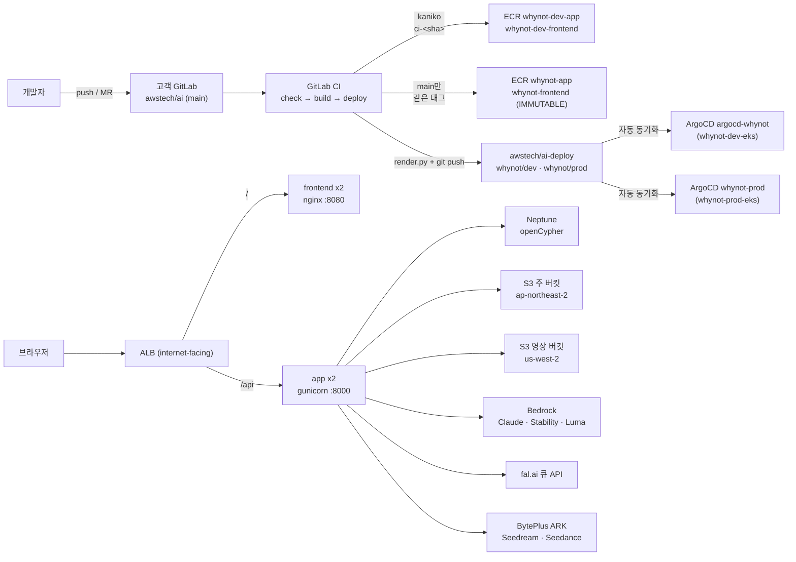
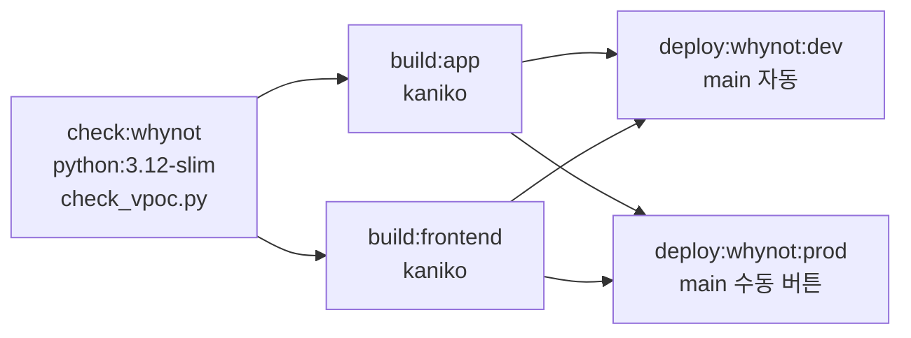

# AI-POC-whynot 저장소 분석 (ANALYSIS)

> 작성 2026-10-26. 저장소 파일을 읽어서만 작성했다(명령 실행·클라우드 조회 없음).
> 근거는 `파일:줄`로 단다. 확인하지 못한 것은 "미확인", 코드로 증명되지 않은 해석은 "추정"으로 표시한다.
> 계정 ID·비밀값은 쓰지 않는다. 계정은 `<고객계정>`·`<허브계정>`으로 가린다.
> 줄 수는 2026-10-26 작업 트리 기준 대략값이다.
> 갱신 2026-10-30: char-fidelity T1·T2·T2b·T3(§3.6.2 구현 결과·Tripo 전환, §7.1, §9.1, §10.1), 운영 `VNEW_ENABLED=true`·`VPOC_ARK_SEEDANCE_ENABLED=true`(사용자 결정, 배포 전 — §1, §5.4, §6.3, §7.1, §8.5, R-21).
> 갱신 2026-10-30(지시서 102·피드백): `VNEW_HIDE_STORY`(화면 전용, 운영 false — §5.2, §7.1), `VNEW_OUTFIT_STALL_S`(추가 복장 멈춤 판단 — §7.1).

---

## 1. 한눈에 보기

웹툰 IP를 드라마·영상으로 각색하는 사내 AI 도구다. 고객 와이낫(whynot) 전용 디렉터리이고(`AI-POC-whynot/README.md:3`), Flask API 1개와 정적 프런트엔드(nginx) 1개로 이루어진다. 크게 세 갈래 기능이 있다.

- **스토리 개발**(track `story`): 원작 자료 → 기획 문서·트리트먼트·대본·콘티(`server.py`, `documents.py`, `story_*`, `roles/`).
- **영상만들기_기존**(track `video`): vpoc1(`/api/vpoc`, ①입력→②분석→③키 장면·샷→④생성·이어붙이기), vpoc2(`/api/vpoc2`, 명령→캐릭터 확정→15초→리뷰).
- **영상만들기_신규**(track `video_new`, vnew, `/api/vnew`): 캐릭터 만들기(시트·3D) → ①입력 ②대본 ③콘티·장소 시트 → ④프리비즈(3D 마네킹, 브라우저 three.js) → ⑤영상 생성(실사·웹툰). 개발계는 켜져 있다(`deploy/config.dev.env`의 `VNEW_ENABLED=true`). **운영은 2026-10-30 사용자 결정("켠다")으로 `deploy/config.prod.env`를 `VNEW_ENABLED=true`로 바꿨고, 그 커밋을 운영 job으로 배포할 때 켜진다**(계획 `docs/plans/2026-10-30-prod-vnew-enable.md`). 그 전까지 운영은 꺼진 화면 그대로다.

주요 화면 흐름:

1. 로그인(`POST /api/auth/login`) → 홈(`#homeView`)에서 프로젝트 목록·생성. 프로젝트를 만들 때 트랙을 고르고 이후 바꿀 수 없다(`project_tracks.py:580-586`).
2. story 트랙 → 프로젝트 상세(`#projectDetailView`)에서 문서·콘티·대본 생성(202 + 백그라운드 스레드, 화면은 폴링).
3. video 트랙 → vpoc 화면(`vpoc.js`, `#vpoc-root`)에서 ①~④ 단계, 영상은 Luma Ray2 / fal 모델로 만들고 ffmpeg로 이어 붙인다.
4. video_new 트랙 → `#vnewView`(`vnew.js`, `vnew-previz.js`)에서 ①~⑤, 캐릭터는 메뉴 "캐릭터 만들기"(`#charactersView`).
5. 관리자 → 사용자·한도·모델·프롬프트 관리(`#usersView`, `#modelsView`, `/api/admin/*`).

근거: `.gitlab-ci.yml:1-37`(헤더 설명), `k8s/ingress.yaml.tmpl:40-58`, `k8s/workloads.yaml.tmpl`, `app/src/server.py:6970-7028`.

---

## 2. 디렉터리 지도

### 2.1 최상위

| 경로 | 역할 |
|---|---|
| `.gitlab-ci.yml` (약 380줄) | 고객 GitLab CI. check → build → deploy(dev 자동·prod 수동) |
| `PLATFORM_FILES.txt` | 여러 고객 디렉터리가 같은 내용을 가져야 하는 "플랫폼 파일" 목록(이 저장소엔 고객 디렉터리가 하나뿐) |
| `.kiro/steering/`, `.kiro/handoff/` | 작업 원칙과 지시서·로그(000~072) |
| `AI-POC-whynot/` | 제품 디렉터리(아래) |

### 2.2 `AI-POC-whynot/`

| 경로 | 역할 |
|---|---|
| `app/` | Flask 백엔드. `Dockerfile`(python:3.13.7-slim, gunicorn), `requirements.txt`, `src/`(Python 74개, 약 55,100줄) |
| `frontend/` | nginx 정적 프런트. `Dockerfile`(nginx-unprivileged 1.27.5), `nginx.conf`, `public/` |
| `deploy/` | `render.py`(템플릿 렌더), `config.env.example`(렌더 원본), `config.dev.env`·`config.prod.env`(오버레이), 옛 PowerShell 배포·운영 스크립트, `verify/` |
| `k8s/` | 앱 매니페스트 템플릿 5개(`namespace`, `service-account`, `model-catalog`, `workloads`, `ingress`) |
| `k8s-gpu/` | GPU 영상 워커용 템플릿 4개. 현재 배포 안 함(8장) |
| `infra/` | IAM·S3·ECR 정책 템플릿, 옛 `build-deploy.sh`, `inventory/`(옛 계정 조회 덤프 JSON) |
| `terraform/` | 허브 계정 전용 root 모음(bootstrap, hub/20·25·26·40, modules 2개) |
| `tools/` | `check_vpoc.py`(29,501줄 — 2026-10-30, CI 유일 검사기), `vpoc_e2e.py`, `vpoc_preflight.py` |
| `video-worker/` | 상주 GPU 워커(SQS 폴링, Wan 2.2). 현재 배포 안 함 |
| `docs/` | PRD·실행 기록·리뷰. `vpoc1/`, `run-log/`, `vendor/`, `구조분석.md`(2026-09-03) |

### 2.3 `app/src/` 모듈

| 모듈 | 줄 수 | 역할 |
|---|---|---|
| `server.py` | 7,031 | Flask 앱, 인증·인가·한도, 스토리·문서·이미지·관리자 라우트 63개, 블루프린트 등록 |
| `graph_store.py` | 3,888 | Neptune openCypher(HTTPS) 접근, 사용자·프로젝트·문서·사용량 등 정점 |
| `documents.py` | 1,515 | 문서 종류별 스키마·프롬프트·생성 |
| `prompt_layers.py` | 899 | 백엔드/프런트 프롬프트 계층, S3 `_config/prompts.json` 덮어쓰기 |
| `project_tracks.py` | 731 | 프로젝트 트랙(story/video/video_new) 선택·가드, 프로젝트 라우트 교체 설치 |
| `model_registry.py` | 691 | 모델 카탈로그(내장 → ConfigMap → S3 `_config/models.json`) |
| `video_prompt.py` | 661 | 한국어 지시 → 영어 영상 프롬프트(구 영상 경로 공용) |
| `prompts_story.py` | 620 | 스토리 프롬프트 |
| `pdf_export.py` | 506 | 콘티·대본 PDF(reportlab) |
| `story_router.py` / `story_models.py` / `story_context.py` | 474 / 291 / 396 | 스토리 역할 분배·모델·계보 지문 |
| `styles.py` | 468 | 그림체 프리셋·라우팅 |
| `gateway.py` | 456 | Bedrock 호출 통로(사용량 기록·타임아웃 일원화) |
| `image_brief.py` | 454 | 참고 이미지 역할 분석(최대 `VIDEO_MAX_REFERENCE_IMAGES`장) |
| `providers.py` | 344 | 모델별 요청·응답 어댑터 |
| `stitcher.py` | 399 | ffmpeg(imageio-ffmpeg) 이어 붙이기·자르기·마지막 프레임 |
| `toon_convert.py` / `prompt_boost.py` | 302 / 266 | 웹툰→실사 변환 모드 / 짧은 지시 확장 |
| `model_capabilities.py` / `image_validation.py` / `account_guard.py` | 177 / 90 / 72 | 모델 능력 / 이미지 검증 / 계정 고정 가드 |
| `roles/` (7파일) | 약 1,460 | 스토리 역할(writer·vision·validator·bible·character_sheet·_json) |
| `vpoc/` (14파일) | 약 10,100 | 영상만들기_기존(vpoc1) — routes 4,645 · fal 1,295 · llm 1,202 · regen 793 · ark 553 · store 422 · settings 412 · compose 357 · video 268 · images 265 · ledger 243 · seedream 141 · errors 108 |
| `vpoc2/` (13파일) | 약 2,200 | 영상 vpoc2 — service 749 · llm 297 · store 289 · compose 192 · routes 167 · mock 146 외 |
| `vnew/` (16파일) | 약 21,600 | 영상만들기_신규 — generate 5,485 · locations 2,903 · previz 2,875 · characters 2,387 · plan 1,644 · previz_camera 1,063 · routes 784 · shot_brief 593 · previz_schema 586 · location_views 376 · previz_fit 347 · previz_grammar 345 · settings 216 · prompts 183 · imaging 132 |
| `fixtures/` | 1 | 빈 패키지 |

---

## 3. 백엔드 모듈

### 3.1 프로세스 모델

- gunicorn `--workers 2 --threads 4 --timeout 60`, `src.server:app`(`app/Dockerfile` 마지막 줄). 앱 Deployment `replicas: 2`(`k8s/workloads.yaml.tmpl` app Deployment). 즉 **동시에 4개 파이썬 프로세스**가 같은 S3 상태를 다룬다.
- 긴 작업은 모두 "202 응답 → `threading.Thread(daemon=True)`" 방식이다. 프로세스 메모리의 드라이버 목록·잠금은 프로세스마다 따로이고, 프로세스 사이의 경합은 S3 조건부 쓰기(ETag `If-Match`)로 막는다(`vpoc/store.py` 머리 주석, `vnew/generate.py:958-976`).

### 3.2 `server.py` — 앱 본체

- 시작: `app = Flask(__name__)`, `MAX_CONTENT_LENGTH = 100MB`(`server.py:181-182`). 상단에서 `vnew`, `vpoc`, `vpoc2`를 포함한 모든 모듈을 import 한다(`server.py:25-49`).
- 요청 훅: `enforce_account_guard`(`server.py:829-842`) — `/health`·`/api/health`를 빼고 `account_guard.state()`가 실패하면 503. `add_api_headers`(`:845-852`) — `Cache-Control: no-store`, `nosniff`, `X-Frame-Options: DENY`, `X-Request-ID`.
- 인증: HMAC-SHA256 서명 토큰(`issue_token` `:293-302`, `verify_token` `:305-334`). 토큰에는 사용자 이름·만료만 있고 role은 매번 Neptune에서 다시 읽는다. TTL 8시간(`TOKEN_TTL_SECONDS`), 로그인 유지 시 7일(`REMEMBER_TOKEN_TTL_SECONDS`, `:99-103`). 데코레이터 `require_auth`(`:342`), `require_admin`(`:359`), `require_quota(category)`(한도 검사, 차감은 결과 완성 시점).
- 권한: `can_read_project`/`can_write_project`(`:815-825`) — 소유자 또는 admin(공유 프로젝트는 읽기 허용).
- 백그라운드 스레드: 문서 생성 `run_document_generation`(`:1887`), 콘티 `run_storyboard`(`:5686`), 대본 개요 `run_script_outline`(`:6135`), 대본 작업 `run_script_job`(`:6499`, `:6542`) + 하트비트 `beat`(`:6258`), 회차 재생성(`:6746`), 이미지 병렬 생성 `ThreadPoolExecutor`(`:2207`). 파드가 바뀌면 스레드가 사라지므로 `DOC_STALE_MINUTES`(기본 10분)를 넘긴 `generating` 문서는 조회 때 실패로 정리한다(`:166`, `reap_stale_document`).
- 블루프린트 등록(**이 한 곳뿐**, `server.py:6970-7011`):
  - `if VIDEO_GEN_ENABLED and vpoc.settings.VPOC_ENABLED:` → vpoc(`/api/vpoc`)
  - `if VIDEO_GEN_ENABLED and vpoc2.settings.ENABLED:` → vpoc2(`/api/vpoc2`)
  - `if VNEW_ENABLED:` → vnew(`/api/vnew`)
  - 마지막에 `project_tracks.install(...)`(`:7015-7028`)이 `/api/projects` 두 핸들러를 교체하고 `PUT /api/projects/<id>/track`을 더하며, 스토리 전용 프로젝트 라우트에 트랙 가드를 씌운다.
- 실행: `__main__`에서만 `app.run(port=8000)`(`:7030-7031`). 운영은 gunicorn.

### 3.3 공통 플랫폼 모듈

| 모듈 | 책임 | 주요 함수 | 부르는 쪽 |
|---|---|---|---|
| `account_guard.py` | 기동 후 첫 요청 때 STS로 계정 확인, `EXPECTED_ACCOUNT_ID`와 다르거나 비어 있으면 fail-closed | `verify`·`state`(`:56-72`) | `server.py` |
| `gateway.py` | Bedrock `converse`·이미지·영상 호출 통로, 사용량을 `graph_store`에 기록(기록 실패는 삼킴), read_timeout 일원화(60/600/900초) | `runtime`(`:100`), `converse`(`:184`) | `server.py`, `documents.py`, `roles/*` |
| `graph_store.py` | Neptune `/openCypher` HTTPS 직접 호출(드라이버 없음, IAM 서명 없음 — SG로 제한), PBKDF2 210,000회 | `run`, `get_user`, `merge_user`, `quota_*`, `begin_document` 등 | 거의 모든 모듈 |
| `model_registry.py` | 카탈로그 3단계(내장 → `MODEL_CATALOG_PATH` ConfigMap → S3 `_config/models.json`), 30초 캐시 | `resolve_for_generation`, `bucket_region` | `server.py`, `providers.py` |
| `prompt_layers.py` | 역할별 프롬프트, 관리자 수정분은 S3 `_config/prompts.json`(버전 관리) | — | `gateway.py`, `server.py` |
| `project_tracks.py` | 트랙 정규화·선택·명령 기록, 라우트 교체 설치 | `install`(`:454`), `_accepted_tracks`(`:398`), `track_enabled`(`:81`) | `server.py` |

의존 방향: `server.py` → (모든 모듈). `gateway` → `graph_store`, `prompt_layers`. `vpoc`·`vnew`는 `gateway`를 거치지 않고 boto3 `bedrock-runtime` 클라이언트를 직접 만든다(`vpoc/llm.py:79-96`, `vpoc/images.py:34`). 즉 vpoc·vnew 호출은 `gateway`의 사용량 기록에 잡히지 않고, 비용은 `vpoc/ledger.py` 원장에 따로 쌓인다.

### 3.4 `vpoc/` — 영상만들기_기존(vpoc1)

| 파일 | 책임 |
|---|---|
| `settings.py` | 환경변수 전부(여기에만 `os.getenv`). 모델·버킷·플래그·단가표·fal 카테고리 |
| `routes.py` | 블루프린트 `whynot_vpoc`(`:151`). 모든 라우트를 `enveloped`로 감싸 오류 봉투로 바꾼다(`:163-178`). 생성 시점에 `ledger.seed()`로 원장에 과거 금액을 넣는다(`:157-161`) |
| `store.py` | S3 상태(`state.json`) 읽기/조건부 쓰기, 키 규칙(`:62-155`) |
| `llm.py` | Claude 분석·계획. 도구 1개 강제로 JSON. 모델 체인 `_model_chain`(`:292-300`), 스트리밍, 거부 모델 10분 건너뜀. 일부 모델은 broker 역할(다른 계정 역할을 assume)로 호출(`:38-76`) |
| `images.py` | 업로드 정규화(JPEG), 분석용 타일, SD3.5 캐릭터 이미지 |
| `video.py` | Luma Ray2 `start_async_invoke`/`get_async_invoke`, read_timeout 20초(`:66-71`) |
| `ark.py` | BytePlus ARK Seedance(`/contents/generations/tasks`, `:487`, `:517`), urllib timeout 60초. `choices`·`resolve_model`·`selected`(`:88`, `:164`, `:182`)가 `VPOC_ARK_SEEDANCE_ENABLED`를 보고 ARK Seedance를 목록에서 빼고 fal Seedance로 바꾼다 |
| `seedream.py` | ARK `/images/generations`(Seedream), timeout 300초(`:65-72`) |
| `fal.py` | fal 큐 API(`queue.fal.run`)·카탈로그(`api.fal.ai/v1`)·OpenAPI. 등록 레지스트리, caps 추출, `submit`/`poll`/`submit_edit`(`:1128`), 단가 캐시 1시간. 이미지는 data URI로만 보낸다(`:9-13`). timeout 60/300초(`:50-51`) |
| `regen.py` | "이 샷만 의견 반영해 다시 만들기"(revise/regenerate/select), `require_enabled`(`:43`) |
| `compose.py` | 영어 프롬프트 조립·코드 검사(모델 호출 없음) |
| `ledger.py` | 비용 원장(상한 없음, 기록만), 키 중복 계상 방지 |
| `errors.py` | `VpocError`, 오류 봉투 `envelope`·`status_for` |

**백그라운드 동작(vpoc1)**

1. `run_task`(`routes.py:811-894`): 상태에 `task{id,status:running}`를 쓰고 스레드 시작. 끝날 때 단계 revision 또는 task id가 바뀌었으면 결과를 버린다(되돌리기·취소 = 결과 폐기). 모델 호출 자체는 멈추지 않는다.
2. `run/generate`(`routes.py:4052-4185`): 화면 금액(`confirmUsd`)과 서버 계산이 0.005 넘게 다르면 409 `CostMismatch`. 새 `genId`로 ④ 상태를 만들고, 응답 뒤 스레드에서 `_prepare_briefs`(ARK) 또는 `_submit_queued` 실행 + `_ensure_driver`.
3. `_ensure_driver`(`routes.py:3315-3357`): 프로세스당 계획 1개 드라이버. 20초마다 상태를 읽고, 다른 곳이 15초 안에 조회했으면 건너뛰고, `refresh_shots`로 제출·조회·애니 변환(`_start_anime_jobs`)을 진행. ④가 끝나거나 3시간이면 종료.
4. 동시 제출 상한 `VPOC_MAX_INFLIGHT=1`(Luma 쿼터 1, `settings.py:241`), ARK `VPOC_ARK_MAX_INFLIGHT=1`.
5. `stitch`(`routes.py:4300-4378`): 완료 샷 mp4를 영상 버킷에서 **전부 메모리로 받아** 임시 디렉터리에 쓰고 `stitcher.concat` → 결과를 다시 메모리로 읽어 주 버킷 `final.mp4`/`final-anime.mp4`에 올린다.

### 3.5 `vpoc2/` — 명령 → 캐릭터 → 15초 → 리뷰

- 블루프린트 `vpoc2`(`vpoc2/routes.py:52`), 모든 라우트가 `require_auth` + 오류 봉투. `before_request`에서 `VPOC2_ENABLED`가 꺼져 있으면 404(`:70-73`) — server.py 등록 조건과 이중 방어.
- 설정: `vpoc2/settings.py` — 15초 = 5초 × 3샷, Luma Ray2, 540p 기본, 720p 월 1편(`VPOC2_HQ_MONTHLY_LIMIT`). `VPOC2_MOCK`+`VPOC2_LOCAL_DIR`일 때만 로컬 파일 라우트(`routes.py:155-165`).
- 작업 실행: `service.py:168`의 데몬 스레드.

### 3.6 `vnew/` — 영상만들기_신규

| 파일 | 책임 |
|---|---|
| `routes.py` | 블루프린트 `vnew`(`:41`). HTTP 입출력만. 계획 API는 `_project_for`(`:260-282`)에서 프로젝트 존재·읽기/쓰기 권한·**트랙이 `video_new`인지** 확인 |
| `settings.py` | vnew 전용 환경변수(그 밖은 `vpoc.settings` 재사용) |
| `characters.py` | 캐릭터 만들기: 웹툰 이미지 분석(Astra → Claude) → Seedream 시트·정면·후면(+ 옆모습 두 장, char-fidelity)(실사·웹툰 2 variant) → 3D GLB(fal, 기본 Tripo H3.1 · 되돌리면 Hunyuan3D v3). 빌드·재시도·재개 스레드(`:1587`, `:1645`, `:1808`, `:1909`, `:2191`, 줄 번호는 2026-10-26 기준) |
| `char_fidelity.py` | 캐릭터 충실도(char-fidelity, 2026-10-30, 순수 함수 — import 는 `re` 뿐). 화면 쪽 → 캐릭터 쪽 좌우 계산·다수결, 기본 복장 좌우 낱말 지우기·꼬리, 좌우 문장·고칠 문장 원문, 그림·시트 검사 기대값·반전 규칙·warning 문구. `characters.py`가 부른다 |
| `plan.py` | ①입력 ②대본 ③콘티. `plan.json` 하나가 프로젝트 상태의 단일 원본. task 스레드(`:1393`). 공용 `plan.task` 단계는 script·conti·fxFill(`_TASK_STEPS` `:60`) |
| `fx.py` | ③ 만화 기호·분위기(vnew-live-fx 묶음 A, 2026-10-30, 순수 함수 — 네트워크·S3·LLM 없음). 기호 5종 열거값·문장(참고 구현 원문)·짧은 형·실사 표현·화면 라벨, 컷 필드 정리(`normalize_cut_fx`), 채우기 대상(`fill_targets`)·합치기(`merge_fill`)·3컷 한도(`apply_cap`)·금액 추정(`estimate_usd`), 프롬프트 문장(`sentences`). `plan.py`(저장·채우기)·`generate.py`(프롬프트)가 읽는다. `VNEW_FX`로 끈다 |
| `casting.py` | 캐릭터 실사 캐스팅(vnew-live-fx 묶음 B, 2026-10-30). 캐스팅 문장·성별(순수 함수)과 뽑기 상태(`char.casting`)·fal 큐 제출·조회(글만, 래퍼 `_fal_request`·`_fetch_url`)·이어하기·고르기·상세 보기. `characters.py`(상세·키)·`routes.py`(라우트 3개)·`generate.py`(`_char_entries.castingKey`)가 읽는다. `VNEW_CASTING`으로 끈다 |
| `locations.py` / `location_views.py` | ③ 장소 4면 시트, 참고 사진. `ThreadPoolExecutor(VIEW_WORKERS)`(`:1848`), task 스레드(`:2846`) |
| `previz*.py` | ④ 프리비즈 3D 장면 설계(Astra), 카메라 문법·토릭 계산(`previz_camera`, `previz_grammar`), 일치도(`previz_fit`), 스키마. task 스레드(`previz.py:2858`) |
| `previz_collision.py` | ④ 인물↔소품 겹침 보정(084 R1, 순수 함수, LLM·네트워크 없음). 앉을 소품(`pick_seat`)·엉덩이 높이 = 소품 윗면·다리 방향(`choose_leg_yaw`, 길쭉한 자리는 짧은 축 법선)·다리 각도(`solve_legs`)·밀어내기(`push_out`). `run_design`이 카메라 계산 전·후 2회 부르고 `fit[cut].collision`에 저장. `previz_view`는 보정과 함께 설계된 장면(`sit` 또는 `fit.collision` 있음)만 보기 사본에 다시 적용하고, 옛 장면은 사본을 바꾸지 않고 `detect_scene`으로 관통 컷만 찾아 `collision.needsRedesign`으로 알린다(저장본 그대로). `VNEW_PREVIZ_COLLISION`으로 끈다 |
| `previz_support.py` | ④ 받침 판단(previz-support-reasoning, 2026-10-29, 순수 함수). 패널 읽기(`previz_grammar.read_cut`, emit_shot `supports[]`)가 인물마다 받침과 닿는 몸이 그려졌는지(`seen`: visible·partial·hidden) → 자세 → 받침 물체 → 정체·보통 크기 → 서 있는 사람 기준 윗면 높이(`heightCue`) → 앉는 방식 → 발을 읽고, 이 모듈이 정리(`normalize_supports`)·높이 환산(`support_height_m`, 키 대비 비율 표)·설계 프롬프트 `[받침 판단]` 줄(`prompt_line`)·서버 맞춤(`apply_supports`: 컷 인물 자세·앉을 소품 `sitOn`·소품 윗면 높이 = 같은 소품 읽기 중앙값)을 맡는다. 서버 맞춤은 `seen`이 visible·partial인 읽기만 쓴다(hidden·모르는 값은 `support`만 붙이고 `status:"hidden"`, 2026-10-29 Claude 실측 뒤 필수 수정 A). `run_design`이 `_apply_gestures` 다음·보정 1차 전에 부르고 `fit[cut].support`에 저장. 읽기 캐시는 `panelGrammar[cut].v = 2`(옛 캐시는 1회 다시 읽어 `supports`만 채움). 발 위치가 dangling이면 `solve_legs` 목표 각도 0°. `VNEW_PREVIZ_SUPPORT`로 끈다 |
| `shot_brief.py` | 프리비즈 승인 후 장소별 촬영 지시서 |
| `generate.py` | ⑤ 영상 생성 드라이버(아래) |
| `imaging.py`, `prompts.py` | 이미지 보조, 프롬프트 |

vnew가 재사용하는 것: `vpoc.llm`·`images`·`store.STORE`·`ark`·`fal`·`seedream`·`video`·`ledger`·`settings`, `stitcher`, `project_tracks`(`vnew/generate.py:31-45`, `vnew/plan.py:21-26`, `vnew/routes.py:11-15`). 프런트 `vnew.js`도 fal 모델 등록에 `/api/vpoc/fal/*`를 부른다(`vnew.js:2255`, `:2280`, `:2370`) — **vnew의 fal 모델 고르기는 vpoc 블루프린트와 `VPOC_MODEL_PICKER_ENABLED`가 켜져 있어야 동작한다.**

**백그라운드 동작(vnew ⑤ generate)**

1. `start_generate` → `plan.json`의 `gen`을 새로 만들고(이전 gen은 `genHistory` 최근 3개 요약) `_spawn_driver`(`generate.py:940-958`).
2. `_drivers`: 프로세스당 `(owner,pid)`별 스레드 1개(`:960-1007`). `GET /p/<pid>/plan` 조회 때 `ensure_driver`가 running gen의 드라이버를 되살린다(`routes.py:285-300`) — 파드 재시작 후 이어하기 경로.
3. `_drive`(`:1022-`): 최대 100,000회 반복. 모드 `previz`/`previz-take`면 `_drive_previz_pass`로 submitted 전부 조회 + queued를 `VNEW_GEN_PARALLEL`(기본 2)까지 동시 제출, 아니면 `_next_action`으로 한 단계씩. 진행이 없으면 `POLL_INTERVAL_S`(5초) 쉰다.
4. 메모리 완화: 준비 단계(녹화 받기→자르기→본문 직렬화)를 프로세스 전역 세마포어 `VNEW_GEN_PREPARE_CONCURRENCY`(기본 1)로 직렬화(`generate.py:51`), 참고 이미지 긴 변 1024px로 축소(`VNEW_REF_MAX_PX`), preparing 선점 300초 지나면 queued로 되돌림(`VNEW_PREPARE_STALE_S`).
5. 갱신 유실 방지: 같은 프로세스 안에서는 계획별 `threading.Lock`(`_mutate_locked`, `:972-976`), 프로세스 사이는 S3 ETag 조건부 쓰기에 의존.
6. 모드 판정: 선택한 영상 모델 caps에 배열 영상 입력(`videoListField`)이 있으면 `previz-take`(Seedance 2.5 reference-to-video 통 테이크, ≤30초, 480p draft 기본), 아니면 컷 단위 `previz`(Kling O3 video-to-video edit)(`vnew/settings.py:157-195`).

**① 영상 모델 목록(`plan.previz_models`, 073 R16, 2026-10-28)**

- 목록 = 기본(Kling O3 edit, 첫 번째·추천) + 등록된 fal 모델. previzCapable이 아닌 모델(H3 Max·Kling v3 Pro 등 i2v)은 `fal · <label>` 회색 "프리비즈 미지원"으로 보이고 고를 수 없다.
- fal Seedance 계열(`VPOC_FAL_SEEDANCE_FAMILY`): 얼굴(i2v)은 숨기고, 짝(r2v) 한 줄을 vpoc ②와 같은 이름 `ark.label(<얼굴>)`("Seedance 2.5 (fal)")로 보인다(`_family_face_of`). 계열 설정이 비면 073 이전처럼 둘 다 `fal · ` 행이다.
- 단가(`_previz_price_row`): unit `seconds`는 그 초당 단가, 기본 모델은 단가를 모르면 `VNEW_PREVIZ_EDIT_USD_PER_S`. 토큰 단가는 전송 해상도를 아는 통 테이크 모델에만 `vpoc settings.shot_usd(id, VNEW_TAKE_RESOLUTION, 1)`과 `priceResolution`을 준다(`_previz_send_resolution`). 통 테이크는 그 해상도를 본문 `resolution`에 늘 명시해 보내고(`generate.py:2918`), 견적·원장(`_take_usd`)도 같은 값이다. 컷 단위 토큰 모델은 `resolution`을 보내지 않아 "단가 미정"이다.
- 화면: `vnew.js` `previzPriceText`가 `$0.206/초(480p)`(목록)·`초당 $0.206(480p)`(설명 줄)을 만든다.

#### 3.6.1 기호·실사 캐스팅·실사 버전(vnew-live-fx)이 닿는 코드 경로 (2026-10-30 조사, 구현 전 · 묶음 A·B·C 구현 결과는 각 표 아래)

스펙은 `.kiro/specs/vnew-live-fx/`다. 아래 표는 **구현 전 지금 코드**를 적는다. 줄 번호는 2026-10-30 작업 트리 기준이다. "참고 구현"은 외부 저장소 `ottlseo/video-vibecode` 사본(읽기 전용)이고, 비교는 `.kiro/handoff/logs/087.log` 끝 보고서에 있다. 묶음 A(기호·분위기), 묶음 B(실사 캐스팅), 묶음 C(통 테이크 실사 버전)는 같은 날 구현했다(아래 「A 구현 결과」·「B 구현 결과」·「C 구현 결과」).

**A. 기호·분위기·묘사 규칙(③ 콘티 → ④ 프리비즈 카드 → 영상 프롬프트)**

| 위치 | 지금 동작 | A가 닿는 점 |
|---|---|---|
| `vnew/prompts.py:112-158` `EMIT_CONTI` | 컷 필드는 id·no·seconds·panels·shotKo·cameraEn·locationEn·characters·dialogueKo·situationKo·promptEn이다. 기호·분위기 칸이 없다 | 바꾸지 않는다(기호는 따로 부른다) |
| `vnew/plan.py:835-878` `run_conti` | 대본 글만 보낸다(`_conti_prompt` `:910`, 이미지 없음). `_analyze_conti`(`:622`, `ANALYZE_MODEL`, max_tokens 8000) 1회, 컷이 모자라면 재요청 1회 | 저장 전에 기호·분위기 채우기 1회(패널 이미지 포함) |
| `plan.py:985-1033` `_normalize_cuts` | 모델 출력에서 알려진 키만 남긴다 | 그대로 둔다 |
| `plan.py:1279-1309` `update_conti` | 화면이 보낸 컷 dict를 그대로 저장한다(`dict(cut)`). 저장할 때마다 `_unapprove_previz` | 기호 칸 정규화. 기호·분위기만 바뀐 저장은 승인을 풀지 않는다 |
| `plan.py:1358` `start_task`, `:1377` `cancel_task`, `:1441` `reconcile_stale` | 공용 `plan.task` 하나. 취소·멈춤 정리는 script·conti 단계만 되돌린다 | 작업 이름 `fxFill`을 더한다 |
| `plan.py:637-659` `ordered_tiles` | 대본 단계와 같은 타일 목록(≤40장, 넘으면 균등 선택). 컷 `panels`가 이 목록의 번호다 | 채우기 호출의 패널 이미지 출처 |
| `vnew/generate.py:2344-2402` `_take_timeline_entries` | 컷마다 시간·샷 약어·ON SCREEN·연기(촬영 지시서 actionEn 첫 문장)·대사·시선 | 기호·분위기 값을 더한다 |
| `generate.py:2405-2783` `_take_prompt` | STYLE → ASSETS → TIMELINE → MOTION → HARMONY → RULES → AVOID. UTF-8 4,000바이트. 줄이기 9단계(`:2665`)와 최소형 후보(`:2748`). 인물 일관성 문장은 RULES `rule_replace`(`:2491`)에 있다. 장소는 ASSETS "keep its structure and props"(`:2573`)뿐이고 "모든 컷에서 같게"는 없다. 손 개수·머리색·무늬 위치 규칙이 없다 | TIMELINE 기호 문장·분위기, RULES 묘사 규칙, 장소 일관성 낱말 |
| `generate.py:3796-` `_cut_prompt`(컷 단위 Kling) | ASSETS → … → ACTION(`:3967`) → MOTION → MOOD(`:3968`, 지시서 moodEn) → SETTING → HARMONY → DIALOGUE → CONTINUITY(`:3938`, 인물·배경 유지 문장 있음). 2,500바이트 | ACTION 뒤 FX 줄, MOOD 앞 분위기, CONTINUITY 묘사 규칙 |
| `vnew/characters.py:444-468` `_ANALYZE_SYSTEM` | appearanceEn = 얼굴·머리·체형·나이, baseOutfitEn = 기본 복장. 머리색·무늬 위치 규칙이 없다 | 규칙 문장 |
| `generate.py:1567-1572` `_CAST_NOTES_SYSTEM` | 장면 의상 읽기. 무늬 위치 규칙이 없다 | 규칙 문장 |
| `frontend/public/vnew.js:2950` `renderContiStep`, `:3903` `cutCard` | 컷 카드 칸은 초·썸네일·샷 종류·카메라·장소·대사·상황·인물·프롬프트다. 저장은 `PUT /conti {cuts}`로 컷 전체를 보낸다 | 기호 칩·분위기 한 줄·채우기 버튼 |
| `vnew.js:4170` `previzPanelMatchCard` | 패널 썸네일 → 연출 문법 → 보정 배지 → 받침 줄(`:4274`) | 읽기 전용 기호·분위기 줄 |

**A 구현 결과(2026-10-30, 작업 A1~A4, `VNEW_FX` 기본 true)** — 줄 번호는 구현 뒤 작업 트리 기준이다.

| 단계 | 위치 | 동작 |
|---|---|---|
| 저장 | `plan.py:1312` `update_conti`, `:1355` `_clear_stale_mood_en` | 켬이면 컷 기호·분위기 필드를 정리(`fx.normalize_cut_fx`, 들어온 키만)하고, moodKo만 바뀐 컷은 moodEn을 비운다. 기호·분위기만 다른 저장(아무것도 안 바뀐 저장 포함)은 프리비즈 승인을 풀지 않는다 |
| 채우기 | `plan.py:857` `run_conti`(콘티를 만들 때 1회), `:1596` `start_fx_fill` → `:1617` `run_fx_fill`(작업 `fxFill`), `:1526` `fill_fx`, `:1443` `_fx_blocks`, `:640` `_analyze_fx`(`ANALYZE_MODEL`, max_tokens 8000, where `vnew.conti.fx`) | 빈 컷(FILL)은 기호·분위기, 번역 대상 컷(TRANSLATE)은 moodEn만. 패널 이미지는 대본 단계와 같은 타일 번호로 ≤ `VNEW_FX_MAX_PANELS`(20)장. 저장 때 지금 컷에 다시 합치고(`fx.merge_fill`) 3컷 한도(`fx.apply_cap`, 그려진 기호 면제)를 적용한다. 원장 `plan._charge` |
| 라우트 | `routes.py:412` `POST /p/<pid>/conti/fx` | 202 `{ok, taskId, targets, translate}`. 404 `FxDisabled`(끔) · 409 `ContiNotReady`·`NothingToFill`·`TaskRunning`. 세 문구는 운영(`VPOC_RAW_ERRORS=false`)에서도 그대로 보인다(`vpoc/errors.py` `USER_FACING_KINDS`) |
| 보기 | `plan.py:1842` `plan_view` → `features {fx}`(`:1906`), `fxFill`(`:1929` — 상태·`targets`·`translate`·`estimateUsd`) | 화면이 설정·대상 수·확인창 금액을 안다 |
| 통 테이크 프롬프트 | `generate.py:2358` `_take_timeline_entries`(항목 `fx`·`moodEn`), `:2427` `RULE_BODY`·`:2434` `RULE_BODY_SHORT`, `:2440` `MOTION_MIN`·`:2445` `HARMONY_MIN`·`:2452` `_harmony_min`, `:2463` `_take_prompt` | 컷 항목 연기 다음 `mood: {moodEn}`(한국 이름 → 로마자, 한글이 남으면 뺌, 로그 `vnew.gen.take_mood_dropped`) → `FX: {기호 문장 " / "}`. RULES에 `RULE_BODY`(손 두 개·머리색·무늬 위치·장소 고정). 기호·분위기가 있으면 줄이기 단계 `mood40`(voiceDrop 뒤)·`moodDrop`·`fxShort`(audioShort 뒤), 켬이면 늘 `bodyShort`(RULE_BODY → 짧은 형, action55 앞). 최소형은 연기를 남기는 후보만 기호 짧은 형, RULES에 묘사 규칙 짧은 형, MOTION·HARMONY는 원문 → 짧은 형 순(로그 `motionHarmonyShort`·`motionHarmonyDrop`) |
| 컷 단위 프롬프트 | `generate.py:2437` `CUT_RULE_BODY`(89B), `:3941` `_cut_prompt` | 웹툰 `FX:` 줄·실사 `EXPRESSION:` 줄(ACTION 바로 뒤), MOOD 맨 앞 컷 moodEn, CONTINUITY "The mannequin colors" 앞에 손·머리색·무늬 문장. 줄이기 ⓪ `bodyDrop`(묘사 문장 빼기, 장소 요약보다 먼저) → ①~⑥ → ⑥-1 FX 짧은 형 → ⑦ ACTION. 로그 `vnew.gen.cut_prompt cut= variant= bytes= steps=`(설정과 상관없이 1줄) |
| 분석 규칙 | `characters.py:479` `_analyze_system`(`_analyze`가 부른다), `generate.py:1581` `_cast_notes_system`(`_read_cast_notes`가 부른다) | 켬이면 상수 끝에 머리색 그대로·무늬 위치 문장. 의상 캐시 키(`_cast_notes_hash`)는 그대로라 이미 읽은 장면은 다시 읽지 않는다 |
| 화면 | `vnew.js:4038-4272`(`FX_KEYS`·`FX_LABEL_KO`·순수 함수 `fxChipStates`·`fxToggled`·`fxFillConfirmText`·`previzFxText` …, DOM `fxRow`·`fxToolbar`·`previzFxLine`), `cutCard`(`:3916`), `renderContiStep`(`:2951`), `decidePlanStep`(`:1587`), `previzPanelMatchCard`(`:4425`); `vnew.css` `vnew-fx-*`·`vnew-mood-input`·`vnew-previz-fx-line` | ③ 칩(추천 먼저·그림 표시·최대 2개·없음)·분위기 60자·영어 옮기기 안내, [기호·분위기 채우기](대상 0이면 막힘, 확인창에 대상 수·예상 금액, 저장 뒤 숫자가 바뀌면 다시 확인 → `POST /conti/fx`), 진행 막대·실패 문구, ④ 읽기 전용 한 줄. `features.fx`가 false면 그리지 않는다 |

끔(`VNEW_FX=false`)이면 저장·채우기·프롬프트·분석 SYSTEM이 구현 전과 같다(fx-e, fx-f, fx-i sha256 5종, fx-k). 켬 상태 바이트는 §10.1 fx-h 출력에 있다. 090 필수 수정(2026-10-30) 뒤 켬 상태 test2 규모 6컷 통 테이크는 MOTION·HARMONY 원문과 묘사 규칙 짧은 형을 남기고(3,874~3,901B), 12컷은 최소형에서도 MOTION·HARMONY(원문 또는 짧은 형)를 남긴다(fx-h 합격 기준 `_FX_TAKE_MUST`). 컷 단위 기본 입력은 켬에서도 SETTING 장소 요약이 끔과 같다(fx-j).

**B. 실사 캐스팅(캐릭터 메이커)**

| 위치 | 지금 동작 |
|---|---|
| `characters.py:225-253` `new_char` | variants webtoon·real(시트·정면·후면·3D)과 outfits가 있다. 캐스팅 칸이 없다 |
| `characters.py:470-500` `_ANALYZE_TOOL`, `:503-560` `analyze_sources` | 성별 필드가 없다(appearanceEn 문장 안에만 있다). Astra → `ANALYZE_FALLBACK_MODEL` 순서 |
| `characters.py:431` `_fal_request`, `:436` `_fetch_url`, `:877` `_status_url`, `:881` `_response_url` | fal 큐 제출·조회·결과 받기 래퍼(3D가 쓴다). 검사가 바꿔 끼운다 |
| `characters.py:1052` `_charge_seedream`, `vnew/settings.py` `SEEDREAM_USD` | 원장 kind image, 시트 그림 장당 0.04. 캐스팅 모델·단가 설정이 없다 |
| `characters.py:2011` `reconcile_stale`, `:2313` `detail_view` | 조회 때 멈춘 빌드를 정리하고 presigned URL을 담는다 |
| `generate.py:792-827` `_char_entries` | 실사 `realFrontKey`·`realBackKey`를 모은다. 컷 단위 실사(Kling)는 `_previz_payload_elements`(`:3568`)·`_previz_payload_image_list`(`:3623`)에서 실사 정면을 인물 참고로 쓴다 |
| `vnew.js:474` `renderDetail`, `:440` `schedulePoll` | 분석 카드 → 실사·웹툰 열 → 추가 복장. 폴링은 `status === "building"`일 때만 |
| `vnew/routes.py:70-238` | 캐릭터 라우트. 캐스팅 라우트가 없다 |

**B 구현 결과(2026-10-30, 작업 B1~B3, `VNEW_CASTING` 기본 true)** — 줄 번호는 구현 뒤 작업 트리 기준이다.

| 단계 | 위치 | 동작 |
|---|---|---|
| 문장·성별 | `casting.py:117` `resolve_gender`, `:305` `look_sentence`, `:368` `pattern_warning`, `:388` `cast_prompt` | 성별 = 사용자 지정 → 분석 `genderEn` → 외모 문장 주어(man·boy·woman·girl) → unknown. genderEn이 unknown이어도 외모 문장에 man·woman이 있으면 그 값이다(091 남은 이슈 3, PM 결정으로 유지). 프리셋 문구(아이돌풍·현실 배우풍)의 male 결과는 참고 구현 원문과 같다. 모든 결과에서 그림 낱말을 지운다 |
| 분석 | `characters.py:501` `_analyze_tool`, `:485` `_analyze_system`, `:552` `analyze_sources` | 켬이면 분석 도구에 선택 필드 `genderEn`, SYSTEM에 성별 문장. 이미 분석된 캐릭터는 다시 분석하지 않는다 |
| 설정 저장 | `routes.py:242` `PUT /characters/<id>/casting` → `casting.py:613` `update_settings` | 느낌·성별·외모 문장(300자, `clean_text`). 빈 외모 문장은 자동 문장으로 되돌린다 |
| 뽑기 | `routes.py:257` `POST …/casting/draw` → `casting.py:625` `start_draw` → 스레드 `:982` `run_draw`(`:847` `_submit_slot` · `:906` `_poll_slot` · `:956` `_finish`) | 확인 금액(`confirmUsd`)이 장 수 × `VNEW_CASTING_USD`와 다르면 409 `CostMismatch`. 진행 중이면 409 `CastingRunning`. fal 큐에 칸마다 **글만** 제출(본문 `{prompt, num_images, image_size}`), 결과는 `users/{owner}/characters/{id}/casting/`에 JPEG(긴 변 1536)로 옮기고 사진마다 원장 1건. 이전 후보는 `history`(12개)로 옮기고 고른 사진(`chosen`)은 유지(결정 5). 4xx 거절 칸 문구는 캐스팅용(`:427` `_MSG_REJECTED` + `error_gist` 요지, B3) |
| 이어하기 | `casting.py:766` `reconcile`(`characters.py:2406` `_casting_detail`이 상세 조회 때 부른다) | 하트비트가 `VNEW_CASTING_STALL_S`(600초)보다 오래됐고 이 파드에서 돌지 않으면 새 claim으로 제출한 칸만 조회한다. 제출하지 않은 칸은 실패로 둔다(다시 과금하지 않음). 시작부터 900초면 남은 칸 실패 |
| 고르기 | `routes.py:274` `POST …/casting/choose` → `casting.py:685` `choose` | 후보·이전 후보 id 또는 ""(고르기 풀기 = 실사 정면) |
| 보기 | `casting.py:711` `view`(상세 `casting`) | `{enabled, preset, presets, gender, genderAuto, lookEn, lookAuto, lookEdited, patternWarning, status, error, slots, unitUsd, count, totalUsd, candidates, history, chosen, chosenUrl}`. 사진은 presigned URL(브라우저 표시용). 끔이면 `{enabled:false}` |
| 영상에 쓰기(B3) | `generate.py:794` `_char_entries`, `:833` `_casting_key_of`, `:842` `_real_front_key` | 켬이면 항목에 `castingKey`(= `casting.chosen_key`, 없거나 저장값이 깨지면 "")를 더한다. 끔이면 키가 없어 B 이전과 키·값이 같다. `_real_front_key`는 `castingKey`가 있으면 그것, 없으면 `realFrontKey`. **이번에는 정의와 검사만 있고 부르는 곳이 없다**(묶음 C 통 테이크 실사가 부른다) |
| 화면(B3) | `vnew.js:963-` 캐스팅 구역(순수 문구 함수 + `:1052` `castingSection`), `renderDetail`(`:539`, 실사·웹툰 열 다음·추가 복장 앞), `schedulePoll`(`:440`, 뽑는 중에도 5초마다); `vnew.css` `vnew-casting-*` | 아래 「캐스팅 화면」 |

캐스팅 화면(`detail.casting.enabled`가 false면 그리지 않는다):
- 머리 "실사 캐스팅"과 안내 "웹툰 그림 없이 글로 실사 배우 사진을 만듭니다. 고른 사진은 통 테이크 실사 버전의 인물 참고로 씁니다(고르지 않으면 실사 정면)."
- 느낌 라디오(아이돌풍·현실 배우풍), 성별 select("자동(분석: 남/여/모름)"·남·여·모름 — "자동" 옆 값은 서버가 정한 `genderAuto`), 외모 문장 textarea(300자), [저장], [분석 문장으로 되돌리기], 무늬 위치 경고.
- [실사 캐스팅 뽑기 (2장 · $0.08)] → `window.confirm("실사 캐스팅 사진 2장을 만듭니다. 예상 비용 $0.08입니다. 계속할까요?")` → `POST /draw {confirmUsd, preset, gender[, lookEn]}`. 409 `CostMismatch`면 상세를 다시 읽어 버튼 글을 새 금액으로 바꾸고 "금액이 바뀌었습니다. 새 금액은 $X입니다. 다시 누르면 새 금액으로 확인합니다."를 보인다. 다시 눌러 새 금액으로 확인해야 보낸다.
- 뽑는 중: 진행 막대 "사진을 만드는 중… (끝난 칸/전체)", 입력 칸·버튼 막힘(5초마다 다시 그리므로 쓰던 글이 사라지지 않게). 실패·일부 실패: 오류 문구.
- "실사 버전에 쓰는 사진: 고른 캐스팅 사진 / 실사 정면" 한 줄과 [실사 정면 쓰기](고른 사진이 있을 때).
- 후보 격자(사진을 누르면 크게, "실사 버전에 쓰는 사진" 배지, [이 사진으로]), 접기 "이전 사진 (n)".
- 사진 `src`는 응답의 presigned `url`만 쓰고, 문구는 모두 `textContent`·속성으로 넣는다.

결정 4(Claude, 2026-10-30): 캐스팅 사진은 통 테이크 실사 버전(묶음 C)에만 쓴다. 컷 단위 Kling 실사 payload(`generate.py:3737` `_previz_payload_elements`, `:3792` `_previz_payload_image_list`)는 바꾸지 않고 지금처럼 실사 정면·실사 후면을 쓴다. 가슴 위 캐스팅 사진과 전신 실사 후면(시트 얼굴)을 같이 넣으면 Kling에서 다른 사람처럼 보일 위험이 있어서다. cast-k가 캐스팅을 고르기 전·후·끔 세 경우의 두 payload(실사·웹툰)가 deep-equal·sha256까지 같고 캐스팅 사진이 들어가지 않는지 본다.

운영 오류 문구(B3, 091 남은 이슈 2): `vpoc/errors.py` `USER_FACING_KINDS`에 고정 한국어 문구 9종(`CastingDisabled`·`CastingRunning`·`NoLook`·`CandidateNotFound`·`BadPreset`·`BadGender`·`BadLook`·`NoConfirmUsd`·`NoCandidateId`)을 더했다. `CostMismatch`는 문구에 화면이 보낸 금액이 들어가고 vpoc(`regen.py`·`routes.py`)는 그 입력 원문을 그대로 실어 넣지 않았다. 운영에서는 "처리 중 오류가 발생했습니다 (코드: CostMismatch)"로 보이지만 봉투의 `type`은 남아 화면이 새 금액을 다시 읽는다.

B의 남은 위험(design §7):

| 위험 | 영향 | 대응 |
|---|---|---|
| 캐스팅 사진(가슴 위)과 실사 후면(전신)이 Kling에서 다른 사람처럼 보임 | 컷 단위 실사 얼굴 흔들림 | 결정 4로 컷 단위에는 쓰지 않는다(cast-k) |
| fal Seedance가 실사 사진 참고를 "실존 인물과 닮음"으로 거절(073 V-2 실측) | C 실사 테이크 실패 | C에서 칸별 실패·다시 시도. 대안: 캐스팅 사진 대신 실사 정면, 컷 단위 Kling 실사 |
| 뽑기 이어하기: fal이 요청을 받은 뒤 submitted를 저장하기 전에 파드가 죽음 | 결과를 못 받는 요청 1건 과금 가능(원장 없음) | 3D와 같은 한계. fal 요청 id를 미리 예약할 수 없어 받아들인다 |
| 재시작 뒤 이어받기까지 최대 600초 | 화면이 그동안 "만드는 중" | 하트비트 기준(`VNEW_CASTING_STALL_S`). 시작부터 900초면 끝난다 |
| 참고 구현 원문이 없는 머리색·주어·나이 표, 무늬·위치 낱말, 경고 문구 | 문장 품질이 참고 구현과 다를 수 있다 | 같은 뜻으로 새로 썼다(091 남은 이슈 1). 원문을 받으면 상수만 바꾼다 |

끔(`VNEW_CASTING=false`)이면 캐스팅 라우트 3개가 404 `CastingDisabled`, 상세 `casting`이 `{enabled:false}`라 화면 칸과 뽑는 중 폴링이 없고, 분석 도구·SYSTEM이 B 이전과 같으며(cast-d sha256), `_char_entries` 항목에 `castingKey`가 없다(cast-k). 이미 저장된 `char.casting`은 지우지 않는다. 진행 중인 뽑기는 끝까지 간다.

**C. 통 테이크 실사 버전(⑤)**

| 위치 | 지금 동작 |
|---|---|
| `generate.py:540-554` `_empty_take_unit`, `:557-578` `_new_take_gen` | 테이크 real 칸·finalReal은 `skipped`(안내 문구), webtoon만 queued |
| `generate.py:2968-3070` `_do_submit_take` | `variant != "webtoon"`이면 바로 돌아간다. 준비는 `_PREPARE_SEM` 안에서 녹화 이어붙이기 → `_take_payload` → `_submit_take` |
| `generate.py:2786-2859` `_take_payload` | 인물 웹툰 정면 → 원작 패널 ≤3장 → 장소(`_take_location_jpeg` `:1434`, webtoon `viewKeys.back`) |
| `generate.py:2881-2942` `_submit_take` | 영상·이미지는 data URI. `generate_audio`는 `VNEW_TAKE_AUDIO` 하나이고 칸별로 바꿀 수 없다 |
| `generate.py:3246-3309` `_maybe_finalize_previz` | 칸이 전부 skipped인 그림체는 건너뛴다. take는 finalReal skipped를 "끝"으로 본다 |
| `generate.py:4607-4680` `_do_concat` | 키가 고정(`final_real_key` `:119` = `final-real.mp4`)이라 다시 만들면 덮어쓴다. 클립 1개면 그대로 복사 |
| `generate.py:5027-5124` `retry_segment` | previz-take는 대상이 webtoon으로 고정 |
| `generate.py:5127-5146` `select_variant`, `:5150-5292` `gen_view` | 고르기는 gen done + 그 final done. 보기는 칸별 `_variant_out` |
| `generate.py:5304-5310` `_gen_stale` | `createdAt`에서 30분이 지나면 running을 멈춘 것으로 본다 |
| `generate.py:5456-5477` `_fail_variant` | `variant == "real" and mode != "previz"`이면 gen을 partial로 바꾼다 |
| `vpoc/fal.py:1331-1343` `rejection`, `:1346` `poll` | 거절을 likeness·sensitive·other로 나눈다. "Output audio has sensitive content."도 sensitive 문구로 바뀌고 원문은 버린다 |
| `vnew/locations.py:355-364` `_empty_variant`, `:1838` `_generate_views` | real·webtoon 각각 `viewKeys{back,front}`. 실사 장소 뷰는 이미 만든다 |
| `routes.py:714-769` | cast-notes·generate·generate/retry·select. 실사 버전 라우트가 없다 |
| `vnew.js:5407` `renderGenStep`, `:5649` `takeRow`, `:5844` `cutCell`, `:5900` `finalResults`, `:3736` `openGenerateConfirm` | take 행의 실사 칸은 "건너뜀" 고정. 고르기 버튼은 두 final이 모두 done일 때만 보인다. 생성 확인창은 금액 숫자를 보이지 않는다(설계자 2026-10-20) |

**조사 중 찾은 지금 코드의 문제**(1~4는 vnew-live-fx 묶음 C에서 함께 고쳤다. 상태는 2026-10-30 C3 기준)

1. `_fail_variant`: previz-take에서 real 칸이 실패하면 gen이 partial이 되고 `_drive`가 멈춘다. 지금은 real 칸이 늘 skipped라 드러나지 않는다. → **고침(C1)**: previz·previz-take는 실사 칸 하나가 실패해도 running을 유지하고, 진행할 칸이 없을 때 partial이 된다(lr-h). `VNEW_TAKE_REAL`과 상관없다(lr-o).
2. `_gen_stale`이 `createdAt`만 본다. 30분 지난 gen에서 [다시 시도]를 누르면 화면이 곧바로 partial로 보이고, 새 생성이 진행 중인 gen을 덮을 수 있다. → **고침(C1)**: 실사 회차 시작·다시 시도가 `gen.activeSince`를 두고 `_gen_stale`이 그 값을 먼저 본다(lr-i·lr-o).
3. `vpoc/fal.rejection`이 소리 검사 거절과 영상 내용 거절을 같은 문구로 바꿔, 화면이 "소리 없이 다시 만들기"를 고를 근거가 없다. → **고침(C1·C3)**: `fal.poll`이 `failureKind:"audio"`와 안내 문구를 돌려주고 칸에 저장한다. 화면 `cutCell`이 그 칸에 [소리 없이 다시 만들기]를 보인다(웹툰·실사, 설정을 꺼도, lr-g·lr-n·lr-o).
4. take gen 화면에는 고르기 버튼이 없다(`finalResults`가 두 final done을 요구하는데 finalReal이 skipped다). → **고침(C2·C3)**: 서버 `select_variant`는 previz-take에서 "gen이 진행 중이 아니고 그 final이 done"이면 고르고(lr-k), 화면 웹툰 열에 [이걸로 고르기]가 있다(설정을 꺼도, lr-n·lr-o).
5. `_gen_previz_stale`은 previz-take를 늘 false로 본다(프리비즈를 다시 녹화해도 take gen이 stale로 보이지 않는다). 이번 스펙 범위 밖이고 기록만 한다. → **남음**.

**C 구현 결과(2026-10-30, 작업 C1~C3, `VNEW_TAKE_REAL` 기본 true)** — 줄 번호는 C3 뒤 작업 트리 기준이다.

| 단계 | 위치 | 동작 |
|---|---|---|
| 소리 거절(C1) | `vpoc/fal.py:1331` `_REJECT_AUDIO_MSG`, `:1337` `_is_audio_rejection`, `:1343` `rejection`, `:1360` `poll` | 원문에 audio와 sensitive가 둘 다 있으면 kind `audio`(likeness 다음, sensitive 앞). 거절 4xx·status 오류·결과 error 세 경로에서 `failureKind:"audio"`와 안내 문구. 소리 거절이 아니면 결과 dict가 C 이전과 같다(pf-b) |
| 칸 실패·다시 시도(C1) | `generate.py:6110` `_fail_variant`(`kind`), `:6141` `_audio_kind`, `:3737` `_do_poll_previz`, `:5635` `retry_segment`(`audio`), `:5956` `_gen_stale`, `routes.py:849` retry 본문 `audio`(bool만) | 칸 `failureKind` 저장·다시 시도 때 지움, `audio:false`면 그 칸만 `generate_audio:false`. previz-take 다시 시도는 실사 회차(`realRun`)가 있으면 실사 칸도 된다. `activeSince` |
| 시작(C2) | `routes.py:824` `POST /p/<pid>/generate/real` → `generate.py:1096` `start_real`(`:1007` `real_estimate`, `:1026` `_real_ready_error`, `:1041` `_real_missing_names`) | 끔 404 `TakeRealDisabled`(프로젝트를 보기 전), 400 `NoConfirmUsd`, 409 `RealNotReady`·`RealRunning`·`CostMismatch`·`CharacterRealMissing`·`FalKeyMissing`. 성공하면 이전 회차를 `realHistory`(최대 3)로, 칸마다 real queued(`audio`), `finalReal` waiting(`n`), `realRun`, `activeSince`, running, 고른 실사 비움. 로그 `vnew.gen.real_start` |
| 제출(C2) | `generate.py:3479` `_do_submit_take`(real 경로), `:3272` `_take_payload(variant)`, `:1663` `_take_location_jpeg(variant)`, `:2735` `_take_prompt(variant)`(`:2694` `REAL_TAKE_STYLE`…, `:2708` `_real_action`, `:2726` `_assert_no_webtoon`), `:3249` `_real_look`·`:3261` `_real_appearance`, `:3391` `_submit_take(audio)` | 같은 녹화(@Video1) + 인물마다 캐스팅 사진(없으면 실사 정면) + 실사 장소 뷰, 패널 없음. 실사 STYLE·AVOID·rule_replace, 기호는 실사 표현, 그림 낱말 제거, "webtoon"이 남으면 제출·원장 0. 외형은 옷 조각을 뺀 외모 조각(093 D3, PM 수용) |
| 병합·고르기(C2) | `generate.py:5205` `_do_concat`(`final-real-r{n}.mp4`), `:5746` `select_variant` | 회차마다 다른 파일. previz-take는 gen이 진행 중이 아니고 그 final이 done이면 고른다 |
| 보기(C2·C3) | `generate.py:5774` `gen_view` | `realRun`·`realHistory`(`finalUrl` presigned)·`realEstimate`·`canStartReal`·`realBlock`, 칸 `failureKind`·`audio`, `finalReal.n`, **`realEnabled`**(`:5944`, C3 — `VNEW_TAKE_REAL` 값, PM 결정 (가)) |
| 화면(C3) | `vnew.js:6550` `finalResults`(take 분기), 실사 버전 구역 `:6629-`(`takeRealShown`·문구 함수·`takePickButton` `:6732`·`takeRealColumn` `:6756`·`takeRealHistory` `:6815`·`openRealConfirm` `:6843`·`takeCompare*` `:6961-`·`takeCompare` `:6989`), `takeTimeline` `:6252`·`takeRow` `:6270`(gen 인자), `cutCell` `:6472`(소리 없이 다시), `renderGenStep` `:6026`(상태 띠 `takeStatusText`); `vnew.css` `vnew-real-*`·`vnew-take-compare*`(`:2171-`) | 아래 「실사 버전 화면」 |

실사 버전 화면(⑤ 통 테이크 gen):
- 실사 열은 take 이면서 `gen.realEnabled` 또는 `gen.realRun`이 있을 때 그린다. 설정을 껐고 회차가 없으면 지금 화면("통 테이크(베타)는 웹툰만 만듭니다 — …", 테이크 행 "건너뜀")이다. 회차를 시작한 뒤 설정을 꺼도 그 결과는 보인다(R0.5).
- 회차 없음: "같은 프리비즈 녹화로 실사 버전을 만들 수 있습니다. 웹툰 결과는 그대로 남습니다." + [실사 버전 만들기 ($X.XX)](`canStartReal`일 때). 아니면 `realBlock` 문구(예 "웹툰 통 테이크가 끝난 뒤에 실사 버전을 만들 수 있습니다.").
- 확인창 "실사 버전 만들기": "같은 프리비즈 녹화로 실사 버전을 만듭니다. 테이크 N개 · M초 · 480p 초안 · 예상 비용 $X.XX. 웹툰 결과는 그대로 남습니다." + 체크 "소리도 만들기"(기본 켬) + [취소]·[만들기 시작] → `POST /generate/real {confirmUsd, audio}`. 다시 만들 때는 "지금 실사 결과는 '이전 실사 보기'로 남습니다."를 더 보인다. 409 `CostMismatch`(운영에서도 `type`은 남는다)면 `GET /plan`으로 새 금액을 읽어 확인창 글을 바꾸고 "금액이 바뀌었습니다. 새 금액은 $X.XX입니다. 다시 누르면 새 금액으로 확인합니다."를 보인다. 이때는 보내지 않고, 다시 눌러야 새 금액으로 보낸다(캐스팅 화면과 같은 방식). 다시 읽은 gen이 시작할 수 없으면 창을 닫고 화면을 다시 그린다.
- 진행: 막대 + "실사 버전을 만드는 중… (완료 테이크/전체)". 폴링은 지금 gen 폴링이다(gen running → 실사 칸이 대기·준비면 3초, 조회 중이면 5초).
- done: 영상·[내려받기]·[이걸로 고르기](gen이 진행 중이 아닐 때)·[실사 버전 다시 만들기 ($X.XX)](`canStartReal`). failed: "실사 테이크 n개를 만들지 못했습니다. 아래 테이크 행에서 다시 시도할 수 있습니다." 또는 병합 실패 문구. cancelled: "실사 버전 만들기를 취소했습니다. …".
- 접기 "이전 실사 보기 (n)": 최근 회차부터 "n회차 · 완료/일부 실패/실패/취소됨 · 소리 없음"과 영상(`finalUrl`, 누를 때까지 받지 않음 `preload="none"`).
- 웹툰 열: done이고 gen이 진행 중이 아니면 [이걸로 고르기](설정과 상관없이, 문제 4). 고르면 받은 plan으로 ⑥을 바로 그린다(`loadPlan`의 `decidePlanStep`이 partial gen을 ⑤로 되돌리지 않게).
- 나란히 보기(두 final done): 웹툰·실사 영상(`preload="metadata"`), [같이 재생](둘 다 0초부터), [멈춤](둘 다), 한쪽을 옮기면 다른 쪽을 같은 시간으로(되부름은 한 번 건너뛰고 0.05초 안은 옮기지 않는다), [소리: 웹툰]↔[소리: 실사](기본 웹툰 켬·실사 음소거).
- 테이크 행 실사 칸: 회차가 있으면 웹툰 칸과 같은 `cutCell`(배지·영상·실패 문구·[실사 다시]·보낸 지시서). 소리 거절 칸(`failureKind:"audio"`)에는 [소리 없이 다시 만들기](`POST /generate/retry {segId, variant, audio:false}`)가 웹툰·실사 모두, 설정을 꺼도 보인다.
- 상태 띠: take 웹툰이 done이고 실사 회차가 없으면(실사 열을 그릴 때) "웹툰 영상이 준비됐습니다. 실사 버전을 만들거나 웹툰을 골라 사운드로 넘어가세요."
- 글은 모두 `textContent`(`el`)로 넣고, 영상 `src`·내려받기 `href`는 응답의 presigned URL만 쓴다(lr-n이 `` 문구와 가짜 DOM의 innerHTML 0회를 본다).

끔(`VNEW_TAKE_REAL=false`)이면 `POST /generate/real`이 404 `TakeRealDisabled`, `gen_view.realEnabled`가 false라 회차가 없는 gen은 C 이전 화면이다. 진행 중인 회차는 끝까지 가고(드라이버는 설정을 보지 않는다) 그 결과는 화면에 보인다. 소리 거절 처리([소리 없이 다시 만들기] 포함)와 결함 수정 1~4는 끔에서도 그대로다(R0.3 예외, lr-o).

**사용자가 개발계에서 써 보는 순서**(C 배포 뒤, 유료 단계는 설계자 승인 뒤)

1. ③ 콘티: 콘티를 만들고 [기호·분위기 채우기 (빈 컷 n개 · 영어 옮기기 m개)] → 확인창 금액(약 $X) 확인 → 칩·분위기를 고친다. 기호·분위기만 고친 저장은 프리비즈 승인을 풀지 않는다(VA-1).
2. 캐릭터 메이커: 인물마다 상세의 「실사 캐스팅」에서 느낌·성별·외모 문장을 확인하고 [실사 캐스팅 뽑기 (2장 · $0.08)] → 사진을 [이 사진으로] 고른다. 고르지 않으면 실사 정면을 쓴다(VB-1).
3. ④ 프리비즈: 설계 → 승인 → 녹화를 마친다(지금과 같다).
4. ⑤ 영상: 통 테이크 모델(Seedance 2.5 reference-to-video)로 [영상 만들기] → 웹툰 통 테이크가 끝날 때까지 기다린다(VA-2). 상태 띠가 "웹툰 영상이 준비됐습니다. …"로 바뀐다.
5. 실사 열 [실사 버전 만들기 ($X.XX)] → 확인창의 테이크 수·초·금액과 "소리도 만들기"를 확인하고 [만들기 시작] → 진행 막대(완료/전체)를 본다(VC-1, 480p 15초 ≈ $3.08). 소리 거절이 나오면 그 테이크 행의 [소리 없이 다시 만들기](VC-3).
6. 실사가 끝나면 아래 「나란히 보기」에서 [같이 재생]·한쪽 시간 옮기기·[소리: 웹툰/실사]로 비교하고, 원하는 열의 [이걸로 고르기] → ⑥ 사운드. 다시 만들면(VC-2) 이전 결과는 "이전 실사 보기"에 남는다.

#### 3.6.2 캐릭터 메이커 — 지금 흐름과 char-fidelity 변경 지점 (2026-10-30 조사, 구현 전)

스펙은 `.kiro/specs/char-fidelity/`다. 아래 표는 **구현 전 지금 코드**다. 줄 번호는 2026-10-30 작업 트리 기준이다(`vnew/characters.py` 약 2,450줄). 계기는 설계자가 개발계 캐릭터 "여의준"에서 본 세 문제다. 시트 4번째가 3/4 후면이 아니라 후면이었다. 시계가 원본과 반대 손목에 있고 3D에서는 양 손목에 생겼다. 기본 복장이 사진 속 옷과 달랐다.

**지금 흐름**

| 단계 | 위치 | 지금 동작 | char-fidelity가 닿는 점 |
|---|---|---|---|
| 업로드 | `characters.py:374` `add_source` | 최대 `MAX_SOURCES`(8)장, JPEG 정규화, `src/{fileId}.jpg` | 없음 |
| 빌드 시작 | `:1598` `start_build` | version+1, variant(webtoon·real)를 새로 만들고 claim·하트비트를 먼저 찍고 스레드 `run_build` | 없음 |
| 분석 | `:1523` `run_build` → `:552` `analyze_sources` → `:414` `_analyze` | 업로드 앞 `MAX_ANALYSIS_IMAGES`(6)장, 이미지 번호 표시 없음. Astra → `ANALYZE_FALLBACK_MODEL`(Fable 5.1), `max_tokens` 1200. SYSTEM `_analyze_system`(`:485`, 상수 `_ANALYZE_SYSTEM` `:450` + FX·성별 규칙), 도구 `_analyze_tool`(`:501`) | 충실 SYSTEM·도구(기준 사진 번호·사진 속 옷·한쪽 소품 화면 쪽), "Image N:" 표시, 2000, 코드가 캐릭터 좌우 계산·`baseOutfitEn` 다시 쓰기(`vnew/char_fidelity.py` 신규) |
| 기본 복장 규칙 | `_ANALYZE_SYSTEM` | "MOST BASIC single outfit … every extra layer removed". `outfitLayersEn` = 덧입힐 옷 한 점 | 기준 사진 한 장의 옷 그대로, 사진 속 옷 = 다른 그림의 한 벌 전체 |
| 참고 이미지 | `:1542-1544`(`run_build`), `:1895-1897`(`run_resume_variant`), `:1987-1989`(`run_rebuild_variant`) | 업로드 순 앞 `MAX_REFERENCE_IMAGES`(4)장 | `_reference_jpegs`: 기준 사진 먼저 |
| variant 순서 | `run_build` | webtoon → real 차례로. 대기 variant는 `_KEEPALIVE`로 claim·하트비트를 함께 찍는다 | 없음 |
| 시트 | `:1313` `_gen_sheet_checked`, 프롬프트 `:801` `_sheet_prompt` | 2560x1440. 다섯 방향 낱말만 있다. 복장 검사 `_check_outfit_consistency`(`:712`, `OUTFIT_CHECK_MODEL`) → 불일치면 `OUTFIT_SHEET_RETRY`(1)회 다시 | 회전 문장(화면 왼쪽으로 45°씩, 4번째 3/4 후면), 회전·복장 한 번에 검사(`_inspect_sheet`) |
| 정면 | `:1292` `_gen_checked`, `:828` `_front_prompt` | 참고 [시트] + 원본 3장, 1440x2560. 사람 수 검사 `_count_people`(`:656`, `PEOPLE_COUNT_MODEL`) ≠1이면 1회 다시 | 옷 그대로 문장(Image 2), 좌우 문장. 소품이 있으면 사람 수·방향·소품 쪽 한 번에 검사(`_inspect_view`) → 1회 다시 → 반전 → warning |
| 후면 | `_gen_checked`, `:854` `_back_prompt` | 참고 [정면, 시트] + 원본 2장 | 같음(Image 3) |
| 옆모습 | 없음 | — | 왼쪽·오른쪽 옆모습([정면, 후면, 시트, 기준 사진]), 검사, 안 맞으면 3D에서 뺌 |
| 원장 | `:1101` `_charge_seedream` | 종류(sheet·front·back)마다 1건. 다시 그린 그림은 남지 않는다 | 종류 left·right |
| 3D | `:1457` `_build_3d_from_images` → `:907` `submit_3d` → `:1024` `_wait_3d` → `:1499` `_copy_3d_result` | 정면·후면을 1024 정사각 흰 패딩 data URI로. 5초 간격·15분, 일시 오류는 다시 조회, unavailable 8회면 `_make_3d_resubmit`(`:1423`, 최대 2회) | 본문에 `left_image_url`·`right_image_url`(있을 때만), 재제출도 같은 묶음 |
| 3D만 다시 | `:1662` `start_retry3d` → `:1705` `run_retry3d` | 이전 요청이 완료면 재사용, 아니면 정면·후면으로 새로 제출 | 저장된 옆모습도 보낸다(설정 켬) |
| 이어 만들기 | `:2362` `detail_view` → `:2060` `reconcile_stale` → `:1805` `_resume_variants` → `:1867` `run_resume_variant` | 하트비트 10분 넘게 멈춘 variant를 claim으로 선점. 시트·정면·후면이 다 있으면 `run_retry3d`, 아니면 그 variant를 처음부터. 최대 `MAX_RESUME`(2)회 | 그림 3개는 있고 옆모습 결과·3D 요청이 없으면 옆모습만 그리고 3D로 |
| 그림체만 다시 | `:1919` `start_rebuild_variant` → `:1969` `run_rebuild_variant` | 저장된 분석을 다시 쓴다 | 참고 순서 도우미 |
| 추가 복장 후보 | `:2099` `sync_auto_outfits` | `outfitLayersEn` → `source:"auto"` 후보, 그림 0장 | 충실 분석이면 `kind:"photo"`·`sourceFileId`·`whereEn` |
| 추가 복장 그리기 | `:2208` `start_build_outfit` → `:2250` `run_build_outfit`, `:2319` `_outfit_prompt` | "same base outfit ({base}), plus {promptEn}", 참고 기본 정면 / [정면, 기본 후면], 검사·3D 없음 | 사진 속 옷은 "기본 복장 대신 이 한 벌", 참고에 원본 그림 |
| 상세 | `:2362` `detail_view`, `:2420` `_outfits_view` | variant `sheetUrl`·`frontUrl`·`backUrl`·`model3d`, 분석 원본, 추가 복장 | `leftUrl`·`rightUrl`, `features`, `kind` |
| 화면 | `vnew.js:476` `renderDetail`(분석 카드 `:492-529`), `:909` `variantColumn`(정면·후면 `:941-944`), `:1324` `outfitsSection`, `:1354` `outfitCard`(후보 배지 `:1359`) | 분석 카드(설명·그림체·대표 옷차림·기본 복장·표정), 3D 보기·시트·정면·후면 | "기준 사진: N번째"·"소품: … — 오른쪽 손목", 왼쪽·오른쪽 그림, "사진 속 옷" 배지 |

**검사·선점 요약(지금, 바꾸지 않는다)**
- 외부 유료 제출(Seedream·3D) 직전마다 `_guard_submit_claim`(`:1222`)이 자기 claim과 "이미 ready"를 확인하고, 아니면 `ClaimLost`로 접는다.
- 하트비트 `_touch_heartbeat`(`:1154`)는 그림마다 갱신하고 대기 variant도 찍는다.
- 끊김 기준은 `VARIANT_STALL_S`·`CLAIM_STALL_S`(600초)다. `BUILD_STALL_S`(1800초)는 `start_build` 409에만 쓴다.

**영상 쪽이 읽는 것(바꾸지 않는다)**
- `generate.py:797` `_char_entries`는 `analysis.outfitEn`과 real·webtoon `sheetKey`·`frontKey`·`backKey`를 모은다.
- 컷 단위 Kling `_previz_payload_elements`는 정면 + 후면과 `appearanceEn + outfitEn`을 쓴다. `_previz_payload_image_list`는 정면을 쓴다.
- 통 테이크 `_take_payload`는 웹툰 정면을 쓰고, 옷은 장면 패널 읽기(`castNotes`)에서 가져온다.
- `generate._appearance_text`와 `shot_brief.py:523`은 `outfitEn`을 쓴다.
- 다시 만든 캐릭터부터 `outfitEn` 끝에 "Worn on one side only: … on the RIGHT wrist only."가 붙어 영상 프롬프트도 같은 좌우를 쓴다. 옆모습은 영상에 쓰지 않는다.

**세 문제의 코드 원인**
1. 회전: 시트 프롬프트가 방향 낱말만 주고 각도·도는 쪽을 정하지 않는다. 검사는 복장만 본다.
2. 시계: 분석이 좌우 기준을 모른 채 "left wrist"라고 썼다(화면 왼쪽 = 캐릭터 오른쪽). 정면·후면은 그 글대로 그렸다. 3D는 정면·후면만 받아 보이지 않는 옆면을 지어내며 반대 손목에도 줄을 만들었다.
3. 기본 복장: "겹옷을 모두 뺀 가장 기본 한 벌" 규칙과 "기본 복장 위에 덧입힘" 추가 복장 규칙 때문에 사진 속 옷과 다른 조합이 나왔다.

**설정(구현 뒤)**: `VNEW_CHAR_FIDELITY`(D1~D3·D5), `VNEW_3D_SIDE_VIEWS`(D4), 둘 다 기본 true. 둘 다 끄면 분석·프롬프트·검사·3D 본문·상세 응답이 지금과 바이트 단위로 같다(검사 cf-b·cf-r). 값·되돌리기는 §7.1 표에 있다.

**예상 비용·시간 변화**(design §13)
- variant당 Seedream이 보통 +2장($0.08), 최대 +4장이다. 검사 LLM은 보통 +2회, 최대 +4회다.
- 캐릭터 빌드 시간은 보통 13분 → 19분, 최악 22분 → 38분이다.
- 옆모습은 차례로 그린다(병렬 아님).

**구현 결과(2026-10-30, 묶음 T1·T2·T2b·T3)**

| 묶음 | 바뀐 곳 | 하는 일 | 검사 |
|---|---|---|---|
| T1 분석·좌우·참고·프롬프트·사진 속 옷 | `vnew/char_fidelity.py`(신규), `characters.py` `_analyze_system`·`_analyze_tool`·`analyze_sources`·`_with_fidelity`·`_reference_jpegs`·`_fidelity_prompt`·`_photo_outfit_prompt`·`sync_auto_outfits`·`run_build_outfit` | 충실 분석(기준 사진 번호·한쪽 소품의 화면 쪽·사진 속 옷), 블록 "Image N:", `max_tokens` 2000. 코드가 캐릭터 좌우를 계산해 `baseOutfitEn` 끝에 "Worn on one side only: … on the RIGHT wrist only."를 붙인다. 기준 사진을 참고 맨 앞에 둔다. 시트 회전 문장(화면 왼쪽으로 45°씩, 4번째 3/4 후면), 프롬프트 길이 예산 2,900자. 사진 속 옷은 "기본 복장 대신 이 한 벌" | cf-a~d·f·g·h·i·l |
| T2 그림·시트 검사·옆모습·3D | `characters.py` `_inspect_view`·`_inspect_sheet`·`_gen_view_checked`·`_gen_sheet_fidelity`·`_draw_side_views`·`_set_view_check`·`_resume_side_views`, `submit_3d`·`run_retry3d`·`run_resume_variant` | 그림마다 검사 LLM 1회(사람 수·방향·소품 쪽). 틀리면 1회 다시 그리고, 그래도 틀리면 반전, 그래도 틀리면 warning. 시트는 회전·복장을 한 번에 검사한다. 왼쪽·오른쪽 옆모습을 그려 `left.jpg`·`right.jpg`로 두고, 안 맞는 쪽은 3D에서 뺀다. 다시 그린 장은 원장 `{kind}-retry`. 이어 만들기는 옆모습만 그린다 | cf-e·f2·j·k·m·n·o·p·q |
| T2b 3D 공급자 | `settings.py` 설정 11개, `characters.py` `_3d_provider`·`_tripo_request`·`_3d_squares`·`_post_3d`·`_charge_3d_request`·`_note_3d_endpoint`·`_orient_glb` 등 | 기본 Tripo H3.1(아래). `VNEW_3D_PROVIDER=hunyuan`이면 T2 Hunyuan 본문·원장·저장 바이트 그대로 | tr-a~l |
| T3 상세·화면 | `characters.py` `detail_view`·`_outfits_view`, `vnew.js` 순수 함수(`analysisFidelityLines`·`variantViewPairs`·`outfitBadgeText`·`outfitsHintText`·`model3dEndpointLabel`)와 DOM 4곳(`renderDetail`·`variantColumn`·`outfitsSection`·`outfitCard`), `vnew.css` | 상세 응답: `leftUrl`·`rightUrl`(키가 있을 때만), `model3d.endpoint`(저장돼 있을 때만), `features{charFidelity, sideViews}`(설정 하나라도 켬), 추가 복장 `kind`. 화면: 분석 카드 "기준 사진: N번째"·"소품: 시계 — 오른쪽 손목", 작은 그림 정면·후면·왼쪽·오른쪽(좁으면 줄바꿈), 3D 아래 작은 글씨 "3D: Tripo H3.1", 배지 "사진 속 옷", 추가 복장 안내 문장(결정 S11) | cf-r·cf-s |

- 옛 데이터: 두 설정을 끄면 분석·프롬프트·검사·3D 본문·상세 응답이 구현 전과 바이트까지 같다(cf-b 지문 32개, cf-o, cf-r). 화면도 옛 캐릭터 + 끔이면 DOM이 구현 전과 같다(cf-s sha256). 켜면 옛 캐릭터 화면은 추가 복장 안내 문장만 바뀐다.
- 새 기본값(켬·tripo) 때문에 `main()` 호출 줄에서 고정한 기존 검사는 §10.1에 적었다.

**3D 공급자 Tripo H3.1 전환(T2b, 2026-10-30)**

- 계기: 사용자 지시(원문) "캐릭터 만들기에서 3D 모델링 할 때 얼굴이 일그러져서 제대로 보이지 않는 상태로 보이고 있다. 이 부분도 개선을 할 수 있도록 진행해라."
- 원인(Claude 확인, 개발계 여의준 정면·후면 그대로): 입력이 1024 정사각이라 얼굴이 약 150px이고, `face_count` 60000이라 머리에 약 8천 면이다. 웹툰은 눈 위 앞머리가 덩어리로 굳어 한쪽 눈을 덮고, 실사는 얼굴 질감이 부어 보이고 이음선이 있다.
- 같은 입력 비교(Claude):

  | 모델 | 결과 |
  |---|---|
  | Hunyuan3D v3, 2048 입력 + 50만 면 | 굴곡은 매끄러워졌지만 앞머리 덩어리와 부은 얼굴은 그대로 |
  | Hunyuan 3.1 Pro | 조금 나음 |
  | Rodin Gen-2 | 얼굴이 일그러짐 |
  | Meshy 6 | 얼굴은 괜찮지만 3만 면에 2K 텍스처 |
  | **Tripo H3.1**(`texture_quality`·`geometry_quality` detailed) | **두 그림체 모두 사진과 가장 가깝다.** 웹툰은 두 눈과 그림체가 살고, 실사도 얼굴이 사진과 비슷하다 |

- 설정(`vnew/settings.py`, 템플릿·base의 `VNEW_3D_SIDE_VIEWS` 바로 뒤). 틀린 값이면 기본값을 쓰고 경고 `vnew.settings.invalid`를 1줄 남긴다: `VNEW_3D_PROVIDER=tripo`, `VNEW_3D_TRIPO_ENDPOINT=tripo3d/h3.1/multiview-to-3d`, `VNEW_3D_TRIPO_SINGLE_ENDPOINT=tripo3d/h3.1/image-to-3d`, `VNEW_3D_TRIPO_FACE_LIMIT=300000`(GLB 약 12MB), `VNEW_3D_TRIPO_TEXTURE_QUALITY=detailed`, `VNEW_3D_TRIPO_GEOMETRY_QUALITY=detailed`, `VNEW_3D_TRIPO_INPUT_SQUARE=2048`, `VNEW_3D_TRIPO_MULTIVIEW=true`, `VNEW_3D_TRIPO_YAW_DEG=-90`, `VNEW_3D_TRIPO_USD=0.60`(fal 가격표 2026-10-30: HD 텍스처 $0.40 + detailed 형상 $0.20), `VNEW_3D_SIDE_SWAP=false`.
- 본문: 왼쪽 옆모습이 있으면 다시점 `image_urls = [정면, 왼쪽, 후면(, 오른쪽)]`, 없으면 단일 `image_url = 정면`. 공통 `texture: true`·`pbr`·`texture_quality`·`geometry_quality`·`orientation: "align_image"`·`face_limit`. 그림은 data URI만 보낸다.
- 진행 중 요청: 공급자 설정이 아니라 `requestArn`의 endpoint로 조회·재제출·회전·원장을 정한다. 배포 전에 낸 Hunyuan 요청은 Hunyuan으로 끝나고 돌리지 않는다.
- 원장: Tripo 1건 $0.60(model = 실제 endpoint). Hunyuan은 지금대로 $0.675.
- 정면 방향 회전: Tripo 결과는 정면이 +X를 보고, 화면 model-viewer의 정면은 +Z다. 우리 버킷으로 옮길 때 기본 scene 루트 노드마다 Y축 `VNEW_3D_TRIPO_YAW_DEG`(기본 −90°, 쿼터니언 (0, −0.7071, 0, 0.7071), +X → +Z)를 앞에서 곱한다(`_orient_glb`, 순수 함수). JSON은 공백, BIN은 0으로 4바이트 정렬하고 BIN 바이트는 그대로다. 읽지 못하는 GLB면 경고 `vnew.3d.orient_failed`를 남기고 받은 GLB를 저장한다. 12MB GLB의 회전 메모리 최고점은 약 12MB다(tr-l).
- 화면(T3): Tripo 요청에만 저장되는 `model3d.endpoint`를 고정 표로 바꿔 3D 아래에 "3D: Tripo H3.1"을 보인다. Hunyuan 요청과 옛 데이터는 endpoint가 없어 이름표가 없다.
- **되돌리기: `config.<target>.env`에 `VNEW_3D_PROVIDER=hunyuan` 한 줄 + 재배포.** 다음 새 요청부터 T2 Hunyuan 본문·원장이다(tr-k). 회전만 끄기는 `VNEW_3D_TRIPO_YAW_DEG=0`, 다시점만 끄기는 `VNEW_3D_TRIPO_MULTIVIEW=false`, 좌우가 반대면 `VNEW_3D_SIDE_SWAP=true`, 본문 크기 거절이면 `VNEW_3D_TRIPO_INPUT_SQUARE=1536`.
- 확인 남음: 정면 방향(−90°)과 좌우 자리는 개발계 VD-4(tasks)로 확인한다.

### 3.7 `stitcher.py`

- ffmpeg는 `imageio-ffmpeg` 휠의 정적 바이너리(`FFMPEG_BINARY` 우선, 없으면 PATH)(`stitcher.py:35-48`). 모든 실행에 `STITCH_TIMEOUT_SECONDS`(기본 600초) timeout(`:51-58`).
- 함수: `concat`(`:117`), `trim`(`:178`, `threads` 인자로 `-threads 1` 가능), `last_frame_jpeg`(`:218`), `probe_duration`(`:252`), `prepare_for_anime`(`:329`, Kling edit 입력 규격 3~15초·높이 ≥720으로 맞춤).
- 호출: `vpoc/routes.py` `stitch`, `vnew/generate.py`(`_concat`·`_last_frame`·`_prepare_anime` 래퍼), `server.py`(롱테이크).

---

## 4. API 표면

모든 `/api/*`는 ALB가 app 서비스로 보낸다(`k8s/ingress.yaml.tmpl:44-51`). nginx에는 `/api` 프록시가 없다(`frontend/nginx.conf`). 계정 가드는 `/health`·`/api/health`를 뺀 전 라우트에 걸린다(`server.py:829-842`).

### 4.1 `server.py` 직접 라우트(63개) + `project_tracks` 1개

| 묶음 | 경로(메서드) | 인증 | 근거 |
|---|---|---|---|
| 헬스 | `/health`, `/api/health` (GET) | 없음 | `server.py:877-878` |
| 인증 | `/api/auth/login`·`signup` (POST), `/api/auth/me` (GET), `/api/auth/renew`·`password` (POST) | login·signup 없음, 나머지 auth | `:909-1007` |
| 관리자 | `/api/admin/company-code` (GET·PUT), `usage`, `video-costs` (GET), `prompts`, `prompts/mapping` (GET), `prompts/<role_id>` (GET·PUT), `users` (GET), `users/<u>/quota` (GET·PATCH), `users/deduplicate` (POST), `users/<u>` (DELETE), `models` (POST), `models/<id>` (PATCH), `story/models` (GET) | `@require_admin`(14개 경로 모두 확인) | `:1065-1496`, `:2649-2663`, `:6884` |
| 사용자 | `/api/usage/me` (GET), `/api/client-errors` (POST), `/api/dashboard` (GET), `/api/styles`, `/api/models`, `/api/document-kinds` (GET) | auth | `:1159`, `:1233`, `:4002`, `:2358`, `:2626`, `:1809` |
| 프로젝트 | `/api/projects` (GET·POST), `/api/projects/<id>` (GET·PATCH·DELETE) — install 후 `project_tracks` 핸들러로 교체 | auth | `:1528`, `:1575`, `project_tracks.py:532`, `:616` |
| 트랙 | `/api/projects/<id>/track` (PUT) | auth, 소유자만 | `project_tracks.py:672-677` |
| 스토리(트랙 가드) | `.../direction` (PUT), `.../source` (GET·POST), `.../documents` (GET), `.../documents/<kind>/generate` (POST), `.../documents/<kind>` (GET·PUT·DELETE), `.../story`, `.../summary` (POST), `.../assets/analyze` (POST), `.../assets/<key>` (PATCH), `.../bible` (POST·GET), `.../outputs/logline`·`storyboard`·`script` (POST), `.../outputs` (GET), `.../outputs/script/options` (GET), `.../script-jobs` (GET), `.../story-text` (GET) | auth + 트랙이 story + `STORY_DEV_ENABLED` | `:1614-6910`, 가드 `project_tracks.py:679-716` |
| 표지 | `.../cover`, `.../cover/restore`, `.../cover/generate` (POST) | auth | `:1963-2011` |
| 영상 계획 | `.../video-plan-from-story` (POST) | auth, `VIDEO_GEN_ENABLED` 아니면 거부 | `:5310`, `:5318` |
| 결과물·대본 작업 | `/api/outputs/<id>` (GET·DELETE), `/api/outputs/<id>/pdf` (GET), `/api/script-jobs/<id>` (GET·DELETE), `.../approve`·`resume` (POST), `.../episodes/<n>` (GET), `.../episodes/<n>/pdf`, `.../pdf` (GET), `.../episodes/<n>/regenerate` (POST) | auth | `:5799-6701` |
| 이미지·자산 | `/api/images` (GET·DELETE), `/api/images/generate` (POST), `/api/assets` (GET·POST) | auth(+한도) | `:2365`, `:2438`, `:2686` |

### 4.2 `/api/vpoc` (블루프린트 `whynot_vpoc`, 14개)

등록 조건: `VIDEO_GEN_ENABLED and VPOC_ENABLED`(`server.py:6970`). 전부 `require_auth`.

| 경로 | 메서드 | 추가 플래그 | 근거 |
|---|---|---|---|
| `/p/<pid>` | GET | — | `vpoc/routes.py:2987` |
| `/p/<pid>/plans` | POST | — | `:3417` |
| `/p/<pid>/plans/<plan_id>` | GET | — | `:3429` |
| `/p/<pid>/uploads` | POST | — | `:3463` |
| `/p/<pid>/plans/<plan_id>/steps/<n>` | PUT | — | `:3502` |
| `/p/<pid>/plans/<plan_id>/back`·`cancel` | POST | — | `:3814`, `:3883` |
| `/p/<pid>/plans/<plan_id>/run/<action>` | POST | action: analyze·prepare·redraw·generate·retry·stitch, revise·regenerate·select는 `VPOC_REGEN_ENABLED`(꺼지면 404) | `:3927-4291`, `regen.py:43` |
| `/smoke` | POST | `VPOC_SMOKE_ENABLED`(꺼지면 404) | `:4382-4385` |
| `/smoke/<id>` | GET | 같음(추정) | `:4485` |
| `/fal/catalog`, `/fal/models` | GET | `VPOC_MODEL_PICKER_ENABLED`(404), catalog는 `FAL_KEY`도(409) | `:4564`, `:4596`, `:4551-4562` |
| `/fal/models` | POST | 같음 + `FAL_KEY` | `:4622` |
| `/fal/models/<path:endpoint_id>` | DELETE | `VPOC_MODEL_PICKER_ENABLED` + **관리자 전용**(073 R10). 비관리자는 403 `AdminOnly`("fal 모델 해제는 관리자만 할 수 있습니다.", 운영 `RAW_ERRORS=false`에서도 보임), warning 로그 `vpoc.fal.unregister.denied`. 판별은 deps `is_admin`(`server.py:6981` `g.role == ROLE_ADMIN`), 주입하지 않으면 거부(fail-closed). 등록(POST)은 로그인 사용자 누구나 | `:4804`, `:4814` |

### 4.3 `/api/vpoc2` (13개 + 목 전용 1개)

등록 조건: `VIDEO_GEN_ENABLED and VPOC2_ENABLED`(`server.py:6986`), 블루프린트 내부에서도 404(`vpoc2/routes.py:70-73`). 전부 `require_auth`.
`/meta`·`/runs` (GET), `/runs` (POST), `/runs/<id>` (GET), `/runs/<id>/input`·`interpretation`·`prompts/<shot>` (PUT), `/runs/<id>/characters/<c>/confirm` (POST), `/runs/<id>/run/<action>` (POST: interpret·draw·prepare·generate·retry·stitch), `/runs/<id>/back` (POST), `/runs/<id>/review` (PUT), `/reviews` (GET)(`vpoc2/routes.py:76-152`). 목 모드 전용 `/_local/<bucket>/<key>`(`:155-165`).

### 4.4 `/api/vnew` (블루프린트 `vnew`, 50개 — vnew-live-fx 5개 포함)

전부 `require_auth`. 계획 API(`/p/<pid>/...`)는 추가로 프로젝트 권한 + 트랙 `video_new` 확인(`vnew/routes.py:260-282`).

| 묶음 | 경로 | 근거 |
|---|---|---|
| 헬스 | `/health` (GET) | `vnew/routes.py:62` |
| 캐릭터 | `/characters` (GET·POST), `/characters/<id>` (GET·DELETE), `/uploads` (POST), `/uploads/<f>` (DELETE), `/build` (POST), `/variants/<v>/retry3d`·`rebuild` (POST), `/outfits` (POST), `/outfits/<o>/build` (POST), `/outfits/<o>` (DELETE), `/model/<variant>.glb` (GET) | `:70-238` |
| 계획 ①②③ | `/p/<pid>/plan` (GET), `/uploads` (POST), `/uploads/<f>` (DELETE), `/input` (PUT), `/input/sort` (POST), `/script` (POST·PUT), `/conti` (POST·PUT), `/conti/fit` (POST), `/cancel` (POST) | `:285-412` |
| 장소 | `/p/<pid>/locations/<lid>/build`, `/locations/build-all` (POST), `/locations/<lid>` (PUT), `/locations/<lid>/photos` (POST), `/photos/<id>` (PUT·DELETE·GET) | `:435-529` |
| 프리비즈 ④ | `/p/<pid>/previz/design`·`approve`·`brief` (POST), `/previz/scene` (PUT), `/previz/recordings/<seg>`·`/frames`·`/finish` (POST), `/previz/texture`·`panel` (GET) | `:555-690` |
| 생성 ⑤ | `/p/<pid>/cast-notes`, `/generate`, `/generate/retry`, `/select` (POST) | `:714-769` |
| vnew-live-fx(2026-10-30, 5개 추가 → 50개) | A `/p/<pid>/conti/fx` (POST, `VNEW_FX`), B `/characters/<id>/casting` (PUT)·`/casting/draw`·`/casting/choose` (POST, `VNEW_CASTING`), C `/p/<pid>/generate/real` (POST, `VNEW_TAKE_REAL`). 설정을 끄면 404(프로젝트를 보기 전). retry 본문에 `audio`(bool, C1) | `:243-290`, `:467`, `:824-847`(C3 뒤 줄 번호) |

### 4.5 `VNEW_ENABLED=false`일 때 `/api/vnew`가 정말 없는가 — 코드 확인 결과

**등록되지 않는다.** 근거:

1. 값 읽기: `VNEW_ENABLED = os.getenv("VNEW_ENABLED", "false").strip().lower() in ("1","true","yes","on")`(`server.py:341`). 기본값도 false.
2. 등록: `if VNEW_ENABLED: app.register_blueprint(vnew.create_blueprint(...))`(`server.py:6996-7011`). 저장소 전체에서 `vnew.create_blueprint`/`register_blueprint`를 부르는 곳은 이 줄과 검사기(`tools/check_vpoc.py:1866`, 테스트용 별도 Flask 앱)뿐이다(`register_blueprint|Blueprint\(` grep 결과).
3. vnew 패키지 자체는 `server.py:46`에서 **항상 import 된다.** import 시점에 스레드를 띄우는 코드는 없다 — vnew의 `threading.Thread(` 호출은 모두 함수 안에 있다(`characters.py:1587…`, `plan.py:1393`, `locations.py:2846`, `previz.py:2858`, `generate.py:1006`). 드라이버는 라우트(`GET /plan`의 `ensure_driver`, `POST /generate`)로만 시작되므로 블루프린트가 없으면 시작 경로가 없다.
4. 트랙: 꺼져 있으면 `_accepted_tracks`가 `video_new`를 빼서 생성·선택 요청이 400 `INVALID_PROJECT_TRACK`이 된다(`project_tracks.py:398-407`, `:488-489`, `:640-641`). 주의: `TRACKS` 튜플에는 항상 `video_new`가 들어 있어(`project_tracks.py:29`) 저장된 값 읽기는 그대로 된다. 같은 파일 27행 주석("TRACKS 에 없어")은 실제 코드와 다르다.
5. 프런트: `vnewEnabled`가 false면 `vnew`/`characters` 화면 진입을 홈으로 돌리고(`app.js:6353`), vnew 버튼·메뉴 토글을 하지 않는다(`app.js:7090-7095`). `vnew.js`는 그래도 항상 로드된다(`index.html:30`). `vnew-previz.js`·three.js는 073부터 `vnewEnabled`일 때만 동적 import된다(`app.js:22`, 5.4).
6. 결과: 꺼진 배포에서 `/api/vnew/*`는 Flask 404 핸들러(`server.py:860-862`, `NOT_FOUND`)로 응답한다(추정 — 실제 요청으로는 확인하지 않음).

---

## 5. 프런트엔드

### 5.1 구성

| 파일 | 줄 수 | 역할 |
|---|---|---|
| `index.html` | 2,343 | 단일 페이지. view 14개: `homeView`, `projectDetailView`, `studioView`, `imageStudioView`, `videoNewView`, `sceneVideoView`, `videoGenView`, `vnewView`, `charactersView`, `sceneProductionView`(복구 전용), `libraryView`, `usersView`, `modelsView`, `myUsageView`(`index.html:268-1702`) |
| `app.js` | 8,670 | 공통 상태·로그인·라우팅·스토리·관리자. `APP_VERSION`(`:13`)과 런타임 플래그(`:14-25`) |
| `vpoc.js` / `vpoc.css` | 3,514 / 1,244 | 영상만들기_기존 화면(`#vpoc-root`) |
| `vnew.js` / `vnew.css` | 6,146 / 3,116 | 영상만들기_신규·캐릭터 만들기 |
| `vnew-previz.js` | 1,214 | ④ 프리비즈 three.js 장면·녹화(ES module, `import * as THREE from "/vendor/three/..."`, `:27`) |
| `vpoc2.html/js/css` | 소형 / 499 / 소형 | vpoc2 독립 페이지(`/vpoc2.html`) |
| `vpoc-smoke.html/js` | 소형 / 155 | 영상 1건 시험 페이지(API는 `VPOC_SMOKE_ENABLED`로 차단) |
| `styles.css` | 3,593 | 공통 스타일 |
| `runtime-config.js` | 2 | 기본값. 배포에서는 ConfigMap이 덮어쓴다 |
| `fonts/`, `assets/` | — | Pretendard(OFL), 로고·로그인 이미지 |

빌드 도구·번들러가 없다. 상태는 전역 객체 + 화면별 렌더 함수.

### 5.2 런타임 플래그

`k8s/workloads.yaml.tmpl:1-13`의 ConfigMap이 `/usr/share/nginx/html/runtime-config.js`를 덮어써 `window.__WHYNOT_RUNTIME__ = { videoGen, storyDev, persistLogin, noticeSpecup, vnewHideStory, vnewEnabled }`를 준다. `app.js:14-25`에서 읽는다. 서버 쪽 같은 이름의 env와 **같은 config 값으로 렌더**되므로 화면과 API가 함께 켜지고 꺼진다. `vnewHideStory`(`VNEW_HIDE_STORY`, 2026-10-30 지시서 102)만 화면 전용이라 앱 env가 없다. vnew가 켜졌을 때 만들기·트랙 고르기 창의 "스토리" 버튼을 숨길지 정한다(값이 없거나 `false`가 아니면 숨김). 프런트 파드 주석 `runtime-track-flags`에도 같은 값이 들어가 값이 바뀌면 프런트 파드가 다시 뜬다.

### 5.3 백엔드 연결

- 토큰: `sessionStorage`(`toon-change-ai-pj:token`), `PERSIST_LOGIN`이면 `localStorage`에도(`app.js:65`, `:855-916`). 모든 호출에 `Authorization: Bearer`(`app.js:380`, `:475`, `vpoc.js:118`, `vnew.js:100`).
- 호출 대상: `app.js` → `/api/auth`·`/api/projects`·`/api/admin`·`/api/outputs`·`/api/script-jobs` 등, `vpoc.js` → `/api/vpoc/p/...`·`/api/vpoc/fal/*`, `vnew.js` → `/api/vnew/...` + `/api/vpoc/fal/*`, `vpoc2.js` → `/api/vpoc2`(`vpoc2.js:6`).
- 폴링 주기: vnew 상세 5초(`vnew.js:19`), vnew 계획 3초(`vnew.js:1300`), 대본 작업 10초(`app.js:7176`), 옛 Wan 15초(`app.js:5467`), smoke 5초.
- 영상·이미지는 S3 presigned URL 또는 같은 출처 API(`/model/<v>.glb`, `/photos/<id>`, `/previz/texture`)로 받는다.

### 5.4 캐시 무효화(ASSET_VERSION)

1. CI가 `--build-arg ASSET_VERSION=$IMAGE_TAG`(= `ci-<sha>`)를 넘긴다(`.gitlab-ci.yml:110-133`).
2. `frontend/Dockerfile`이 `index.html`, `app.js`, `vpoc-smoke.html`, `vnew-previz.js`(073 R9.4)의 `__ASSET_VERSION__`을 sed로 치환하고, 남아 있거나 `APP_VERSION`이 없으면 빌드를 실패시킨다(`frontend/Dockerfile:22-35`).
3. `index.html`은 `styles.css`, `vpoc.css`, `vnew.css`, `runtime-config.js`, `app.js`, `vpoc.js`, `vnew.js`를 `?v=<태그>`로 부른다(`index.html:14-33`). `vnew-previz.js`(three.js)는 `index.html`에서 싣지 않는다(`index.html:34` 주석).
   - 동적 import(073 R9.1-9.3): `app.js:22`가 `VNEW_ENABLED`일 때만 `import("/vnew-previz.js?v=<태그>")`를 하고 결과 Promise를 `window.vnewPrevizReady`에 둔다. 꺼진 배포는 `Promise.resolve(false)`라 `vnew-previz.js`·three.js(약 690KB)를 내려받지 않는다. 켜진 배포는 ④를 열기 전, **앱을 처음 읽을 때** 이 둘(약 735KB, 압축 전)을 비동기로 받는다(첫 화면 그리기를 막지는 않는다). 운영은 2026-10-30 `VNEW_ENABLED=true` 배포부터 받는다(11장 R-21).
   - `vnew.js:4542`의 ④ 프리비즈 화면이 그 Promise를 기다린 뒤 `window.vnewPreviz.create`를 부른다. 로드 실패면 E7 "3D 뷰어를 불러오지 못했습니다: <원인>"을 기존 `showError` 경로로 보인다.
   - 치환된 `vnew-previz.js`가 three.js를 `?v=<태그>`로 import하므로 three.js도 배포마다 새 URL이다.
4. nginx: 정적 확장자(css/js/svg/png/jpg/webp/ico/woff2)는 `public, max-age=2592000, immutable`, HTML은 `no-store`(`nginx.conf`의 두 location). 배포마다 URL이 바뀌어 새 파일을 받는다.
5. 예외: `vpoc2.html`의 고정 `?v=2026093002`는 치환 대상이 아니다(11장 R-11). `vnew-previz.js`는 073부터 치환 대상이다.

### 5.5 vendor 라이브러리(이름·버전만 확인)

| 라이브러리 | 버전·라이선스 | 근거 | 쓰는 곳 |
|---|---|---|---|
| three | 0.169.0, MIT | `frontend/public/vendor/three/VERSION.txt` | `vnew-previz.js:27` |
| @google/model-viewer | 3.5.0, Apache-2.0 | `frontend/public/vendor/model-viewer/VERSION.txt` | 캐릭터 3D 보기(`index.html:31` 주석) |

`docs/vendor/README.md`는 BytePlus 공식 문서 6개를 받아 둘 자리의 목록이다(파일 자체는 아직 없음).

---

## 6. 외부 의존

### 6.1 Bedrock 모델

| 용도 | 기본 모델(코드) | 리전 | 근거 |
|---|---|---|---|
| vpoc ② 분석·샷 설명 | `global.anthropic.claude-fable-5-1` (`VPOC_ANALYZE_MODEL`, `VPOC_BRIEF_MODEL`) | broker 경유(아래) | `vpoc/settings.py:50-53` |
| vpoc 텍스트 폴백 체인 | primary → `claude-opus-5-5` → `claude-opus-4-6-v1` → `claude-sonnet-4-6` → `claude-sonnet-4-5-20250929-v1:0` → `VPOC_TEXT_MODEL` | `VPOC_TEXT_REGION`(=AWS_REGION) | `vpoc/settings.py:85-93`, `vpoc/llm.py:292-300` |
| vnew 분석·설계·지시서 | `global.openai.gpt-6-astra`(`VNEW_ASTRA_MODEL`) 먼저, 실패 시 Claude 분석 체인(`ANALYZE_MODEL`). 장소 설계·사실은 반대로 Claude 먼저, Astra 폴백 | broker 경유 | `vnew/settings.py:41-46`, `vnew/locations.py:120-130`, `vnew/characters.py:533` |
| 문서·스토리 | `DOC_TEXT_MODEL` = `claude-sonnet-4-5`, 표지·그림체 판단 haiku-4-5, prompt_boost opus-4-5 | AWS_REGION | `documents.py:22`, `server.py:104-120` |
| 이미지 | `stability.sd3-5-large-v1:0` 등(카탈로그) | us-west-2 | `k8s/model-catalog.yaml.tmpl`, `vpoc/settings.py:95-96` |
| 영상 | `luma.ray-v2:0`, 비동기 출력은 같은 리전 버킷 | us-west-2 | `vpoc/settings.py:98-100`, `k8s/model-catalog.yaml.tmpl` |

- **broker**: 모델 이름에 `claude-fable-`, `claude-opus-5`, `claude-sonnet-5`, `gpt-6`가 들어가면 다른 계정의 역할을 STS `AssumeRole`(ExternalId 사용)로 빌려 호출한다(`vpoc/settings.py:56-62`, `vpoc/llm.py:38-76`). 역할 ARN 기본값이 코드에 들어 있다(값은 여기 옮기지 않는다). `VPOC_BEDROCK_BROKER_ROLE_ARN=""`로 끌 수 있다.
- IAM: `infra/app-bedrock-policy.json.tmpl` — `InvokeModel`·`StartAsyncInvoke`·`GetAsyncInvoke`, 다른 계정 주체 Deny. 스트리밍(`InvokeModelWithResponseStream`)은 없다 — `vpoc/llm.py:303-305` 주석대로 운영 역할에서 거부되면 일반 호출로 바꾼다. 실제 고객 계정 역할 정책은 미확인.

#### 6.1.1 LLM 호출 — 단계별 1순위 모델 (2026-10-28, llm-top-model-first)

vpoc·vnew의 Bedrock 도구 호출은 전부 `vpoc.llm._converse`(`vpoc/llm.py:450-535`)를 지난다. 모델 순서는 두 겹이다.

1. **체인**(`_model_chain`, `llm.py:293-300`): [1순위, Opus 5.5, Opus 4.6, Sonnet 4.6, Sonnet 4.5] 중복 제거. 거부된 모델은 10분 건너뛴다.
2. **호출부 다음 모델**: 호출부가 `for model in (A, B)`로 다시 부른다. 체인 전체가 실패해야 B로 간다. Fable 5.1은 `VPOC_TEXT_FALLBACK_MODELS`에 없으므로, Astra가 1순위인 호출은 Astra → Opus 5.5 → Opus 4.6 → Sonnet 4.6 → Sonnet 4.5 순서이고 그다음에야 Fable 5.1 체인으로 간다.

| 화면·단계 | where | 1순위 | 호출부 다음 모델 | max_tokens(잘림 재시도) | 근거 |
|---|---|---|---|---|---|
| vpoc ② 분석 | `claude.analyze`(`.retry`) | Fable 5.1 | — | 8000(없음) | `vpoc/llm.py:858`, `:879` |
| vpoc ③ 키 장면 콘티 | `claude.storyboard`(`.retry`) | Fable 5.1 | — | 8000(없음) | `vpoc/llm.py:767`, `:782` |
| vpoc ③ 마스터 계획(영상 1개) | `claude.master_plan` | Fable 5.1 | — | 4000(4096) | `vpoc/llm.py:1238` |
| vpoc ③ 샷 계획 | `claude.plan`(`.retry`, `.retry2`) | **Sonnet 4.5**(`VPOC_TEXT_MODEL`, model 미지정) | — | 6000(없음) | `vpoc/llm.py:1075-1106` |
| vpoc ④ 샷 설명 | `claude.scene_brief` | Fable 5.1(`VPOC_BRIEF_MODEL`) | — | 1500(4096) | `vpoc/llm.py:645` |
| vpoc 그림 필터 재작성 | `claude.safe_image_prompt` | **Sonnet 4.5** | — | 600(2400) | `vpoc/llm.py:565` |
| vpoc ④ 의견 반영 | `claude.revise`(`.retry`) | **Sonnet 4.5** | — | 2000(4096) | `vpoc/regen.py:458`, `:468` |
| vnew 캐릭터 분석 | `vnew.analyze` | GPT-6 Astra | Fable 5.1 | 1200(4096) | `vnew/characters.py:415`, `:533` |
| vnew 캐릭터 사람 수 | `vnew.count_people` | Fable 5.1(`VNEW_PEOPLE_COUNT_MODEL`) | — | **400**(1600) | `vnew/characters.py:620` |
| vnew 캐릭터 복장 일관성 | `vnew.outfit_check` | Fable 5.1(`VNEW_OUTFIT_CHECK_MODEL`) | — | 300(1200) | `vnew/characters.py:689` |
| vnew 추가 복장 번역 | `vnew.outfit_translate` | GPT-6 Astra | Fable 5.1 | 200(800) | `vnew/characters.py:2113` |
| vnew ② 대본 | `vnew.script` | Fable 5.1 | — | 8000(없음) | `vnew/plan.py:617`, `:1332-1335` |
| vnew ③ 콘티 | `vnew.conti` | Fable 5.1 | — | 8000(없음) | `vnew/plan.py:629`, `:1338-1341` |
| vnew ③ 장소 설계 | `vnew.location.design` | Fable 5.1 | GPT-6 Astra | 1600(4096) | `vnew/locations.py:447`, `:584` |
| vnew ③ 장소 사실 | `vnew.location.facts` | Fable 5.1 | GPT-6 Astra | 2400(4096) | `vnew/locations.py:969`, `:1007` |
| vnew ③ 장소 그림 문장 | `vnew.location.prompt` | GPT-6 Astra | Fable 5.1 | 1400(4096) | `vnew/locations.py:1260`, `:1322` |
| vnew ③ 장소 검수 | `vnew.location.verify` | Fable 5.1 | — | 700(2800) | `vnew/locations.py:1914` |
| vnew ④ 프리비즈 설계 | `vnew.previz.design` | GPT-6 Astra | Fable 5.1 | 8000(없음) | `vnew/previz.py:425`, `:1713` |
| vnew ④ 패널 분석 | `vnew.previz.panel` | Fable 5.1 | — | 1200(4096) | `vnew/previz.py:441` |
| vnew ④ 연출 문법 | `vnew.previz.grammar` | Fable 5.1 | — | **2000**(4096) | `vnew/previz_grammar.py:308` |
| vnew ④ 다시 만들기 지시 | `vnew.previz.edits` | GPT-6 Astra | Fable 5.1 | 1500(4096) | `vnew/previz.py:458`, `:1590`, `:1629` |
| vnew ④ 촬영 지시서 | `vnew.shot_brief` | GPT-6 Astra(`VNEW_BRIEF_MODEL`) | Fable 5.1 | 6000(없음) | `vnew/shot_brief.py:114`, `:121` |
| vnew ⑤ 의상·목소리 메모 | `vnew.generate.cast_notes` | Fable 5.1 | — | 1200(4096) | `vnew/generate.py:1609` |

- 굵은 max_tokens는 2026-10-28에 올린 값이다(120→400, 900→2000). 굵은 1순위(Sonnet 4.5)는 호출부가 model을 넘기지 않아 `VPOC_TEXT_MODEL`이 1순위가 되는 곳이다(바꾸지 않았다. WORKLOG 2026-10-28 남은 이슈).
- **미리 적용**(`_request`, `llm.py:337-352`): 모델 id(소문자)에 `VPOC_LLM_NO_FORCED_TOOL`의 부분 문자열이 있으면 첫 요청부터 toolChoice `auto` + system 끝 도구 강제 문장, `VPOC_LLM_NO_TEMPERATURE`에 있으면 temperature를 뺀다. 기본값에서 Opus 5.5·Fable 5.1은 auto·temperature 없음, Astra는 tool·temperature 없음, Opus 4.6·Sonnet 4.x는 tool·temperature 0.6. 목록에 없는 모델은 거절 뒤 적응한다(`_adapt`, `llm.py:355-365`).
- **잘림 재시도**(`_converse`): stopReason이 `max_tokens`이고 도구 입력이 없으면, 같은 모델로 `min(max_tokens × VPOC_LLM_TRUNC_RETRY_FACTOR, VPOC_LLM_TRUNC_RETRY_CAP)`(기본 ×4, 4096) 예산으로 한 번 더 부른다. 그 값이 원래 이하면(4096 이상 호출부) 재시도 없이 다음 모델로 간다. 다음 모델은 원래 예산으로 시작한다.
- **로그**: `vpoc.call where= model= ms= ok= in= out= stop=`(응답마다), `vpoc.call.trunc_retry where= model= budget=`, `vpoc.call.adapt`(적응 때). 프롬프트 본문은 남기지 않는다.
- **원장**: 호출부가 성공한 호출의 usage만 계상한다. 실패한(잘린) 시도의 토큰은 `vpoc.call` 로그에만 남는다(WORKLOG O-7).

### 6.2 fal.ai

- 호스트: 큐 `https://queue.fal.run`, 카탈로그 `https://api.fal.ai/v1`, 스키마 `https://fal.ai/api/openapi/queue/openapi.json`(`vpoc/settings.py:147-152`). 인증 `Authorization: Key <FAL_KEY>`(`vpoc/fal.py:129-131`).
- **등록 레지스트리**: S3 주 버킷 `users/_system/vpoc/fal-models.json`(`vpoc/fal.py:39`), 프로세스 캐시 30초. 등록 때 OpenAPI 스키마에서 caps(프롬프트·첫/끝 프레임·참고 이미지·영상·영상 배열·elements·길이·해상도)를 뽑아 저장(`fal.py:238-299`).
- 카테고리: 등록 가능 `text-to-video`·`image-to-video`·`video-to-video`·`reference-to-video`(`vpoc/settings.py:162-167`), 목록만 3D 2종 추가. 금지 글롭 `*seedance*2*fast*`(`VPOC_FAL_DENY_ENDPOINTS`).
- 코드에 박힌 endpoint 기본값: `fal-ai/kling-video/o3/standard/video-to-video/edit`(애니 변환·프리비즈 edit), 캐릭터 3D `tripo3d/h3.1/multiview-to-3d`·`tripo3d/h3.1/image-to-3d`(T2b 기본, `vnew/settings.py` `VNEW_3D_TRIPO_*`)와 되돌릴 때의 `fal-ai/hunyuan3d-v3/image-to-3d`, ARK Seedance 대체 `bytedance/seedance-2.5/image-to-video`(`vpoc/settings.py:139-142`, `:203-205`, `vnew/settings.py:58`, `:114-116`). 3D endpoint는 fal 레지스트리에 등록하지 않고 코드가 큐로 바로 낸다.
- 결과 영상은 만료 URL이라 완료 즉시 우리 영상 버킷으로 옮긴다(`fal.py:9-13`).

### 6.3 BytePlus ARK

- `ARK_BASE_URL` 기본 `https://ark.ap-southeast.bytepluses.com/api/v3`, 키 `ARK_API_KEY`(`vpoc/settings.py:105-106`).
- Seedance 2.0/2.5: `/contents/generations/tasks`(`vpoc/ark.py:487`, `:517`). 2026-10-26부터 코드·base 기본 비활성(`VPOC_ARK_SEEDANCE_ENABLED=false`, `settings.py:134`) — 목록에서 빠지고 저장된 선택은 fal Seedance로 바뀐다. 이미 제출된 `ark/tasks/` 작업은 계속 조회한다(`settings.py:128-133` 주석). **운영은 2026-10-30 사용자 결정("seedance도 사용할 수 있고 fal seedance도 사용할 수 있게 해라")으로 `config.prod.env`에 `true`를 둔다** — ②에 BytePlus Seedance와 "Seedance 2.5 (fal)"이 함께 보인다. 개발은 `false`(fal만).
- Seedream 5.0 flash/pro(이미지): `/images/generations`(`vpoc/seedream.py:65`), 모델 `dola-seedream-5-0-*`(`settings.py:78-79`). vnew 캐릭터 시트·장소 시트·시작 장면에 쓴다.

### 6.4 Neptune · S3 · Secret

- Neptune: `NEPTUNE_ENDPOINT:8182/openCypher`(HTTPS, `graph_store.py:38-41`, `:130`). 타임아웃 15초.
- S3 버킷(이름 패턴만): 주 버킷 `whynot-<고객계정>`(운영)·`whynot-dev-<고객계정>`(개발), 영상 버킷(us-west-2) `whynot-video-<고객계정>-us-west-2`(운영)·`whynot-dev-video-<고객계정>-usw2`(개발)(`deploy/config.prod.env`, `deploy/config.dev.env`). IRSA 정책은 `users/*`와 `_config/models.json`·`_config/prompts.json`만 허용(`infra/app-s3-policy.json.tmpl`).
- k8s Secret(이름·키만, 값 없음):

| Secret(config 키) | 키 | 주입 env | optional |
|---|---|---|---|
| `whynot-auth` (`AUTH_SECRET_NAME`) | `username`, `password`, `token-secret`, `company-code`, `seed-users`, `user-quotas` | `ADMIN_USERNAME`, `ADMIN_PASSWORD`, `TOKEN_SECRET`, `DEFAULT_COMPANY_CODE`, `SEED_USERS`, `USER_QUOTAS` | 아니오 |
| `seedance-api-key` (`SEEDANCE_SECRET_NAME`) | `ark-api-key` | `ARK_API_KEY` | 예 |
| `fal-api-key` (`FAL_SECRET_NAME`) | `fal-api-key` | `FAL_KEY` | 예 |

근거: `k8s/workloads.yaml.tmpl`(app env 블록). AWS Secrets Manager를 앱 코드가 직접 읽는 곳은 없다(`secretsmanager` 미사용 — grep 기준 추정). CI의 ai-deploy 쓰기 토큰은 GitLab CI 변수 `AI_DEPLOY_TOKEN`(masked·protected)(`.gitlab-ci.yml:34-37`).

### 6.5 Python 패키지(`app/requirements.txt`)

`boto3==1.40.2`, `Flask==3.1.2`, `gunicorn==23.0.0`, `Pillow==11.3.0`, `imageio-ffmpeg==0.6.0`, `reportlab==5.0.1`. 모두 고정 버전. HTTP는 표준 `urllib`(fal·ARK·Neptune). `video-worker/requirements.txt`는 별도(미배포).

---

## 7. 설정 플래그 표

값 출처: 코드 기본값 / `deploy/config.env.example`(= base, CI 렌더 원본) / `config.dev.env` / `config.prod.env`. 오버레이는 base에 있는 키만 덮어쓸 수 있다(`deploy/render.py:68-90`). "—"는 오버레이에 없어 base 값을 쓴다는 뜻이다.

### 7.1 기능 스위치

| 환경변수 | 읽는 곳 | 코드 기본 | base | dev | prod |
|---|---|---|---|---|---|
| `VIDEO_GEN_ENABLED` | `server.py:337`, runtime-config | false | true | — (true) | true |
| `STORY_DEV_ENABLED` | `server.py:338`, runtime-config | true | true | — | — |
| `VNEW_ENABLED` | `server.py:341`, runtime-config | false | false | **true** | **true**(2026-10-30 사용자 결정 "켠다", 배포 전) |
| `VNEW_HIDE_STORY` | 프런트만(runtime-config `vnewHideStory`, `app.js` `applyVnewToggles`) | true(값 없음 = 숨김) | true | — | **false**(2026-10-30 지시서 102: 운영은 스토리 만들기 유지, 배포 전) |
| `PERSIST_LOGIN` | 프런트만(`app.js:22`) | false | false | — | true |
| `NOTICE_SPECUP_ENABLED` | 프런트만(`app.js:25`) | false | false | — | true |
| `VPOC_ENABLED` | `vpoc/settings.py:32` | true | true | — | true |
| `VPOC_RAW_ERRORS` | `vpoc/settings.py:33` | true | true | — | false |
| `VPOC_SMOKE_ENABLED` | `vpoc/settings.py:34` | false | true | — | false |
| `VPOC_REGEN_ENABLED` | `vpoc/settings.py:37` | true | true | — | true |
| `VPOC_MODEL_PICKER_ENABLED` | `vpoc/settings.py:103` | false | false | true | true |
| `VPOC_DUAL_STYLE_ENABLED` | `vpoc/settings.py:200` | false | false | true | true |
| `VPOC2_ENABLED` | `vpoc2/settings.py:24` | false | true | — | true |
| `VPOC_ARK_SEEDANCE_ENABLED` | `vpoc/settings.py:134` | false | false | — | **true**(2026-10-30 사용자 결정: BytePlus·fal Seedance 둘 다) |
| `VPOC_FAL_SEEDANCE_FAMILY` | `vpoc/settings.py:248` | `bytedance/seedance-2.5/image-to-video=bytedance/seedance-2.5/reference-to-video` | 같은 값 | — | — |
| `VPOC_FAL_SEEDANCE_MAX_S` | `vpoc/settings.py:228` | 15 | 15 | — | — |
| `VPOC_FAL_PROMPT_MAX_OVERRIDES` | `vpoc/settings.py:293` | `bytedance/seedance-2.5/*=4000` | 같은 값 | — | — |
| `VPOC_FAL_SEEDANCE_TAG_STYLE` | `vpoc/settings.py:330` | `at` | `at` | — | —(V-2 실패 시에만 `plain`) |
| `PROMPT_BOOST_ENABLED` | `prompt_boost.py:42` | 1 | 키 없음 | — | — |
| `VNEW_PREVIZ_COLLISION` | `vnew/settings.py`(`_bool`), `previz.run_design`·`previz_view` | true | true | — | —(base 값. 운영 VNEW 켬 배포부터 적용) |
| `VNEW_PREVIZ_SUPPORT` | `vnew/settings.py`(`_bool`), `previz.run_design` | true | true | — | —(base 값. 운영 VNEW 켬 배포부터 적용) |
| `VNEW_FX` | `vnew/settings.py:164`(`_bool`), `plan.update_conti`·`run_conti`·`start_fx_fill`·`plan_view`, `generate._take_timeline_entries`·`_take_prompt`·`_cut_prompt`·`_cast_notes_system`, `characters._analyze_system`, 화면 `features.fx` | true | true | — | —(base 값. 운영 VNEW 켬 배포부터 적용) |
| `VNEW_FX_MAX_PANELS` | `vnew/settings.py:166`(`_int`), `plan._fx_blocks`·`_fx_estimate_usd` | 20 | 키 없음(코드 기본) | — | — |
| `VNEW_CASTING` | `vnew/settings.py:171`(`_bool`), `casting.require_enabled`·`view`, `characters._analyze_tool`·`_analyze_system`·`analyze_sources`, `generate._char_entries`, 화면 `detail.casting.enabled` | true | true | — | —(base 값. 운영 VNEW 켬 배포부터 적용) |
| `VNEW_CASTING_MODEL`·`_USD`·`_COUNT`·`_SIZE`·`_STALL_S`·`_POLL_MAX_S` | `vnew/settings.py:173-180`, `casting.py` | Seedream 4.5 t2i · 0.04 · 2(1~4) · 1920x2560 · 600 · 900 | 키 없음(코드 기본) | — | — |
| `VNEW_TAKE_REAL` | `vnew/settings.py:186`(`_bool`), `generate._require_take_real`(`start_real`·`POST /generate/real`)·`_real_block_text`·`gen_view.realEnabled`, 화면 `takeRealShown` | true | true | — | —(base 값. 운영 VNEW 켬 배포부터 적용) |
| `VNEW_CHAR_FIDELITY` | `vnew/settings.py`(`_bool`), `characters._analyze_system`·`_analyze_tool`·`analyze_sources`·프롬프트·그림·시트 검사·`sync_auto_outfits`·`run_build_outfit`·`detail_view.features`, 화면 분석 카드·배지·안내 | true | true | — | —(base 값. 운영 VNEW 켬 배포부터 적용) |
| `VNEW_3D_SIDE_VIEWS` | `vnew/settings.py`(`_bool`), `characters._build_variant`·`_draw_side_views`·`run_retry3d`·`run_resume_variant`·`detail_view.features` | true | true | — | —(base 값. 운영 VNEW 켬 배포부터 적용) |
| `VNEW_3D_PROVIDER` | `vnew/settings.py`(`_checked_choice`), `characters._3d_provider`(새 3D 제출만) | `tripo` | `tripo` | — | —(되돌릴 때만 `hunyuan`) |
| `VNEW_3D_TRIPO_*`(9개)·`VNEW_3D_SIDE_SWAP` | `vnew/settings.py`(`_checked_*`), `characters._tripo_request`·`_3d_squares`·`_charge_tripo_3d`·`_copy_3d_result` | §3.6.2 「3D 공급자 Tripo H3.1 전환」 목록 | 코드 기본과 같음 | — | — |
| `VNEW_OUTFIT_STALL_S` | `vnew/settings.py`(`OUTFIT_STALL_S`, `max(60, _int)`), `characters._outfit_variant_stalled`(`start_build_outfit`·`_outfits_view`) | 1200(60 아래는 60) | 1200 | — | — |

`VNEW_OUTFIT_STALL_S`(2026-10-30 지시서 102 피드백)는 앱 env(`k8s/workloads.yaml.tmpl`의 `VNEW_3D_SIDE_SWAP` 바로 뒤)와 base(같은 자리)에 배선돼 있다. 추가 복장 그리기(`images`)가 `startedAt`(`start_build_outfit`이 적는다)부터 이 초를 넘으면 멈춘 것으로 본다. `startedAt`이 없거나 읽을 수 없는 옛 데이터는 캐릭터 `updatedAt`이 이 초보다 오래됐을 때만 멈춤이다. 멈춘 복장은 상세(`_outfits_view`)에 `failed`와 "만들기가 중단됐습니다. 다시 만들어 주세요."로 보이고(저장값은 그대로), 다시 만들기가 409 없이 시작하며 경고 `vnew.outfit.stale_restart`를 1줄 남긴다. 화면 상세 폴링(5초)은 어느 복장이든 `images`이면 계속된다(`vnew.js` `schedulePoll`·`outfitsBuilding`). 검사는 ob-f·ob-g·ob-h다.

`VNEW_PREVIZ_COLLISION`(084 작업 1, 2026-10-28)은 앱 env(`k8s/workloads.yaml.tmpl`의 `VNEW_ENABLED` 바로 뒤)와 base(`deploy/config.env.example`의 `VNEW_ENABLED` 뒤)에 배선돼 있다. false면 보정·앉을 자리(`sit`)가 없고 엉덩이 0.5(지금 동작)다. 설계는 시작 때 읽은 값으로 끝낸다. 되돌림 배선 검사 `PARITY_ENV_KEYS`(rw-a~c)에 들어 있다.

`VNEW_PREVIZ_SUPPORT`(previz-support-reasoning, 2026-10-29)는 템플릿·base 모두 `VNEW_PREVIZ_COLLISION` 바로 뒤에 배선돼 있고 `PARITY_ENV_KEYS`에 들어 있다(rw-a~c, sr-l). false면 설계 프롬프트의 `[받침 판단]` 줄·지시 단락, 서버 받침 맞춤(자세·`sitOn`·소품 높이), `fit[cut].support`가 없다(지금 동작). 패널 읽기의 `supports`는 설정과 상관없이 읽어 캐시에 둔다. 설계는 시작 때 읽은 값으로 끝낸다. 되돌린 뒤에도 이미 저장된 장면(맞춘 소품 높이)과 `fit.support` 화면 줄은 그대로다(다음 설계부터 지금 동작).

`VNEW_FX`(vnew-live-fx 묶음 A, 2026-10-30)는 템플릿·base 모두 `VNEW_PREVIZ_SUPPORT` 바로 뒤에 배선돼 있고 `PARITY_ENV_KEYS`에 들어 있다(rw-a~c, fx-m). 되돌리기는 `config.<target>.env`에 `VNEW_FX=false` 한 줄이다. false면 `POST /conti/fx`가 404, 콘티 만들기에 채우기 호출이 없고, `update_conti`가 지금처럼 늘 승인을 풀며, 통 테이크·컷 단위 프롬프트와 분석·의상 읽기 SYSTEM이 구현 전과 글자 하나 다르지 않다(fx-i sha256). 화면은 `plan_view.features.fx`로 칩·버튼·④ 한 줄을 숨긴다. 이미 저장된 컷 필드(`fx`·`fxSuggest`·`fxDrawn`·`moodKo`·`moodEn`)와 `plan.fxFill`은 지우지 않는다. 채우기 스레드는 시작 때, 프롬프트는 제출 때 설정을 읽는다(진행 중인 채우기는 끝까지 간다). `VNEW_FX_MAX_PANELS`는 코드 기본값만 쓴다.

`VNEW_CASTING`(vnew-live-fx 묶음 B, 2026-10-30)은 템플릿·base 모두 `VNEW_FX` 바로 뒤에 배선돼 있고 `PARITY_ENV_KEYS`에 들어 있다(rw-a~c, cast-m). 되돌리기는 `config.<target>.env`에 `VNEW_CASTING=false` 한 줄이다. false면 캐스팅 라우트 3개가 404 `CastingDisabled`, 상세 `casting`이 `{enabled:false}`(화면 칸·뽑는 중 폴링 없음), 분석 도구·SYSTEM이 B 이전과 같고(cast-d sha256), `generate._char_entries`에 `castingKey`가 없다(cast-k). 이미 저장된 `char.casting`은 지우지 않고, 진행 중인 뽑기는 끝까지 간다(뽑기 스레드는 시작 때 설정을 읽는다). 나머지 `VNEW_CASTING_*`는 코드 기본값만 쓴다.

`VNEW_TAKE_REAL`(vnew-live-fx 묶음 C, 2026-10-30)은 템플릿·base 모두 `VNEW_CASTING` 바로 뒤에 배선돼 있고 `PARITY_ENV_KEYS`에 들어 있다(rw-a~c, lr-o). 되돌리기는 `config.<target>.env`에 `VNEW_TAKE_REAL=false` 한 줄이다. false면 `POST /generate/real`이 프로젝트를 보기 전에 404 `TakeRealDisabled`, `gen_view.realEnabled`가 false(`realBlock` "실사 버전 기능이 꺼져 있습니다.")라 실사 회차가 없는 gen은 C 이전 화면("건너뜀")이다. 이미 시작한 회차는 드라이버가 끝까지 진행하고(드라이버·제출은 설정을 보지 않는다) 결과는 화면에 보인다. 소리 거절 처리([소리 없이 다시 만들기])와 결함 수정(`_fail_variant`·`_gen_stale` `activeSince`·take 웹툰 고르기)은 설정과 상관없다(R0.3 예외). 저장된 `realRun`·`realHistory`·`units[].real`·`final-real-r{n}.mp4`는 지우지 않는다. **코드 이미지를 C 이전으로 되돌릴 때**는 진행 중인 실사 회차를 먼저 취소한다(옛 `_do_submit_take`는 실사 칸을 제출하지 않고 돌아가 preparing·queued를 30분까지 오간다, 093 운영성 리뷰).

073 새 키 5개(위 `VPOC_ARK_SEEDANCE_ENABLED`~`VPOC_FAL_SEEDANCE_TAG_STYLE`)는 앱 env(`k8s/workloads.yaml.tmpl:298-311`)와 base(`deploy/config.env.example:368-392`)에 배선돼 있어 오버레이 한 줄로 바꿀 수 있다. 템플릿이 env를 늘 설정하므로 base 값이 실제 기본값이다. 빈 값의 뜻: `FAMILY` 빈 값은 계열 라우팅 끔(070 동작), `PROMPT_MAX_OVERRIDES` 빈 값은 덮어쓰기 없음(caps·2,500), `TAG_STYLE` 빈 값·틀린 값은 `at`(design.md §6).

**운영 오버레이 2줄(2026-10-30 사용자 결정, 배포 전)**: `config.prod.env`의 `VNEW_ENABLED=false`를 `true`로 바꾸고, `VPOC_ARK_SEEDANCE_ENABLED=true`를 더했다(바로 위에 날짜·결정 주석 1줄). 사용자 원문은 "앞으로 추가로 운영에도 같이 배포를 진행해라", 운영 vnew "켠다", "seedance도 사용할 수 있고 fal seedance도 사용할 수 있게 해라"다. 개발(`config.dev.env`)은 바꾸지 않았다(vnew 켬·fal Seedance만). 검사 rw-c가 렌더 값을 본다(prod `VPOC_ARK_SEEDANCE_ENABLED="true"`·`VNEW_ENABLED="true"`, dev `"false"`). 배포·확인·되돌리기는 `docs/plans/2026-10-30-prod-vnew-enable.md`와 `docs/plans/2026-10-26-prod-deploy-fal-seedance.md`다. `config.prod.env`의 VNEW 주석 3줄("운영은 꺼진 채로 둔다")은 이번에 바꾸지 않아 값과 맞지 않는다(지시 범위: 두 줄만).

`VNEW_CHAR_FIDELITY`·`VNEW_3D_SIDE_VIEWS`(char-fidelity T1, 2026-10-30)는 템플릿·base 모두 `VNEW_TAKE_REAL` 바로 뒤에 배선돼 있고 `PARITY_ENV_KEYS`에 들어 있다(rw-a~c, cf-a). 되돌리기는 `config.<target>.env`에 `VNEW_CHAR_FIDELITY=false`·`VNEW_3D_SIDE_VIEWS=false` 한 줄씩이다.
- 둘 다 false면 분석 SYSTEM·도구·블록·`max_tokens` 1200, 시트·정면·후면·추가 복장 프롬프트, 사람 수·복장 검사 호출, 3D 본문, 상세 응답이 구현 전과 바이트까지 같다(cf-b 지문 32개, cf-o, cf-r). 화면도 같다(cf-s).
- `VNEW_CHAR_FIDELITY`만 false면 분석·프롬프트·검사·화면 새 줄이 지금 동작이고, 옆모습만 그린다. `VNEW_3D_SIDE_VIEWS`만 false면 옆모습을 그리지 않고 저장된 옆모습도 3D에 보내지 않는다.
- 상세 `features{charFidelity, sideViews}`는 둘 중 하나라도 켜져 있을 때만 있다. `leftUrl`·`rightUrl`·추가 복장 `kind`·`model3d.endpoint`는 설정이 아니라 저장값이 있을 때만 있다.
- 이미 저장한 새 필드(`fidelity`·`sidedItems`·`leftKey`·`viewCheck`·`kind` 등)는 지우지 않는다. 다음 빌드부터 끈 동작이다. 끈 뒤 재시작하면 이어 만들기도 끈 동작으로 이어 간다(옆모습 없이 3D).
- `VNEW_3D_PROVIDER` 등 3D 공급자 설정 11개(T2b)는 템플릿·base 모두 `VNEW_3D_SIDE_VIEWS` 바로 뒤에 있고 `PARITY_ENV_KEYS`에 들어 있다(tr-b). 값·되돌리기는 §3.6.2 「3D 공급자 Tripo H3.1 전환」이다.

### 7.2 계정·저장소·리전

| 환경변수 | 읽는 곳 | 코드 기본 | 비고 |
|---|---|---|---|
| `EXPECTED_ACCOUNT_ID` (← `AWS_ACCOUNT_ID`) | `account_guard.py:21` | 빈 값(fail-closed) | base는 허브 계정, dev·prod는 고객 계정 |
| `AWS_REGION` | 여러 곳 | ap-northeast-2 | |
| `S3_BUCKET` | `server.py:82`, `vpoc/settings.py:39`, `model_registry.py:27`, `prompt_layers.py:58` | `""` / 일부 모듈은 옛 버킷명 | dev·prod 오버레이가 고객 버킷으로 |
| `S3_VIDEO_BUCKET` | `server.py:83`, `model_registry.py:29` | `""` | prod는 빈 값 |
| `VPOC_VIDEO_BUCKET` | `vpoc/settings.py:100`, `vpoc2/settings.py:33` | `""` | dev·prod 각자 고객 영상 버킷 |
| `VPOC_VIDEO_REGION` / `VPOC_IMAGE_REGION` | `vpoc/settings.py:96-99` | us-west-2 | |
| `VIDEO_OUTPUT_REGION` / `COVER_IMAGE_REGION`(← `IMAGE_MODEL_REGION`) | `server.py:140`, `model_registry.py:30-31` | us-west-2 | |
| `NEPTUNE_ENDPOINT` / `NEPTUNE_PORT` | `graph_store.py:38-39` | `""` / 8182 | |
| `MODEL_CATALOG_PATH` / `MODEL_CONFIG_KEY` | `model_registry.py:32-33` | `/etc/AI-POC/models.json` / `_config/models.json` | base는 `/etc/ai-poc/models.json` |
| `VIDEO_MAX_REFERENCE_IMAGES` | `server.py:2905`, `image_brief.py:56` | 20 | |

### 7.3 모델·단가·동시성(주요)

| 환경변수 | 읽는 곳 | 코드 기본 | base |
|---|---|---|---|
| `VPOC_TEXT_MODEL` | `vpoc/settings.py:40` | claude-sonnet-4-5 | 같음 |
| `VPOC_LLM_NO_FORCED_TOOL` / `VPOC_LLM_NO_TEMPERATURE` | `vpoc/settings.py:104-107` | `claude-opus-5,claude-fable-5` / `claude-opus-5,claude-fable-5,gpt-6`(부분 문자열, 빈 값이면 미리 적용 끔) | 같음 |
| `VPOC_LLM_TRUNC_RETRY_FACTOR` / `VPOC_LLM_TRUNC_RETRY_CAP` | `vpoc/settings.py:111-112` | 4 / 4096(FACTOR=1이면 잘림 재시도 끔) | 같음 |
| `VPOC_IMAGE_MODEL` / `VPOC_VIDEO_MODEL` | `:95`, `:98` | sd3-5-large / luma.ray-v2:0 | 같음 |
| `VPOC_RESOLUTION` / `VPOC_DURATION` / `VPOC_ASPECT` | `:234-236` | 540p / 5s / 16:9 | 같음 |
| `VPOC_MAX_INFLIGHT` / `VPOC_MAX_SHOTS` | `:241`, 그 아래 | 1 / 6 | 1 / 6 |
| `VPOC_ARK_MODEL_2_0` / `_2_5` / `VPOC_ARK_RESOLUTION` | `:109-112` | dreamina-seedance-2-0/2-5 / 720p | 같음 |
| `VPOC_ARK_USD_PER_SEC_2_0` / `_2_5` | `:125-126` | 빈 값(표 사용) | 빈 값 |
| `VPOC_ANIME_MODEL` / `VPOC_ANIME_USD_PER_S` | `:203-207` | Kling O3 standard v2v edit / 0.14 | 같음 |
| `VPOC_TEXT_USD_PER_MTOK_IN/OUT` | settings | 3 / 15 | 3 / 15 |
| `ARK_BASE_URL` | `vpoc/settings.py:105` | ap-southeast BytePlus | 같음 |
| `VNEW_*` (약 50개) | `vnew/settings.py` | 코드 기본값 | **매니페스트 미주입**(base 주석에만 설명, `config.env.example` "VNEW_* 주석") |
| `TOKEN_TTL_SECONDS` / `REMEMBER_TOKEN_TTL_SECONDS` | `server.py:99-103` | 28800 / 604800 | 미주입 |
| `STITCH_TIMEOUT_SECONDS` | `stitcher.py:28` | 600 | 미주입 |

### 7.4 파드 자원

| 키 | base(dev) | prod |
|---|---|---|
| `APP_CPU/MEM_REQUEST` | 100m / 128Mi | 500m / 1Gi |
| `APP_CPU/MEM_LIMIT` | 500m / **512Mi** | 4 / 8Gi |
| `FRONTEND_*` | 50m·64Mi / 200m·128Mi | 100m·128Mi / 500m·256Mi |
| `PRESTOP_SLEEP_S` / `TERMINATION_GRACE_S` | 15 / 45 | — |

근거: `deploy/config.env.example`, `deploy/config.prod.env`. dev 오버레이는 자원 키를 덮어쓰지 않는다.

### 7.5 매니페스트에 있지만 코드가 읽지 않는 값

`app/src` 전체를 이름으로 grep 해 읽는 곳이 0건인 것(검사 패턴과 결과는 이 세션의 grep 기준).

| 환경변수 | 매니페스트 주입 | 비고 |
|---|---|---|
| `SEEDANCE_MODE` | 예(`workloads.yaml.tmpl` app env) | 옛 `scene_video` 모듈용. 모듈은 삭제됨(`tools/check_vpoc.py`의 `MUST_NOT_EXIST`에 `app/src/scene_video`) |
| `ARK_MODEL_ID` | 예 | 현재 코드는 `VPOC_ARK_MODEL_2_0/2_5`를 읽는다 |
| `VENDOR_INPUT_POLICY` | 예 | |
| `SEEDANCE_SCHEMA_VERIFIED` | 예 | |
| `SEEDANCE_CONTRACT_TOKEN_TOTAL` / `_RATES` / `_ENDS_AT` | 예 | |
| `SEEDANCE_ALLOW_ORIGINAL_ASSETS` | 예 | |
| `PROVIDER_MODE` | 예 | |
| `STORY_MODEL_MODE` | 예 | prod 오버레이가 `real`로 덮어쓰지만 효과 없음 |
| `SCENE_VIDEO_PROVIDER` / `_ALLOWED_PROVIDERS` / `_ALLOW_STUB` / `_GPU_ENABLED` / `_VERIFICATION_TTL_SECONDS` | 예 | prod 오버레이가 `SCENE_VIDEO_PROVIDER`를 덮어쓰지만 효과 없음 |
| `S3_VIDEO_LEGACY_BUCKET` | 예(app env) | 앱은 안 읽음. `render.py`가 IAM 정책 ARN 파생에 씀(`render.py:118-124`) |
| `STORY_TEXT_INPUT_PREVIEW` / `_GENERATION`, `LEGACY_VIDEO_WRITE_MODE`, `VIDEO_ANALYSIS_CACHE_ENABLED`, `ARK_MODEL_ID_FAST`, `S3_VIDEO_LEGACY_WRITABLE`(앱 기준) | 아니오(config에만) | config 전용 잔재. `S3_VIDEO_LEGACY_WRITABLE`은 `render.py:133`이 정책 파생에 씀 |
| GPU 키(`GPU_NODEGROUP_NAME`, `VIDEO_WORKER_*`, `VIDEO_CLIP_QUEUE_URL`, `MODEL_PVC_SIZE`, `WAN_*`) | `k8s-gpu/*`만 | CI는 `k8s-gpu` 렌더 결과를 ai-deploy에 쓰지 않는다 |
| `ARK_API_KEY=`(config 키) | 아니오 | 실제 주입은 Secret `secretKeyRef` |

반대로 **코드는 읽지만 템플릿에 자리가 없는 값**: `VPOC_ANALYZE_MODEL`, `VPOC_BRIEF_MODEL`, `VPOC_BEDROCK_BROKER_*`, `VPOC_TEXT_FALLBACK_MODELS`, `VPOC_FAL_DENY_ENDPOINTS`, `VNEW_*`, `VPOC2_MOCK` 등. 이 값들을 바꾸려면 `config.env.example` 키 추가 + `k8s/workloads.yaml.tmpl` env 추가가 함께 필요하다(`render.py`는 템플릿의 `${VAR}`만 치환한다, `render.py:206-219`).

---

## 8. 빌드·배포 경로

### 8.1 CI job 순서(`.gitlab-ci.yml`)

| job | 단계 | 실행 조건 | 하는 일 | 근거 |
|---|---|---|---|---|
| `check:whynot` | check | main, MR, web, api | requirements 설치 후 `python -X utf8 tools/check_vpoc.py` | `:51-65` |
| `build:app` / `build:frontend` | build | main, web, api (`needs: check:whynot`) | kaniko v1.23.2로 빌드. 항상 `whynot-dev-*:<태그>`에 push, **main이면 같은 태그를 `whynot-*`(운영 리포)에도 push**. build-arg `IMAGE_TAG`, `SOURCE_STAMP`, `ASSET_VERSION`(프런트) | `:68-133` |
| `deploy:whynot:dev` | deploy | main 자동 | dev ECR 이미지 존재 확인 → `render.py --target dev` → 미치환·태그·허브 계정 문자열 검사 → ai-deploy `whynot/dev/`에 **3개 파일**(service-account, model-catalog, workloads) 커밋·push(rebase 재시도 5회) | `:270-380` |
| `deploy:whynot:prod` | deploy | main 수동(`when: manual`) | 운영 ECR 이미지 확인 → 같은 manifest로 `prod-<sha>` 보호 태그 추가 → `render.py --target prod` → 검사 → ai-deploy `whynot/prod/`에 **4개 파일**(+ingress) | `:136-268` |

- MR 파이프라인은 check만 돈다(build의 rules에 `merge_request_event`가 없다).
- 두 deploy job은 `resource_group: ai-deploy`로 직렬화된다(`:145`, `:278`).
- 자격: runner 서비스 계정이 IRSA로 `whynot-dev-runner-role`을 assume(파일에 키 없음, `:30-33`).

### 8.2 이미지 태그·ECR 수명 주기

- 태그: `IMAGE_TAG = ci-$CI_COMMIT_SHORT_SHA`(`:44`). 운영 승격 시 `prod-<sha>`(`prod_tag="prod-${IMAGE_TAG#ci-}"`, `:165`)를 같은 manifest에 추가.
- 운영 리포는 IMMUTABLE(`:12-14` 주석).
- 저장소의 `infra/ecr-lifecycle.json` 규칙: untagged 1일, `20*` 최근 10개, `ci-*` 최근 20개. **`prod-*` 보존 규칙은 이 파일에 없다.** CI 주석은 "ECR lifecycle's top rule keeps prod-*"라고 적는다(`.gitlab-ci.yml:159-163`). 실제 고객 계정 리포의 정책은 미확인(11장 R-6).
  - **확인(Claude, 2026-10-26, `aws ecr get-lifecycle-policy`)**: 운영 리포 `whynot-app`·`whynot-frontend`의 실제 정책은 1순위 "keep prod-* forever", 2순위 "keep last 20 ci-*"다. 저장소 파일(`infra/ecr-lifecycle.json`)만 실제와 다르다. `prod-ae21dc13` 같은 승격 이미지는 보존된다.

### 8.3 렌더링(`deploy/render.py`)

1. `config.env`(CI에서는 `config.env.example`을 복사하고 `IMAGE_TAG`만 바꿈) 읽기 → `config.<target>.env` 덮어쓰기. 오버레이에만 있는 키는 실패(`render.py:68-90`).
2. 파생값: `ECR_REGISTRY`(← `ECR_ACCOUNT_ID` 없으면 `AWS_ACCOUNT_ID`), `APP_IMAGE`, `FRONTEND_IMAGE`, `IAM_APP_ROLE_ARN`, TLS 리스너(인증서 있으면 443 + 도메인 있으면 ssl-redirect), 영상 버킷 ARN 대체 등(`:93-200`).
3. `k8s/`, `k8s-gpu/`, `infra/`의 `*.tmpl`을 `${VAR}` 치환. 값 없는 변수가 있으면 실패(`:206-219`). 결과는 `deploy/rendered/`.

### 8.4 ai-deploy·ArgoCD

- 경로: `awstech/ai-deploy` main 브랜치의 `whynot/dev/`(3개 파일 CI 관리 + `ingress.yaml`·`namespace.yaml` 수동 관리), `whynot/prod/`(4개 파일 CI 관리). 파일 머리에 "Generated by CI … source: <프로젝트>@<sha>" 주석(`.gitlab-ci.yml:228-231`, `:351-354`).
- dev ingress를 CI가 쓰지 않는 이유: 개발 ALB를 GitLab·ArgoCD와 한 ALB 그룹으로 공유하고 group 설정·host가 템플릿에 없다(`deploy/config.dev.env` 머리 주석, `.gitlab-ci.yml:20-27`).
- ArgoCD: 운영 클러스터 안 앱 `whynot-prod`, 개발 클러스터 안 앱 `argocd-whynot`이 해당 경로를 자동 동기화·selfHeal(`.gitlab-ci.yml:15-16`, `:28-29`; "3분 안에 동기화" 출력 `:244`, `:367`). `CLAUDE.md`는 개발 앱 이름을 `whynot-dev`로 적는다 — 이름이 문서마다 다르다. **ArgoCD Application 정의는 이 저장소에 없다**(미확인: sync 옵션·prune 설정).
- 옛 경로 차단: `deploy/deploy.ps1:77-80`이 `DEPLOY_MANAGED_BY=argocd`면 거부(`-ForceManual`만 예외). `CLAUDE.md` "배포" 절도 kubectl 직접 변경을 금지한다.

### 8.5 롤백(코드·문서에서 확인되는 범위)

| 방법 | 근거 | 비고 |
|---|---|---|
| 기능 플래그 끄기 후 main 배포 | `config.env.example`의 `VPOC_REGEN_ENABLED`·`VPOC2_ENABLED` 주석("이 값만 false로 바꿔 배포"), `vpoc/settings.py:35-37` | 플래그가 템플릿에 주입된 값일 때만 가능(7.5) |
| ARK Seedance 되살리기 | `vpoc/settings.py:128-134`(`VPOC_ARK_SEEDANCE_ENABLED=true`) | 073부터 템플릿·base에 배선됨. `config.prod.env`에 한 줄 + 운영 job(design.md §8). 운영은 2026-10-30부터 이 줄이 있다(BytePlus·fal 둘 다) |
| 운영 vnew 끄기 | `config.prod.env` `VNEW_ENABLED=false` 한 줄 + 운영 job | 화면·`/api/vnew`가 함께 꺼진다(같은 config 값으로 렌더, 5.2). 저장된 vnew 데이터(`users/{owner}/characters/…`·`…/vnew/…`)는 남는다(무해) |
| 캐릭터 3D 공급자 되돌리기 | `config.<target>.env` `VNEW_3D_PROVIDER=hunyuan` 한 줄 + 재배포 | 다음 새 3D 요청부터 Hunyuan(T2 본문). 진행 중 요청은 arn 공급자로 끝난다(§3.6.2) |
| 이전 커밋으로 운영 재배포 | `deploy:whynot:prod`는 그 파이프라인의 `$IMAGE_TAG`를 쓴다(`:136-`) → 이전 main 파이프라인의 수동 버튼을 다시 누르면 그 태그가 렌더된다(추정 — GitLab이 옛 파이프라인 수동 job 재실행을 허용하는지와 그 태그가 ECR에 남아 있는지에 좌우됨) | `prod-<sha>` 태그 이미지는 보존 의도 |
| ai-deploy 커밋 되돌리기 | ArgoCD가 경로를 그대로 동기화하므로 revert 커밋이 반영될 것(추정, Application 설정 미확인) | 다음 CI 실행이 다시 덮어씀 |
| kubectl 직접 수정 | 금지(selfHeal이 되돌림, `CLAUDE.md`) | — |

### 8.6 배포 안 하는 구성요소

- `k8s-gpu/`·`video-worker/`: Wan 2.2 상주 GPU 워커(SQS). `render.py:142-151` 주석대로 GPU 대상에만 별도 적용하는 구조이고, CI는 이 결과를 ai-deploy에 쓰지 않는다. `ECR_VIDEO_GEN_REPO`·`VIDEO_GEN_TAG`는 빈 값(`config.env.example`).
- `terraform/`: "Hub 계정 전용" root 모음(`terraform/README.md:1-3`) — 고객 계정 인프라 IaC는 이 저장소에 없다(미확인: 다른 저장소 여부).
- `deploy/*.ps1`(start/stop/schedules/backup/bastion/preflight/deploy), `infra/build-deploy.sh`, `infra/verify-*.sh.tmpl`: 허브 계정·배스천 시절 도구. 고객 계정에는 배스천이 없다(`config.prod.env` `BASTION_INSTANCE_ID=` 주석).

---

## 9. 데이터 저장 구조

### 9.1 S3 주 버킷(ap-northeast-2)

| 키 | 내용 | 근거 |
|---|---|---|
| `_config/models.json` | 모델 카탈로그 관리자 덮어쓰기 | `model_registry.py:32` |
| `_config/prompts.json` | 프롬프트 관리자 덮어쓰기(버전) | `prompt_layers.py:62` |
| `users/{u}/{category}/YYYY/MM/DD/{uuid}_{file}` | 업로드 이미지·영상 | `server.py:577` |
| `users/{u}/sources/{pid}/{uuid}_{stem}.txt` | 원본 자료 | `server.py:732` |
| `users/{owner}/documents/{pid}/{kind}_{uuid}.json` | AI 문서 본문 | `server.py:1680` |
| `users/{u}/covers/YYYY/MM/DD/…` | 표지 | `server.py:2056` |
| `users/{owner}/video/{pid}/vpoc1/` 아래 `project.json`, `uploads/{id}.jpg·json`, `characters/{c}/{img}.jpg`, `plans/{plan}/state.json`, `jobs/{gen}/{shot}-{n}.json`, `keyframes/…`, `master/background-*.jpg`, `final.json`, `final.mp4`, `final-anime.mp4`, `finals/{stamp}.json`, `track-commands.json` | vpoc1 상태·산출물 | `vpoc/store.py:62-150`, `server.py:6956`, `vpoc/routes.py:4366` |
| `users/_vpoc1/ledger.json` | vpoc1 비용 원장(전 사용자 공용 1파일) | `vpoc/store.py:154` |
| `users/{user}/video/_smoke/{id}.json` | smoke 기록 | `vpoc/store.py:155` |
| `users/{owner}/video/_vpoc2/index.json`, `_vpoc2/{run}/run.json`, `characters/…`, `final-*.mp4` | vpoc2 | `vpoc2/store.py:4-10` |
| `users/_vpoc2/ledger.json`, `users/_vpoc2/reviews.json` | vpoc2 원장·리뷰 | `vpoc2/store.py:55-56` |
| `users/_system/vpoc/fal-models.json` | fal 등록 레지스트리(전역) | `vpoc/fal.py:39` |
| `users/{owner}/characters/index.json`, `{c}/char.json`, `{c}/src/{f}.jpg`, `{c}/{variant}/v{n}/…`, `{c}/outfits/{o}/{variant}/front.jpg`·`back.jpg`, `{c}/casting/{id}.jpg` | vnew 캐릭터. `{c}/{variant}/v{n}/` 아래 `sheet.jpg`·`front.jpg`·`back.jpg`·**`left.jpg`·`right.jpg`**(옆모습, char-fidelity T2 — 3D에 쓸 수 있는 쪽만 저장하고 `char.json` variant `leftKey`·`rightKey`에 키, 뺀 쪽은 `""`)·`model.glb`(Tripo 결과는 정면을 +Z로 돌린 GLB)·`thumb.png` | `vnew/characters.py:116-185`(`left_key`·`right_key`) |
| `users/{owner}/video/{pid}/vnew/plan.json` | **vnew 프로젝트 단일 원본** | `vnew/plan.py:64-68` |
| `users/{owner}/video/{pid}/vnew/uploads/{f}.jpg`, `locations/…`, `previz/{rev}/{seg}.mp4`, `previz/{rev}/frames/{seg}/` | vnew 입력·장소·프리비즈 녹화 | `vnew/plan.py:72`, `vnew/previz.py:185-204` |
| `users/{owner}/video/{pid}/vnew/gen/{gen}/opening.jpg`, `{seg}-firstframe.jpg`, `final-real.mp4`, `final-webtoon.mp4` | vnew ⑤ 산출물 | `vnew/generate.py:107-124` |

### 9.2 S3 영상 버킷(us-west-2)

- vpoc1 출력: `users/{owner}/video/{pid}/vpoc1/plans/{plan}/shots/{gen}/{shot}-{n}/…`(`vpoc/store.py:146-151`), 애니 변환은 그 옆 `…/anime`(`vpoc/routes.py:139-147`).
- vnew 출력: 같은 함수로 `plan_id = vnew-{gen}`(`vnew/generate.py:127-129`).
- vpoc2 출력: `users/{owner}/video/_vpoc2/{run}/shots/{shot}-{n}/`(`vpoc2/store.py:10`).
- 수명 주기: 저장소의 `infra/s3-lifecycle.json`은 미완료 multipart 1일, `_build/` 1일만 정의. 실제 버킷 설정은 미확인(`config.prod.env` 주석: "users/ 자동 삭제 규칙 없음").

### 9.3 Neptune(openCypher)

정점 라벨(`graph_store.py`의 CREATE/MERGE): `user`, `project`, `setting`, `document`, `sequence`, `storyboard`, `usage`, `credit`, `wanjob`, `story_bible`, `story_output`, `script_job`, `video_scene`, `scene_review`, `scene_review_revision`, `preference_memory`, `preference_memory_reset`, `character_sheet`(`:265-3788`). 간선 `(user)-[:owns]->(project)`(`:11`). 쓰임: 로그인·역할·한도(credit)·사용량(usage)·프로젝트·문서 상태·스토리 계보. vpoc·vnew의 진행 상태는 Neptune이 아니라 S3 JSON에 둔다(vpoc는 프로젝트 정점에 진행 요약만 `update_graph`로 갱신, `vpoc/routes.py:4183`).

---

## 10. 테스트·검증 도구

### 10.1 `tools/check_vpoc.py`(CI 유일 검사기, 29,501줄 — 2026-10-30)

`main()`이 아래 61개를 순서대로 부른다(`check_vpoc.py` 끝 `def main`). 실패가 하나라도 있으면 종료 코드 1. 외부 호출은 모듈 래퍼를 monkeypatch 하고 S3는 메모리 저장소로 바꾼다(예: `:892` "메모리 S3", `:916`, `:1216`, `:1930`). 새 기본값(`VNEW_FX` 켬)에서 기대값이 달라지는 기존 검사 3개(`check_vnew_plan`·`check_vnew_locations`·`check_vnew_previz`)는 `main()`의 부르는 줄에서 `_run_fx_off(...)`(`_pin_vnew(VNEW_FX=False)`)로, `VNEW_CASTING` 켬에서 달라지는 `check_vnew_fx_prompt` 1개는 `_run_casting_off(...)`로 끔 고정한다. 본문·기대값은 그대로다.

char-fidelity 새 기본값 때문에 `main()` 호출 줄에서만 고정한 기존 검사(본문·기대값 그대로):

| 기존 검사 | 고정 | 이유 |
|---|---|---|
| `check_vnew_characters` | `_run_3d_hunyuan(lambda: _run_char_fidelity_off(check_vnew_characters))` | T1: 켬이면 분석·프롬프트·검사 함수가 바뀐다. T2b: tripo면 3D 본문·조회 주소·원장 수가 Hunyuan 기준과 다르다 |
| `check_vnew_fx_prompt` | `_run_char_fidelity_off(lambda: _run_casting_off(check_vnew_fx_prompt))` | T1: fx-k가 분석 SYSTEM을 `_ANALYZE_SYSTEM` + 규칙과 글자째 비교한다 |
| `check_vnew_casting` | `_run_char_fidelity_off(check_vnew_casting)` | T1: cast-d가 끔 도구 = 원본 객체·SYSTEM sha256을 본다 |
| `check_vnew_char_fidelity` | `_run_3d_hunyuan(check_vnew_char_fidelity)` | T2b: cf-b·cf-m·cf-o·cf-p가 Hunyuan 본문을 본다 |

T3에서 새로 고정한 기존 검사는 없다. 기대값을 바꾼 기존 검사는 `check_fal_parity_rollback`(rw-c) 하나다: 2026-10-30 사용자 결정으로 운영 렌더 `VPOC_ARK_SEEDANCE_ENABLED`가 `"true"`(개발 `"false"`), 운영 `VNEW_ENABLED`가 `"true"`다.

| 접두어 | 검사 함수 | 대상 |
|---|---|---|
| 기반 | `check_compileall`, `check_import`, `check_js`, `check_residue` | `app/src` compileall, `src.server` import 스모크(`VIDEO_GEN_ENABLED`·`VPOC_ENABLED`=true, `/api/vpoc` 라우트 존재), `frontend/public/*.js` `node --check`(node 없으면 경고 후 건너뜀, `:118-122`), 구 식별자·삭제 파일 잔존 |
| vpoc | `check_compose`, `check_client_token`, `check_regen`, `check_gen_id`, `check_no_budget_cap`, `check_planview_keys`, `check_cancel`, `check_dual`, `check_anime_style` | `vpoc.compose`, `video`(토큰), `regen`, `store`, `ledger`, `routes`(취소·dual 경로), `ark`, `fal`, `stitcher` |
| fal | `check_fal_pricing`, `check_fal_model_caps` | `vpoc.fal` 단가·caps 추출, `settings.shot_usd` |
| ark | `check_ark_seedance_gate` | `VPOC_ARK_SEEDANCE_ENABLED` 게이트(`ark.choices`·`resolve_model`) |
| vnew | `check_vnew`, `check_vnew_characters`, `check_vnew_plan`, `check_vnew_locations`, `check_vnew_generate`, `check_vnew_real_start`, `check_vnew_previz`, `check_vnew_previz_camera`, `check_vnew_shot_brief`, `check_vnew_mannequin`, `check_vnew_reference_video` | `project_tracks`, `vnew.routes`(별도 Flask 앱에 등록, `:1866`), `characters`, `plan`, `locations`, `location_views`, `previz`, `previz_camera`·`previz_fit`·`previz_grammar`·`previz_schema`, `shot_brief`, `generate` |
| vnew take | `check_vnew_take`, `check_vnew_take_prompt`, `check_vnew_take_costume`, `check_vnew_take_prompt_polish`, `check_vnew_take_prompt_budget`, `check_vnew_take_on_screen`, `check_vnew_take_harmony_motion` | `vnew.generate` 통 테이크(Seedance reference-to-video) 프롬프트·바이트 예산·의상·화면 행동 |
| vnew previz 084 | `check_previz_collision`(cs-a~p, 2026-10-28) | `previz_collision` 전 함수, `previz_schema` sit 정규화, `previz_fit.body_y`·`match_visible` hip_y, `previz_camera._actor_points`, `previz.run_design` 1·2차 보정·`_rematch_cut`·`_recompute_manual_fit`·`previz_view`·`_scene_view`, 렌더러·화면 문자열. 개발계 test3 실측 장면(`_previz_test3_scene`)을 쓴다. 공용 도우미 `_pin_vnew`·`_guard_real_llm`(실제 Bedrock 0회 보장) |
| vnew previz 받침 | `check_previz_support`(sr-a~m, 2026-10-29) | `previz_support` 전 함수, `previz_grammar` emit_shot `supports`·SYSTEM·`normalize_grammar`·`GRAMMAR_VERSION`, `previz._read_grammars` 캐시 판 올림·`_design_prompt` 받침 줄(끔 = 변경 전 sha256)·`run_design` 받침 맞춤·`fit.support`, `previz_schema` 컷 인물 `support`, `previz_collision.solve_legs` `feet`, `vnew.js` `previzSupportText`(node 실행)·`vnew.css`, 배선. test3 실측 장면 + Astra 1m 가로대 → 윗면 0.561m. sr-m은 test3 실제 패널 읽기 3종(몸·받침 화면 밖)이 자세·소품을 바꾸지 않는지 본다 |
| vnew 기호·분위기 | `check_vnew_fx`(fx-a~g·fx-m·fx-n 저장 쪽), `check_vnew_fx_prompt`(fx-h~k·fx-n 프롬프트 쪽), `check_vnew_fx_screen`(fx-l), 2026-10-30 | `vnew/fx.py` 전 함수, `plan` 저장 규칙·채우기 호출(가짜 `vnew.conti.fx`)·작업·`plan_view`, `POST /conti/fx`(별도 Flask 앱), 배선, `generate._take_prompt`·`_cut_prompt`(끔 = 변경 전 sha256 5종 `_FX_PROMPT_SHA_OFF`, 켬 바이트·단계 출력)·`_cast_notes_system`, `characters._analyze_system`, `vnew.js` 기호 구역(순수 함수·DOM 조립을 node 가짜 DOM으로 실행)·`vnew.css`, 운영 오류 문구(`USER_FACING_KINDS`). 고정 입력은 기존 take 검사 값(`_fx_take_fixture`·`_fx_cut_fixture`) |
| vnew 실사 캐스팅 | `check_vnew_casting`(cast-a~m, `:21336`, 2026-10-30) | `vnew/casting.py` 전 함수(문장·성별·뽑기·이어하기·고르기·보기, 가짜 fal 큐·내려받기·원장·스레드), `characters` 분석 도구·SYSTEM(끔 = 변경 전 sha256)·`genderEn`·`casting_key`·`_casting_detail`, 캐스팅 라우트 3개(별도 Flask 앱), 배선. cast-k: `generate._char_entries.castingKey`·`_real_front_key`(고름·안 고름·끔), 캐스팅을 골라도 컷 단위 Kling payload 2종이 그대로(결정 4). cast-l: `vnew.js` 캐스팅 구역(문구 함수·`castingSection`·`schedulePoll`)을 node 가짜 DOM으로 실행(`_CAST_SCREEN_NODE_HARNESS`·`_cast_screen_problems`)·`vnew.css`·`node --check`·운영 문구 9종(`USER_FACING_KINDS`) |
| vnew 통 테이크 실사 버전 | `check_vnew_take_real`(lr-a~m, `:23104`), `check_vnew_take_real_screen`(lr-n·lr-o, `:24490`), 2026-10-30 | lr-a~m: `start_real`·`POST /generate/real`·실사 payload·프롬프트(웹툰 sha256 그대로 `_LR_TAKE_SHA_ON`)·드라이버·병합·소리 거절(`vpoc.fal.poll`)·`_fail_variant`·`_gen_stale`·재시작·취소·`select`·`gen_view`·세마포어(하네스 `_LrEnv`: 가짜 fal 제출·조회·취소·concat·원장·캐릭터, urlopen 막음). lr-n: `vnew.js` ⑤ 결과·실사 열·확인창·나란히 보기·테이크 행·`cutCell` 소리 없이 다시·`schedulePlanPoll`을 잘라(`_LR_SCREEN_SLICES`) node 가짜 DOM으로 실행(`_LR_SCREEN_NODE_HARNESS`·`_lr_screen_problems`), 배선·`vnew.css`·`node --check`. lr-o: 설정·배선, `_LrEnv`의 실제 `gen_view`(끔·소리 거절·켬·회차 중 끔)를 화면 함수에 넣고 화면이 만든 요청 본문을 Flask 라우트에 그대로 보낸다 |
| vnew 캐릭터 충실도 | `check_vnew_char_fidelity`(cf-a~r), `check_vnew_char_fidelity_screen`(cf-s), 2026-10-30 | `vnew/char_fidelity.py` 전 함수. `characters`의 분석·좌우·참고 순서·프롬프트·길이 예산·사진 속 옷(T1), 그림·시트 검사·반전·옆모습·3D 본문·재제출·이어 만들기·선점(T2), `detail_view`·`_outfits_view`(cf-r: 끔 = 구현 전 sha256, 켬 Tripo 빌드 → 라우트 상세·다른 사용자 404). 끔 지문 `_CF_OFF_SHA` 32개·`_CF_3D_OLD_SHA`는 구현 전에 잰 값이다. 하네스 `_CfFakes`·`_CfFakesT2`(가짜 LLM·Seedream·fal·원장, 동기 스레드). cf-s: `vnew.js` 캐릭터 충실도 순수 함수와 DOM 4곳을 잘라(`_CF_SCREEN_SLICES`) node 가짜 DOM으로 실행하고 실제 `detail_view` 응답을 넣는다. 옛 캐릭터 + 끔 화면 DOM = 구현 전 sha256(`_CF_SCREEN_OLD_SHA`) |
| vnew 3D 공급자 | `check_vnew_3d_tripo`(tr-a~l), 2026-10-30 | `settings._checked_*`·설정 11개(하위 프로세스), 배선·렌더, `_tripo_request`·`submit_3d`·`_3d_squares`·`poll_3d`·`_orient_glb`(진짜 GLB)·`_copy_3d_result`·원장·재제출·`run_retry3d`·이어 만들기, Hunyuan 지문 16개 = 시작 전(`_TR_HUNYUAN_SHA`), 12MB GLB 회전 메모리. 하네스 `_TrFakes` |
| 되돌리기 배선 | `check_fal_parity_rollback`(rw-a~c) | `PARITY_ENV_KEYS`(28개)의 템플릿·base 배선, `render.py` prod·dev 렌더. 운영 `VPOC_ARK_SEEDANCE_ENABLED`·`VNEW_ENABLED`는 `"true"`, 개발 `VPOC_ARK_SEEDANCE_ENABLED`는 `"false"`(2026-10-30 사용자 결정), 오버레이 `true` 한 줄 되돌리기 경로 |

### 10.2 기타 도구

| 파일 | 역할 | 유료 여부 |
|---|---|---|
| `tools/vpoc_e2e.py` | dev API 로그인(`VPOC_E2E_USER`/`PASS`) 또는 앱 파드 안 test client로 vpoc1 전체를 실제로 돈다 | **유료**(약 15.2 USD, `:2`) |
| `tools/vpoc_preflight.py` | 표준 라이브러리 + boto3로 Bedrock·S3 사전 점검(C1~C10) | C9(SD3.5)·C10(Luma)만 유료(`:7`) |
| `deploy/verify/*` | 옛 배포 검증 PowerShell·파이썬(스타일·한도·프롬프트·프로젝트·모델·문서 API, 병합 비삭제 검사) | 미확인(대상 API에 따라) |
| `infra/verify-*.sh.tmpl`, `infra/status-check.sh` | 배스천에서 매니페스트·API 확인(옛 경로) | — |

### 10.3 검사가 비어 있는 모듈

`check_vpoc.py`가 import 하지 않는 모듈(`from src import …` 기준 grep): `server.py`(import 스모크만), `gateway.py`, `graph_store.py`, `documents.py`, `model_registry.py`, `prompt_layers.py`, `providers.py`, `styles.py`, `image_brief.py`, `pdf_export.py`, `toon_convert.py`, `video_prompt.py`, `prompt_boost.py`, `prompts_story.py`, `story_router.py`·`story_models.py`·`story_context.py`, `account_guard.py`, `image_validation.py`, `model_capabilities.py`, `roles/*`, **`vpoc2/*` 전체**. 스토리 트랙·인증·관리자·Neptune 경로는 단위 검사가 없다. 커버리지 수치는 측정하지 않았다(명령 실행 금지).

---

## 11. 위험·남은 정리 거리

| # | 내용 | 근거 | 영향 |
|---|---|---|---|
| R-1 | fal 모델 등록·해제가 `require_auth`만 요구한다. 레지스트리는 전 사용자 공용(`users/_system/…`)이라 일반 사용자도 모든 사람의 ② 모델 목록을 바꿀 수 있다 | `vpoc/routes.py:4622-4645`, `vpoc/fal.py:39` | 권한 |
| R-2 | broker 역할 ARN(다른 계정) 기본값이 코드에 박혀 있다. 환경변수로 끌 수 있지만 템플릿에 자리가 없어 배포 설정으로는 못 끈다 | `vpoc/settings.py:56-59`, `k8s/workloads.yaml.tmpl`(해당 env 없음) | 계정 의존·운영성 |
| R-3 | 매니페스트에 죽은 env 20여 개(7.5). prod 오버레이의 `SCENE_VIDEO_PROVIDER`·`STORY_MODEL_MODE`는 효과가 없는데 주석은 효과가 있는 것처럼 적는다 | `deploy/config.prod.env`, `k8s/workloads.yaml.tmpl` | 혼동 |
| R-4 | (073에서 해소) `VPOC_ARK_SEEDANCE_ENABLED`가 템플릿 env·base에 배선돼 config 한 줄로 되돌린다 | `k8s/workloads.yaml.tmpl:298-299`, `deploy/config.env.example:374` | 되돌리기 |
| R-5 | nginx CSP(Report-Only)의 img-src·media-src가 허브 계정 버킷 호스트를 하드코딩. 고객 계정 버킷이 없다. 강제 모드로 바꾸면 이미지·영상이 막힌다 | `frontend/nginx.conf` `map $host $toon_csp` 블록과 그 위 TODO | 보안 헤더 실효 |
| R-6 | 저장소 `infra/ecr-lifecycle.json`에 `prod-*` 보존 규칙이 없다. CI 주석은 있다고 가정한다. 이 파일을 그대로 적용하면 `ci-*` 규칙이 승격 이미지를 지울 수 있다(추정 — ECR이 다중 태그 이미지를 어떻게 고르는지는 실제 정책으로 확인 필요) | `infra/ecr-lifecycle.json`, `.gitlab-ci.yml:159-163` | 롤백 대상 소실 |
| R-7 | 드라이버·잠금이 프로세스 메모리에 있다. gunicorn 2 worker × 2 replica = 4 프로세스라 같은 계획의 드라이버가 여러 개 돌 수 있다. 중복 제출은 S3 ETag·claim·"15초 내 조회 건너뛰기"로 막는 설계 | `vpoc/routes.py:3312-3357`, `vnew/generate.py:960-1007`, `app/Dockerfile` CMD | 동시성 |
| R-8 | `stitch`가 샷 mp4 전부와 결과 mp4를 메모리로 읽는다. dev 앱 limit 512Mi | `vpoc/routes.py:4339-4358`, `config.env.example` `APP_MEM_LIMIT=512Mi` | OOM(dev). vnew ⑤는 세마포어로 완화(`vnew/generate.py:51`) |
| R-9 | 비용 원장이 전 사용자 공용 JSON 1개(`users/_vpoc1/ledger.json`)에 항목을 계속 쌓는다. 읽기-수정-쓰기라 크기와 경합이 함께 커진다(추정) | `vpoc/store.py:154`, `vpoc/ledger.py:27-35` | 성능 |
| R-10 | CI 검사 이미지에 node가 없어 JS 구문 검사가 항상 건너뛰어진다(추정 — `python:3.12-slim`에 node 미포함). 검사 파이썬(3.12)과 앱 이미지(3.13.7)도 다르다 | `.gitlab-ci.yml:53`, `tools/check_vpoc.py:118-122`, `app/Dockerfile:1` | 검사 공백 |
| R-11 | (073에서 `vnew-previz.js` 부분 해소: Dockerfile 치환 대상에 들어갔다, 5.4) `vpoc2.html`은 고정 버전 쿼리라 30일 immutable 캐시에서 옛 파일이 나올 수 있다 | `frontend/Dockerfile:22-24`, `vpoc2.html:8-12` | 캐시 |
| R-12 | 단위 검사가 없는 모듈이 많다(10.3). 특히 인증·한도·Neptune·스토리·vpoc2 | `tools/check_vpoc.py` import 목록 | 회귀 |
| R-13 | `project_tracks.py:27` 주석과 실제 동작(TRACKS에 항상 포함, `_accepted_tracks`가 거절)이 다르다 | `project_tracks.py:27-29`, `:398-407` | 문서 |
| R-14 | `server.py`의 `TOKEN_SECRET`·회사 코드에 약한 코드 기본값이 있다. 매니페스트는 Secret을 필수(`optional` 없음)로 참조해 Secret이 없으면 파드가 뜨지 않으므로 운영에는 영향이 없다(추정) | `server.py:88`, `:98`, `k8s/workloads.yaml.tmpl` | 로컬·잘못된 배포 |
| R-15 | `model_registry.py`·`prompt_layers.py`의 `S3_BUCKET` 기본값이 옛 계정 버킷 이름이다 | `model_registry.py:27`, `prompt_layers.py:58` | 잔재 |
| R-16 | `config.env.example`(base)이 허브 계정 값(계정·클러스터·버킷·인증서)을 그대로 가진다. dev·prod 오버레이가 빠뜨린 키는 허브 값으로 렌더된다. CI의 허브 계정 문자열 검사가 막아 주지만 계정 번호가 없는 값(예: 리전·이름)은 못 잡는다(추정) | `deploy/config.env.example:21`, `.gitlab-ci.yml:195-204`, `:318-327` | 설정 |
| R-17 | 옛 도구·데이터가 남아 있다: `deploy/*.ps1`, `infra/build-deploy.sh`, `infra/inventory/`(옛 계정 조회 덤프), `terraform/hub/*`, `k8s-gpu/`, `video-worker/`, `README.md` 본문(정본 설명 그대로), `model-catalog.yaml.tmpl` 주석의 옛 계정 정보 | 각 경로 | 정리 |
| R-18 | vnew의 fal 모델 등록 UI가 vpoc 블루프린트(`VIDEO_GEN_ENABLED`·`VPOC_ENABLED`)와 `VPOC_MODEL_PICKER_ENABLED`에 의존한다. 이 중 하나라도 꺼진 환경에서 vnew만 켜면 모델 등록이 404 | `vnew.js:2255-2370`, `vpoc/routes.py:4551-4553`, `server.py:6970` | 결합 |
| R-19 | vpoc `create_blueprint`가 등록 시점에 `ledger.seed()`로 S3를 읽고 쓴다(실패는 경고). 파드 기동마다 실행 | `vpoc/routes.py:157-161` | 기동 부작용 |
| R-20 | ArgoCD Application·dev ingress·운영 ECR 정책이 저장소 밖에 있다. 이름도 문서마다 다르다(`argocd-whynot` vs `whynot-dev`) | `.gitlab-ci.yml:28-29`, `CLAUDE.md` 배포 절 | 추적성 |
| R-21 | 운영 vnew를 처음 켠다(2026-10-30 사용자 결정, 배포 전). 켜는 순간 운영 사용자 전체의 화면이 바뀐다: 만들기·트랙 고르기 창의 "영상" → "영상만들기_기존", "영상만들기_신규" 버튼, 메뉴 "캐릭터 만들기"가 생기고 **"스토리" 버튼이 숨는다**(기존 스토리 프로젝트는 목록·열기 그대로). 앱을 처음 읽을 때 `vnew-previz.js`·three.js(약 735KB)를 비동기로 받는다. 새 유료 기능(캐릭터 1명 약 $1.2, Tripo 3D $0.60 × 2 포함)이 로그인한 운영 사용자 누구에게나 열린다. 비용 상한은 없다(2026-09-23 사용자 결정, 원장 기록만 — `check_no_budget_cap`) | `app.js:18-30`·`:100-111`·`applyVnewToggles`, `config.prod.env`, `docs/plans/2026-10-30-prod-vnew-enable.md` | 화면·비용·운영 |

---

## 12. 부록 — `구조분석.md`(2026-09-03)와 달라진 점

| 항목 | 2026-09-03 (`구조분석.md`) | 지금(2026-10-26) | 근거 |
|---|---|---|---|
| 코드 원본 | 허브 GitLab `gitlab.meta-clouds.com/awstech/ai`, 워크스테이션이 사실상 원본(미커밋 39개) | 고객 계정 GitLab `awstech/ai` main | `.gitlab-ci.yml:1-37` |
| CI/CD | 없음(`.gitlab-ci.yml` 없음) | check → build(kaniko) → deploy dev 자동 / prod 수동 | `.gitlab-ci.yml` |
| 배포 방식 | `deploy.ps1` → S3 `_build/` → SSM → 배스천 docker build·`kubectl apply` | CI가 ai-deploy에 매니페스트 커밋 → 클러스터 안 ArgoCD 동기화. `deploy.ps1`은 거부 | `.gitlab-ci.yml`, `deploy/deploy.ps1:77-80` |
| 클러스터 | `quick-test-eks` 1개(프라이빗 API, 배스천 경유) | 개발 `whynot-dev-eks`, 운영 `whynot-prod-eks`(고객 계정), 배스천 없음 | `config.prod.env` `EKS_CLUSTER_NAME`, 작업 지시 |
| 계정 | 옛 계정 → 허브 계정 | 고객 계정(dev·prod 모두), 허브 계정 문자열이 매니페스트에 있으면 CI 실패 | `config.dev.env`, `config.prod.env`, `.gitlab-ci.yml:195-204` |
| 네임스페이스·이름 | `toon-change-ai-pj` | `whynot`(`whynot-app`, `whynot-frontend`, `whynot-auth`) | `config.env.example` |
| ECR | `toon-change-ai-pj-app/frontend/video-gen` 3개, 태그 `YYYYMMDD-vN` | dev `whynot-dev-app/frontend`, prod `whynot-app/frontend`, 태그 `ci-<sha>` + `prod-<sha>` | `.gitlab-ci.yml:44`, `:85-133`, `:165` |
| 도메인 | `ai-pj.testlink.click` | 운영 `whynot.meta-clouds.com`, 개발 `dev-whynot.meta-clouds.com` | `.gitlab-ci.yml` environment url |
| 자체 GPU(Wan 2.2) | 운영 중(g6e.24xlarge, `video-gen` Deployment) | 이관 안 함. `k8s-gpu/`·`video-worker/`만 남음 | `render.py:142-151`, `config.env.example` |
| 영상 기능 | `/api/videos/*`(Luma), `/api/v2/video/*`(Wan) | `/api/vpoc`(vpoc1), `/api/vpoc2`, `/api/vnew`(개발. 운영은 2026-10-30 `VNEW_ENABLED=true` 배포부터). 옛 영상 모듈은 삭제되고 잔존 검사로 막음 | `server.py:6970-7011`, `tools/check_vpoc.py` `MUST_NOT_EXIST` |
| 외부 영상 공급자 | Bedrock Luma + 자체 GPU | Bedrock Luma + fal.ai(Kling·Seedance·Hunyuan3D) + BytePlus ARK(Seedream, Seedance는 기본 꺼짐) | `vpoc/settings.py`, `vnew/settings.py` |
| LLM | Bedrock Claude(gateway 경유) | 스토리는 gateway 경유, vpoc·vnew는 직접 boto3 + 모델 체인 + broker 역할 + GPT-6 Astra | `vpoc/llm.py:38-96`, `:292-300` |
| 백엔드 규모 | 15개 모듈 약 13,100줄, 라우트 55개 | 74개 파일 약 55,100줄, 라우트 server 63 + track 1 + vpoc 14 + vpoc2 13 + vnew 45 | 2장, 4장 |
| 프런트 규모 | `app.js` 5,835줄 등 약 8,900줄 | `app.js` 8,670 + `vnew.js` 6,146 + `vpoc.js` 3,514 + `index.html` 2,343 등, vendor three·model-viewer 추가 | 5장 |
| 검사 | `.build/check-*.py` 10여 종 | `tools/check_vpoc.py` 1개(34개 검사 함수)만 CI에서 실행 | `check_vpoc.py:11809-11843` |
| 비밀값 | `config.env`·`test.json` 평문, `SEED_USERS` 평문 env | k8s Secret `whynot-auth`·`seedance-api-key`·`fal-api-key` 참조, 매니페스트에 비밀값 없음, ai-deploy 토큰은 CI 변수 | `k8s/workloads.yaml.tmpl`, `.gitlab-ci.yml:34-37` |
| 파드 자원 | 앱·프론트 공통 | 운영만 app limit 4 CPU·8Gi(노드 m6i.2xlarge), 개발은 512Mi | `config.prod.env` |
| 롤링 무중단 | 기술 없음 | preStop 15초 + 종료 유예 45초 | `config.env.example`, `workloads.yaml.tmpl` |
| 프로젝트 트랙 | 없음 | 생성 시 story/video/video_new 고정, 스토리 라우트에 트랙 가드 | `project_tracks.py` |
| 비용 스케줄 | EventBridge 스케줄로 18시 중지(`schedules.ps1`) | 고객 계정 스케줄 여부 미확인(스크립트는 허브 계정 기준으로 남음) | `deploy/schedules.ps1` |
