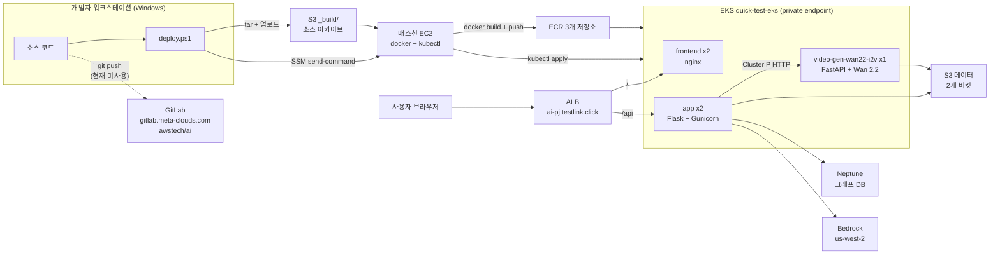
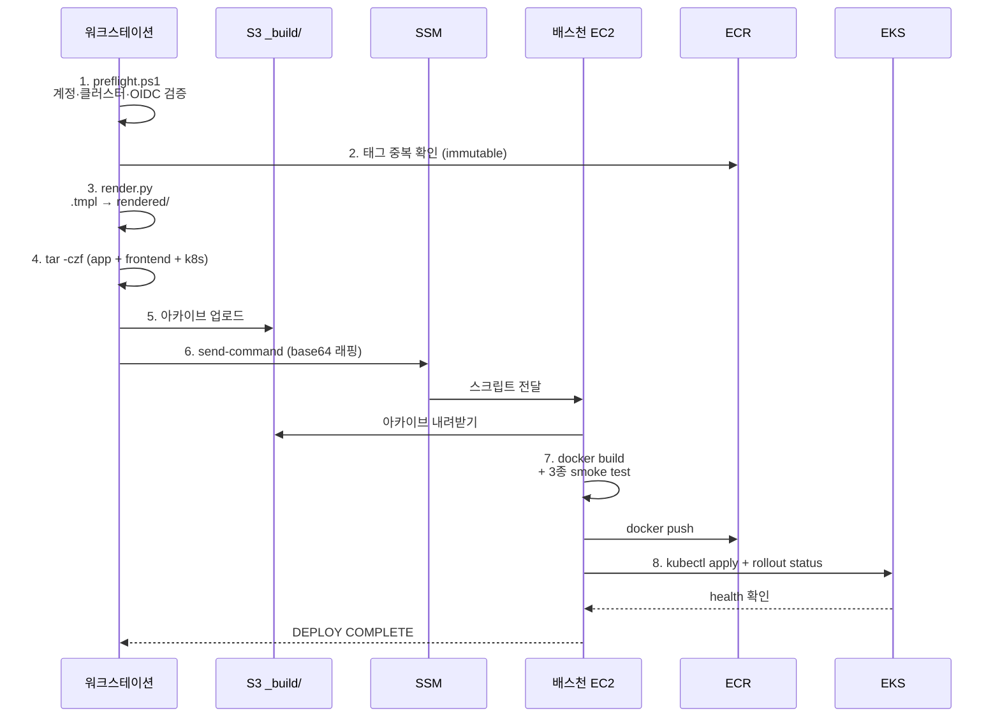
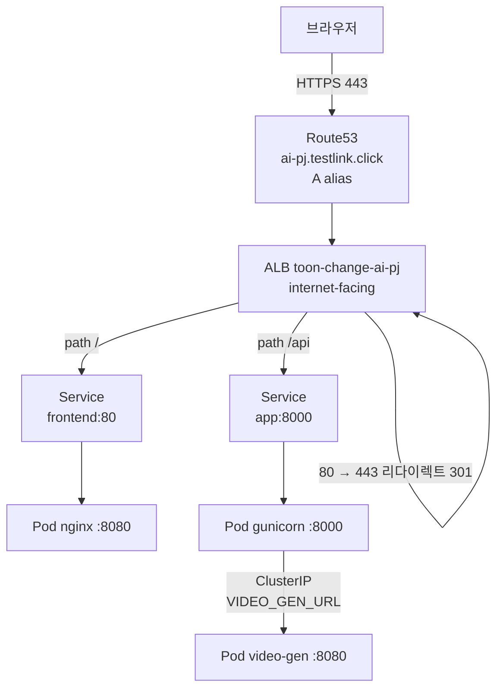
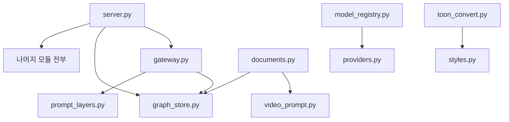
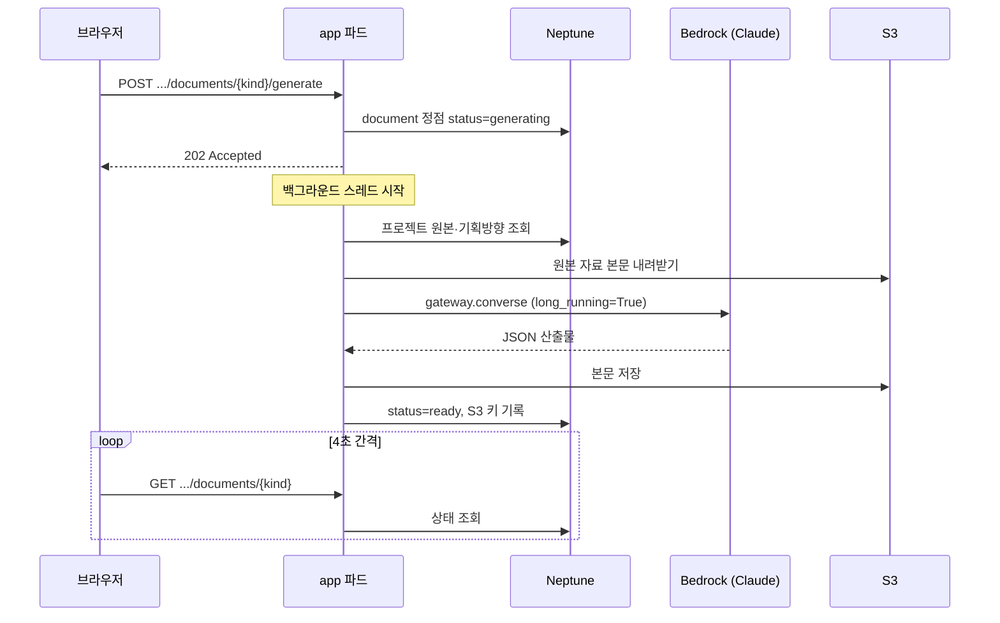
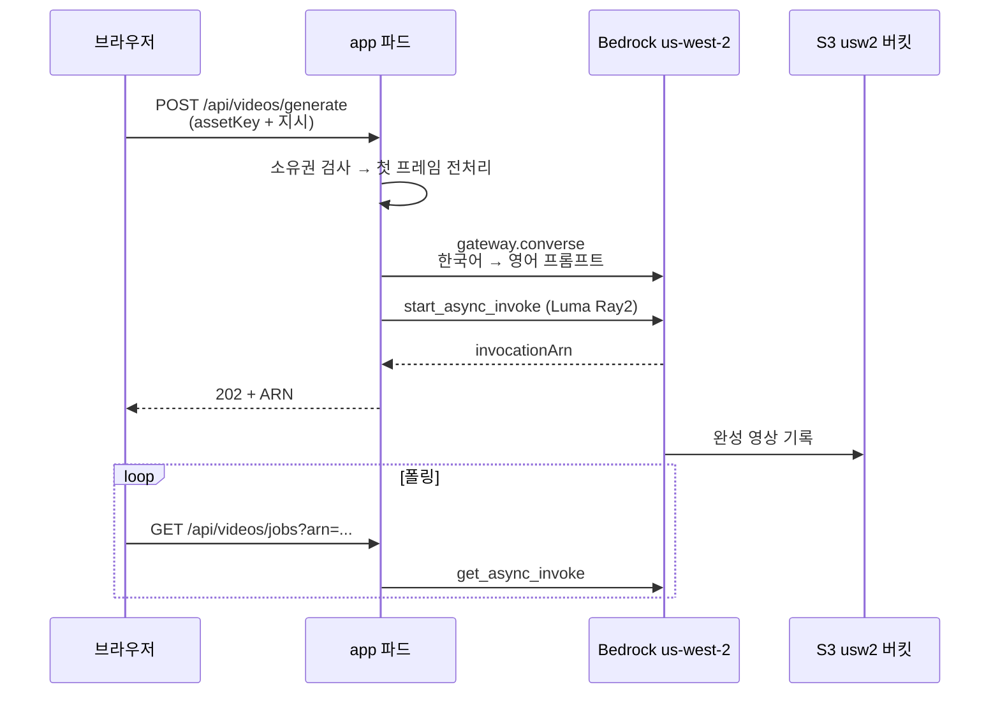
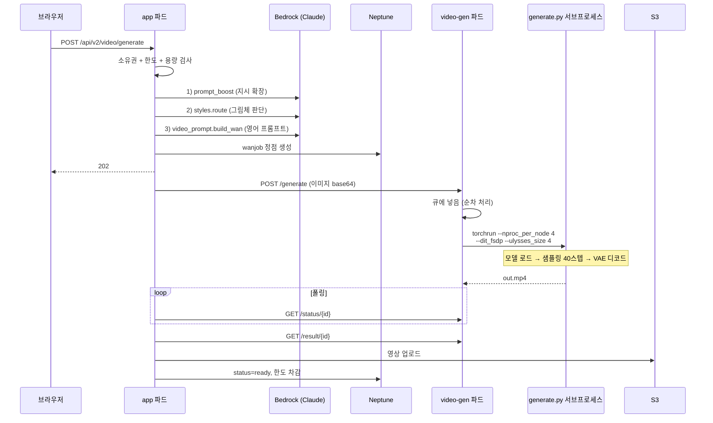
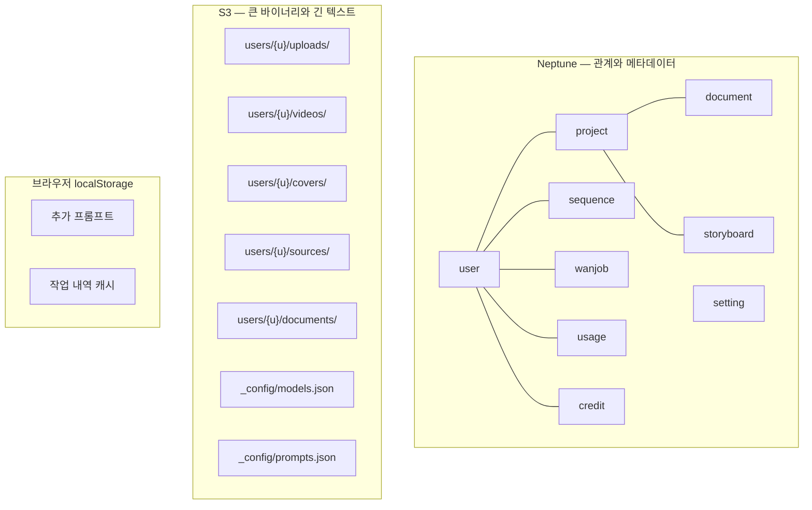

# 웹툰 IP 영상화 AI 도구 — 시스템 구조 분석

> 작성 시점 2026-09-03. 코드와 실제 AWS 리소스를 직접 조회해 작성했다.
> 추정이 섞인 항목은 본문에 "추정"으로 표시했다.

---

## 1. 한눈에 보기

웹툰 원작을 드라마 영상으로 만드는 과정을 AI로 돕는 사내 도구다. 기획자가 웹툰 컷과
텍스트를 넣으면 기획 문서(분석·각색·인물), 콘티 기획표, 영상 클립을 만들어 준다.



**핵심 특징 세 가지**

| 특징 | 내용 |
|---|---|
| 배포에 GitLab CI가 없다 | 워크스테이션 → S3 → SSM → 배스천에서 빌드·배포한다. GitLab은 소스 보관용이다 |
| EKS API가 프라이빗 전용이다 | 로컬에서 `kubectl`로 직접 붙을 수 없어 모든 클러스터 작업이 배스천을 경유한다 |
| 영상 생성 경로가 둘이고 서로 독립이다 | 외부 API(Bedrock/Luma)와 자체 GPU(Wan 2.2). 한쪽이 죽어도 다른 쪽이 산다 |

---

## 2. 코드가 사는 곳 — GitLab

| 항목 | 값 |
|---|---|
| 원격 저장소 | `https://gitlab.meta-clouds.com/awstech/ai.git` |
| 그룹 / 프로젝트 | `awstech` / `ai` |
| 브랜치 | `main` |
| 마지막 커밋 | `eca71d0` (2026-08-27) |
| CI/CD 파이프라인 | **없음** (`.gitlab-ci.yml` 파일이 저장소에 없다) |
| 인증 | 그룹 액세스 토큰 (`glpat-`), `gitlab_정보.md`에 보관 |

### 짚어야 할 점: GitLab과 실제 운영 코드가 다르다

```
마지막 커밋:  2026-08-27  eca71d0
미커밋 변경:  39개 파일 (추적 중 수정 26 + 새 파일 16)
실제 배포본:  app 20260827-v51 / video-gen wan22-v11
```

배포 파이프라인이 **로컬 워킹 디렉터리**를 그대로 패키징한다. GitLab을 거치지 않으므로
커밋하지 않은 변경도 그대로 배포된다. 그래서 지금 GitLab의 `main`은 운영 중인 코드가 아니다.

이 구조가 만드는 위험:

- 워크스테이션이 고장나면 최근 1주일 작업이 사라진다
- 배포된 이미지에서 어떤 소스가 들어갔는지 커밋으로 되짚을 수 없다
- 여러 사람이 작업하면 서로의 변경을 덮어쓴다

현재 백업은 GitLab 대신 **ECR 이미지 태그 + Neptune 스냅샷**으로 대체하고 있다
(`deploy/backup.ps1`). 코드는 이미지 레이어 안에만 남는다.

---

## 3. 빌드·배포 경로

로컬에 Docker가 없고 EKS API가 프라이빗이라, 빌드와 `kubectl`을 모두 배스천에서 실행한다.
명령 한 줄이 아래 8단계를 수행한다.

```powershell
powershell -NoProfile -ExecutionPolicy Bypass -File toon-change-ai-pj/deploy/deploy.ps1
```



### 단계별 방어 장치

배포 스크립트가 막아 주는 실수들이다. 각각 실제로 사고가 났던 지점이다.

| 단계 | 검사 | 막는 사고 |
|---|---|---|
| preflight | STS 계정 = `061051247564`, 클러스터 ACTIVE, OIDC ID 일치 | 다른 계정에 리소스 생성 |
| 태그 확인 | ECR에 같은 태그가 있으면 exit 5 | immutable 태그 재푸시 실패 |
| 렌더 대조 | 렌더 결과의 이미지 태그가 요청 태그와 같은지 | 렌더를 잊어 옛 태그로 롤백 |
| JS 문법 검사 | `node --check app.js` | 문법 오류가 든 프론트 배포 |
| import smoke | 컨테이너에서 `from src import server` | 의존 패키지 누락 |
| ffmpeg smoke | `--read-only` 환경에서 ffmpeg 실행 | 롱테이크 병합 실패 |
| 파드 선택 | `deletionTimestamp` 없고 Ready=True인 파드만 | 종료 중 파드에 exec |

`ASSET_VERSION` build-arg를 넘기지 않으면 자산 URL이 `dev`로 고정되어 브라우저 캐시가
갱신되지 않는다. 그래서 태그를 build-arg로 함께 넣는다.

### ECR

| 저장소 | 담는 것 | 크기 |
|---|---|---|
| `toon-change-ai-pj-app` | Flask 앱 | 수백 MB |
| `toon-change-ai-pj-frontend` | Nginx + 정적 파일 | 수십 MB |
| `toon-change-ai-pj-video-gen` | PyTorch + CUDA + Wan 2.2 | **10GB 이상** |

- 태그 IMMUTABLE, scanOnPush, AES256 암호화
- 수명주기: untagged 1일 후 삭제 / `20*` 태그는 최근 10개만 유지
- **`backup-*` 태그는 어느 규칙에도 걸리지 않아 영구 보존된다.** 규칙 패턴이 `*`이면
  백업까지 개수 제한에 포함되어 조용히 지워진다. 그래서 `20*`으로 좁혔다

video-gen 이미지는 크고 자주 바뀌지 않아 **배포 스크립트를 분리했다**
(`deploy-video-gen.ps1`). 앱을 고칠 때마다 10GB를 다시 빌드하면 배포가 몇 배 느려진다.

---

## 4. 실행 환경 — EKS

| 항목 | 값 |
|---|---|
| 클러스터 | `quick-test-eks` (Kubernetes 1.36) |
| API 엔드포인트 | **프라이빗 전용** (`endpointPublicAccess=false`) |
| VPC | `vpc-06c0dbbbebdf22308` (10.10.0.0/16), public 2 + private 4 서브넷 |
| 네임스페이스 | `toon-change-ai-pj` |
| Addon | coredns, kube-proxy, metrics-server, vpc-cni |
| Ingress 컨트롤러 | AWS Load Balancer Controller v3.5.0 |

### 노드그룹 두 개

| 노드그룹 | 인스턴스 | desired | 용도 | 시간당 단가 |
|---|---|---|---|---|
| `quick-test-eks-nodegroup` | t3.medium × 3 | 3 | 앱·프론트 | 낮음 |
| `quick-test-eks-gpu-g6e24` | g6e.24xlarge × 1 | 1 | Wan 2.2 추론 | **약 $18.5** |

g6e.24xlarge 한 대에 **NVIDIA L40S 4장**(각 46GB)이 붙는다.

옛 GPU 노드그룹 3개(`-gpu`, `-g6e12`, `-g7e`)가 desired 0으로 남아 있다. 인스턴스 타입을
바꿔 가며 용량을 실측한 흔적이다. **삭제하지 않고 0으로 둔 이유**는 되돌릴 필요가 생겼을 때
노드그룹을 다시 만드는 시간(약 10분)을 아끼기 위해서다. 대신 `start` 스케줄이 잘못된
노드그룹을 켜면 GPU 두 대 값을 내면서 파드는 엉뚱한 노드를 기다리게 되므로, 실제로 쓰는
`-g6e24`만 스케줄에 연결해 두었다.

### 워크로드

| 리소스 | 구성 |
|---|---|
| `toon-change-ai-pj-frontend` | Deployment 2, Nginx unprivileged, ClusterIP 80 → 8080 |
| `toon-change-ai-pj-app` | Deployment 2, Flask + Gunicorn, ClusterIP 8000 |
| `video-gen-wan22-i2v` | Deployment 1, FastAPI, GPU 4장 점유, 메모리 300~420Gi |

세 Deployment 모두 readiness/liveness probe, resource requests/limits,
`readOnlyRootFilesystem`, `runAsNonRoot`, capabilities drop ALL을 적용했다.
앱·프론트는 `topologySpreadConstraints`로 2a/2c 노드에 분산한다.

GPU 파드가 특별히 다른 점:

- `nodeSelector` + `tolerations`로 GPU 노드에만 배치
- `nvidia.com/gpu: "4"` 명시. 이 값이 `WAN_GPUS` 환경변수와 어긋나면 `torchrun`이 실패한다
- **`/dev/shm`을 16Gi로 키운다.** 기본 64Mi로는 NCCL이 랭크 4개를 붙이지 못한다
- 모델 가중치 118GB를 PVC(`/weights`)에 두고 파드 재시작 시 다시 받지 않는다

---

## 5. 인입 경로



| 항목 | 값 |
|---|---|
| 도메인 | `ai-pj.testlink.click` (Hosted Zone `Z09749582ZM3UJIDV1X9L`) |
| 인증서 | ACM `*.testlink.click` |
| SSL 정책 | `ELBSecurityPolicy-TLS13-1-2-2021-06` |
| 리스너 | 80 → 443 리다이렉트(301), 443 HTTPS |
| 라우팅 | `/api` → app:8000, `/` → frontend:80 |
| 헬스체크 | 둘 다 `/health`, 15초 간격, 성공 2회 |
| target-type | `ip` (파드 IP로 직접 라우팅) |

**GPU 추론 서버는 외부에 노출되지 않는다.** ClusterIP만 갖고 앱 파드에서만 접근한다.
그래서 워크스테이션이나 배스천에서 직접 호출할 수 없고, 진단할 때는 `kubectl exec`로
파드 안에서 `127.0.0.1:8080`을 부른다.

### 인증·인가

```mermaid
flowchart LR
  L["POST /api/auth/login"] --> H["PBKDF2-HMAC-SHA256<br/>210,000회 + 사용자별 salt"]
  H --> T["HMAC-SHA256 서명 토큰<br/>TTL 8시간"]
  T --> B["브라우저 sessionStorage"]
  B -->|"Authorization: Bearer"| RA["require_auth"]
  RA -->|"서명 검증"| RG["Neptune에서 role 재조회"]
  RG --> RQ["require_quota<br/>잔여 한도 확인"]
  RQ --> OWN["소유권 검사<br/>is_owned_image_key"]
  OWN --> BIZ["실제 처리"]
```



토큰은 서명만 검증하고 **role은 매번 그래프에서 다시 읽는다.** 토큰에 박아 두면 권한을
회수해도 토큰이 만료될 때까지 관리자로 남는다.

소유권 검사는 다른 검증보다 **먼저** 걸린다. 순서를 바꾸면 남의 키를 넣어 유효성 오류
메시지로 키 존재 여부를 알아낼 수 있다. 이 순서 때문에 검증 스크립트에서 해상도 검사를
HTTP로 확인할 수 없다(이미지 없이 부르면 소유권 단계에서 먼저 막힌다).

애플리케이션 계층에도 계정 잠금장치가 있다. `account_guard.py`가 기동 시 STS로 계정을
확인하고, `EXPECTED_ACCOUNT_ID`와 다르면 `/health`를 제외한 **모든 라우트가 503**을 준다.

---

## 6. 애플리케이션 구성

### 백엔드 모듈 (`app/src/`, 총 약 13,100줄)

| 모듈 | 줄 수 | 역할 |
|---|---|---|
| `server.py` | 5,205 | Flask 앱. 라우트 55개, 인증·인가, S3 입출력 |
| `graph_store.py` | 2,210 | Neptune openCypher 접근. 정점 9종 |
| `documents.py` | 1,515 | AI 산출물 종류별 스키마·프롬프트 (`KIND_SPECS`) |
| `prompt_layers.py` | 703 | 백엔드/프론트엔드 프롬프트 이원화, 역할 21종 |
| `video_prompt.py` | 661 | 한국어 지시 → 영어 영상 프롬프트 |
| `model_registry.py` | 489 | 모델 카탈로그, 활성화 시 사용 가능성 검증 |
| `styles.py` | 468 | 그림체 프리셋 12종, 라우팅 |
| `wan_client.py` | 447 | GPU 추론 서버 HTTP 클라이언트 |
| `image_brief.py` | 441 | 참고 이미지 역할 분석 (최대 20장) |
| `gateway.py` | 383 | **모든 Bedrock 호출의 유일한 통로** |
| `providers.py` | 381 | 모델별 요청·응답 어댑터 |
| `toon_convert.py` | 302 | 웹툰 → 실사 변환 모드 |
| `prompt_boost.py` | 266 | 짧은 입력을 구체적 지시로 확장 |
| `stitcher.py` | 135 | ffmpeg로 컷 이어 붙이기 |
| `account_guard.py` | 72 | 계정 검증 |

의존 방향이 단순하다. `server.py`가 나머지 전부를 임포트하고, 모듈 사이의 결합은 넷뿐이다.



### `gateway.py`가 유일한 통로인 이유

다른 모듈에서 `boto3.client("bedrock-runtime")`을 직접 만들지 않는다. 두 가지를 구조로
보장하기 위해서다.

| 보장 | 이유 |
|---|---|
| 사용량 기록 | 호출과 같은 자리에서 기록하므로 빠뜨리는 지점이 생기지 않는다 |
| 프롬프트 계층 결합 | 역할 id가 gateway의 `purpose` 문자열과 같게 설계돼 있다 |
| 클라이언트 설정 일원화 | 긴 생성은 `long_running=True`로 read_timeout 240초, 재시도 없음 |

botocore 기본 `read_timeout`은 60초다. 긴 생성은 아직 응답 중인 요청이 끊기고 재시도되어
**시간과 비용만 배로 든다.** 이 함정을 한 곳에서만 다루면 되도록 게이트웨이에 모았다.

프롬프트 결합도 게이트웨이 한 곳에서 한다. 호출 지점마다 넣으면 10곳이 넘고, 한 곳을
빠뜨려도 오류가 없어 **그 모델만 조용히 지시를 무시한다.**

### 프론트엔드

| 항목 | 값 |
|---|---|
| `app.js` | 5,835줄 |
| `index.html` | 1,327줄 |
| `styles.css` | 1,774줄 |
| 빌드 도구 | **없음.** 순수 정적 파일을 Nginx가 서빙 |
| 상태 관리 | 단일 `state` 객체 + 화면별 렌더 함수 |
| 캐시 무효화 | `ASSET_VERSION` build-arg를 URL 쿼리로 |

번들러·프레임워크가 없다. 배포가 `docker build` 한 번으로 끝나고 의존성 취약점 관리
대상이 없다는 장점이 있는 반면, 5,800줄 단일 파일이라 화면이 늘어날 때 탐색 비용이 커진다.

---

## 7. 명령이 결과가 되는 과정

### (a) AI 산출물 생성 — 즉시 응답 후 백그라운드

기획 문서 하나 만드는 데 60~120초가 걸린다. 요청 안에서 끝내면 브라우저와 ALB가 먼저
끊는다. 그래서 **202를 먼저 주고 스레드가 채운다.**



**파드가 롤아웃되면 스레드가 사라진다.** 그래서 `generating` 상태로 10분
(`DOC_STALE_MINUTES`)을 넘긴 문서는 조회 시점에 실패로 정리한다. 이 장치가 없으면
문서가 영원히 "생성 중"으로 굳는다.

산출물을 **JSON으로 받는 이유**는 뒷단계가 앞단계 결과를 프로그램으로 다시 써야 하기
때문이다. 대본 단계는 인물 목록을, 콘티 단계는 주요 씬 목록을 그대로 받는다.

### (b) Bedrock 영상 생성 (새 영상 만들기)



이 경로의 제약이 결과를 크게 좌우한다.

| 제약 | 값 | 영향 |
|---|---|---|
| 클립 길이 | 5초 또는 9초뿐 | 긴 영상은 컷을 이어 붙여야 한다 |
| 해상도 | 540p / 720p | |
| 첫 프레임 크기 | 한 변 최대 **1552px** (문서는 4096px이라 적혀 있다) | 1536px로 줄여 넣는다 |
| 동시 요청 | **1건** (`L-3447D96F`, 상향 불가) | 컷을 순차로 만들어야 한다 |
| 부정 프롬프트 | 없음 | 원하지 않는 것을 적으면 오히려 나타난다 |
| 콘텐츠 필터 | 있음 | 웹툰 컷이 거부되는 경우가 있다 (9장 참조) |

동시 한도가 1이라 롱테이크(30초=컷 4개)는 약 16분, 3분 영상은 약 1시간 20분이 걸린다.

### (c) 자체 GPU 영상 생성 (NEW_영상 제작)

원작 화풍을 유지하는 것이 목적이라 자체 호스팅 모델을 쓴다.



**앱이 GPU 서버에 직접 붙는다.** `gateway.start_video`를 쓰지 않는다. 게이트웨이를 쓰면
자체 GPU 기능이 Bedrock 동시 한도 1건에 묶여, 외부 API가 바쁠 때 자체 GPU도 멈춘다.

**한도 차감 위치가 특이하다.** 이 경로는 Bedrock을 거치지 않아 게이트웨이에서 세면
이 기능만 무제한이 된다. 그래서 한도는 게이트웨이가 아니라 **진입점 10곳에서** 센다.
중복 차감을 막기 위해 `refId`(작업 id)로 MERGE한다.

### (d) GPU 추론 서버 내부

```
POST /generate   →  큐에 적재 (202)
GET  /status/{id} →  진행 상태 + 스테이지 프로파일
GET  /result/{id} →  mp4 파일
GET  /health      →  가중치·GPU 확인
```

작업마다 공식 `generate.py`를 **서브프로세스로 새로 실행한다.** 파이프라인을 파이썬 API로
직접 붙이면 업스트림이 바뀔 때마다 깨지고 오프로딩·dtype 인자를 다시 구현해야 한다.
대신 **모델을 매 작업마다 다시 읽는 비용**을 낸다.

GPU 4장에 시퀀스를 쪼개 돌린다.

```
torchrun --nproc_per_node 4 --standalone generate.py \
  --dit_fsdp --ulysses_size 4 --offload_model False \
  --convert_model_dtype --t5_cpu
```

| 인자 | 효과 |
|---|---|
| `--ulysses_size 4` | 잠재 토큰을 랭크 4개로 쪼갠다. 토큰에 비례하는 활성값이 1/4 |
| `--dit_fsdp` | 가중치를 쪼갠다. 전문가 26.6GiB → 랭크당 6.65GiB |
| `--offload_model False` | FSDP가 이미 쪼갰으므로 호스트 왕복 불필요 |
| `--convert_model_dtype` | fp32 → bf16 |
| `--t5_cpu` | 텍스트 인코더(11GB)를 CPU에 |

이 조합이 720p를 막고 있던 두 항목을 모두 1/4로 줄였다.

### 업스트림 패치 4개

Wan 2.2 저장소를 빌드 시점에 고친다. **앵커를 못 찾으면 빌드를 실패시킨다** —
조용히 통과하면 패치 없는 이미지가 배포되고, 그 실패는 가중치를 다 읽은 뒤에 드러난다
(회당 수십 분).

| 패치 | 고치는 것 |
|---|---|
| `patch_attention.py` | flash-attn 미설치 환경에서 SDPA로 대체 (`model.py` + `ulysses.py` 양쪽) |
| `patch_sdpa_mask.py` | SDPA 경로의 패딩 처리. 없으면 결과가 오염된다 |
| `patch_neg_prompt.py` | 부정 프롬프트 주입 (CLI 인자가 없다) |
| `patch_stage_timing.py` | 스테이지별 시간 계측 (2026-09-02 신설) |

---

## 8. 데이터가 사는 곳

세 곳으로 나뉘고 각각 이유가 있다.



| 저장소 | 담는 것 | 담지 않는 이유 |
|---|---|---|
| Neptune | 사용자·프로젝트·산출물 상태·사용량·한도 | 속성 크기 제한이 있어 긴 본문을 못 담는다 |
| S3 | 이미지·영상·원본 자료 본문·산출물 JSON | 관계 질의를 못 한다 |
| localStorage | 사용자가 입력한 추가 프롬프트, 작업 내역 | 서버에 남길 이유가 없다 |

**버킷이 두 개다.** 비동기 영상 출력 버킷은 모델과 같은 리전이어야 해서
`mtx-test-ai-change-toon-usw2`(us-west-2)를 따로 둔다. 그래서 영상 라이브러리 목록은
**두 버킷을 함께 조회한다.**

키가 모두 `users/` 아래에 있어야 한다. IRSA 정책이 그 prefix로 제한되어 있어 벗어나면
저장 자체가 실패한다. 앱 파드에 액세스 키를 주입하지 않고 **IRSA 역할**만 쓴다.

---

## 9. 외부 모델 의존

### 리전을 옮길 수 없는 이유 (실제 조회 결과)

| 용도 | ap-northeast-2 | us-east-1 | us-west-2 |
|---|---|---|---|
| 영상 | 없음 | Nova Reel 둘 다 **LEGACY** | **`luma.ray-v2:0` ACTIVE** |
| 이미지 | 없음 | 생성 모델 없음 (nova-canvas LEGACY) | Stability 3종 ACTIVE |
| 텍스트 | 사용 가능 | 사용 가능 | 사용 가능 |

**서울에는 영상·이미지 생성 모델이 없고, us-east-1에도 없다.** 그래서 영상·이미지 관련
리소스를 us-west-2로 통일했다. 앱 자체는 서울에 있고 모델만 원격으로 호출한다.

### 현재 활성 모델 6종

| id | 종류 | 용도 |
|---|---|---|
| `sd35-large` | 이미지 | 기본. 프롬프트 준수가 가장 좋다 |
| `stable-image-core` | 이미지 | 러프 콘티, 가장 저렴 |
| `stable-image-ultra` | 이미지 | 최종 키비주얼 |
| `style-guide` | 이미지 | 참조 이미지의 화풍을 추출해 적용 |
| `control-structure` | 이미지 | 구도만 유지하고 화풍 교체 (실사 변환 1단계) |
| `luma-ray2` | 영상 | 이 계정에서 호출 가능한 유일한 영상 모델 |

Wan 2.2는 자체 호스팅이라 **카탈로그에 없다.** 그래서 카탈로그를 건드려도 GPU 경로는
영향받지 않는다.

### 그림체를 다루는 방식

**텍스트→이미지 모델은 `style_preset` 파라미터를 받지 않는다.** 실제 호출로 확인했다.
그림체는 프롬프트로 만든다.

```
프리셋 12종 (프롬프트 조각)  ×  등급 3단계 (모델 선택)
```

프롬프트 **순서가 결과를 바꾼다.** 매체를 문장 맨 앞에 둬야 한다.

```
나쁜 예: "두 사람이 마주 본다, 러프한 콘티 스타일로"     → 사실적인 사진이 나왔다
좋은 예: "A quick black marker storyboard sketch of ..." → 의도한 러프 콘티
```

값싼 모델은 지시를 무시하는 경우가 있다. Core는 "러프"를 무시하고 완성된 잉크
일러스트를 그렸다. 그래서 프리셋마다 **최소 등급**을 두고 상향 이유를 사용자에게 알린다.

### 콘텐츠 필터 실측 (2026-09-02)

Luma가 웹툰 컷을 거부하는 원인을 좁히려고 같은 컷의 변형 10종을 실제 제출했다.

| 변형 | 통과율 |
|---|---|
| 사람이 없는 합성 이미지 | 2/2 |
| 인물 한 명만 남긴 컷 | 2/2 |
| 같은 장면을 실사로 변환 | 2/2 |
| 원본 (2인 웹툰) | **0/4** |
| 여백을 1.8배로 확장 | 1/5 |
| 말풍선 제거 / RGB 변환 / 업스케일 | 각 0/1 |

**일러스트 화풍 + 인물 2인**이 신호다. 한 명을 지우거나 실사로 바꾸면 통과한다.
말풍선·해상도·비율·여백은 원인이 아니다. 판정에 무작위성이 있으나 20% 수준이라
자동 재시도를 넣지 않았다 — 실패 판정에 1분이 걸리는데 대기만 배로 늘고 결과는 대개 같다.

이 결과가 실용적으로 뜻하는 것: **원작 화풍을 유지해야 하는 2인 컷은 GPU 경로로 보내야 한다.**
자체 호스팅이라 외부 필터가 없다. 두 경로를 남겨 둔 판단이 여기서 값을 한다.

---

## 10. 비용 구조와 스케줄

업무 시간에만 켜 두는 방식으로 비용을 줄인다. 전부 `Asia/Seoul` 기준이다.

| 스케줄 | 대상 | 현재 상태 |
|---|---|---|
| `toon-change-neptune-start` / `-stop` | Neptune 클러스터 | start 꺼짐 / stop 18:00 |
| `quick-test-eks-nodes-start` / `-stop` | 앱 노드그룹 3대 | start 꺼짐 / stop 18:00 |
| `quick-test-eks-gpu-start` / `-stop` | GPU 노드그룹 1대 | start 꺼짐 / stop 18:00 |
| `quick-test-bastion-start` / `-stop` | 배스천 EC2 | start 꺼짐 / stop 18:00 |

**stop만 켜져 있고 start는 전부 꺼져 있다.** 즉 매일 18시에 자동으로 내려가고, 다음 날
기동은 수동이다(`start-all.ps1`). GPU가 쓰든 안 쓰든 매일 아침 올라오면 하루 약 $166이
나가므로 의도한 상태다.

**확인해야 할 함정**: start만 켜져 있고 stop이 꺼져 있으면 자원이 매일 켜지고 꺼지지
않아 24시간 과금된다. `schedules.ps1`이 짝을 대조해 경고한다.

### 스케줄로 줄일 수 없는 비용

| 리소스 | 이유 |
|---|---|
| EKS 컨트롤 플레인 | 중지 API가 없다. 삭제만 가능 |
| NAT Gateway | 중지 개념이 없다 |
| ALB | 중지하면 DNS 별칭이 끊기고 재생성 시 이름이 바뀐다 |
| EBS 20GB × 4 | 인스턴스를 중지해도 볼륨은 계속 과금 |
| S3 / ECR / Neptune 스토리지 | 저장 용량 과금 |

껐다 켤 수 있는 자원은 위 4종이 전부이고 모두 스케줄이 걸려 있다.

### GPU 비용 구조

| 항목 | 값 |
|---|---|
| 인스턴스 | g6e.24xlarge, 시간당 약 $18.5 |
| 클립 1건 소요 | **약 40분** (480p 5초, 40스텝, GPU 4장) |
| 클립당 비용 | **약 $12** |
| 처리량 | GPU 4장이 클립 1건에 묶인다 (동시 생성 불가) |

달러당 처리량이 가장 낮은 구성이다. 개선 계획이 별도 문서에 있고
(`kiro-quality-speed-plan.md`) 현재 스테이지별 프로파일링 계측까지 배선을 마쳤다.

---

## 11. 이 구조의 강점과 약점

### 강점

| 항목 | 내용 |
|---|---|
| 영상 경로 이중화 | 외부 API와 자체 GPU가 코드 수준에서 독립. 한쪽이 죽어도 다른 쪽이 산다 |
| 검사 자동화 | AST로 배선을 대조하는 검사 스크립트 10여 종. 리뷰로 못 잡는 결합을 막는다 |
| 단일 원본 원칙 | 계정·태그·비밀번호가 `config.env` 한 곳. 문서와 코드에 복제하지 않는다 |
| 실패 메시지 | 모델 원문 대신 원인과 다음 행동을 한국어로 준다 |
| 배포 방어 장치 | 계정 오배포, 태그 중복, 렌더 누락, 문법 오류를 배포 전에 막는다 |

### 약점

| 항목 | 내용 | 위험도 |
|---|---|---|
| GitLab과 운영 코드 불일치 | 39개 파일이 미커밋. 워크스테이션이 유일한 원본 | 높음 |
| CI/CD 없음 | 배포가 개발자 워크스테이션에 묶여 있다. 다른 사람이 배포할 수 없다 | 높음 |
| GPU 처리량 | 클립 1건 40분, GPU 4장 점유. 달러당 처리량 최저 | 높음 |
| 자격증명 평문 보관 | `test.json`, `config.env`에 키·비밀번호 평문 | 중간 |
| 단일 GPU 파드 | replicas 1. 파드가 죽으면 GPU 경로 전체 정지 | 중간 |
| 프론트 단일 파일 | `app.js` 5,835줄. 화면이 늘수록 탐색 비용 증가 | 낮음 |
| 백그라운드 스레드 | 파드 롤아웃 시 진행 중 작업이 끊긴다 (재부착 장치는 있다) | 낮음 |

### 다음 단계로 논의할 것

1. **소스 관리 정상화** — 미커밋 39개 파일을 GitLab에 올리고, 배포 이미지와 커밋을 연결한다
2. **GPU 처리량** — 증류 LoRA로 스텝 40→4, CFG 생략을 합쳐 forward 횟수 80→4. 기준선 측정 후 판단
3. **단일 GPU 노드 수평 확장** — 지금은 g6e.24xlarge 1대가 1건을 처리한다. 작은 노드
   여러 대로 나누면 시간당 단가가 낮아지고 처리량은 노드 수에 비례한다
4. **자격증명 관리** — `SEED_USERS` 평문 env를 Secret으로 이전

---

## 부록 A. 주요 수치

| 항목 | 값 |
|---|---|
| 백엔드 코드 | 약 13,100줄 (Python 15개 모듈) |
| 프론트엔드 코드 | 약 8,900줄 (JS 5,835 + HTML 1,327 + CSS 1,774) |
| API 라우트 | 55개 |
| Neptune 정점 라벨 | 9종 |
| 활성 AI 모델 | 6종 (이미지 5 + 영상 1) + 자체 호스팅 1 |
| 그림체 프리셋 | 12종 |
| 프롬프트 역할 | 21종 (텍스트 17 / 이미지 6 / 영상 3, 일부 중복) |
| 모델 가중치 | 118GB (PVC) |
| 검사 스크립트 | 10종 이상 (`.build/check-*.py`) |

## 부록 B. 진단·운영 명령

```powershell
# 선행 확인 (계정·클러스터·OIDC)
powershell -File toon-change-ai-pj/deploy/preflight.ps1

# 전체 기동 / 중지 / GPU만 중지
powershell -File toon-change-ai-pj/deploy/start-all.ps1
powershell -File toon-change-ai-pj/deploy/stop-all.ps1
powershell -File toon-change-ai-pj/deploy/stop-all.ps1 -GpuOnly

# 배포 (config.env의 IMAGE_TAG를 올린 뒤)
powershell -File toon-change-ai-pj/deploy/deploy.ps1
powershell -File toon-change-ai-pj/deploy/deploy-video-gen.ps1

# 백업 (ECR 태그 + Neptune 스냅샷)
powershell -File toon-change-ai-pj/deploy/backup.ps1

# 스케줄 상태
powershell -File toon-change-ai-pj/deploy/schedules.ps1

# 클러스터 명령 (배스천 경유)
powershell -File .build/run-on-bastion.ps1 -ScriptPath <로컬.sh>
```
